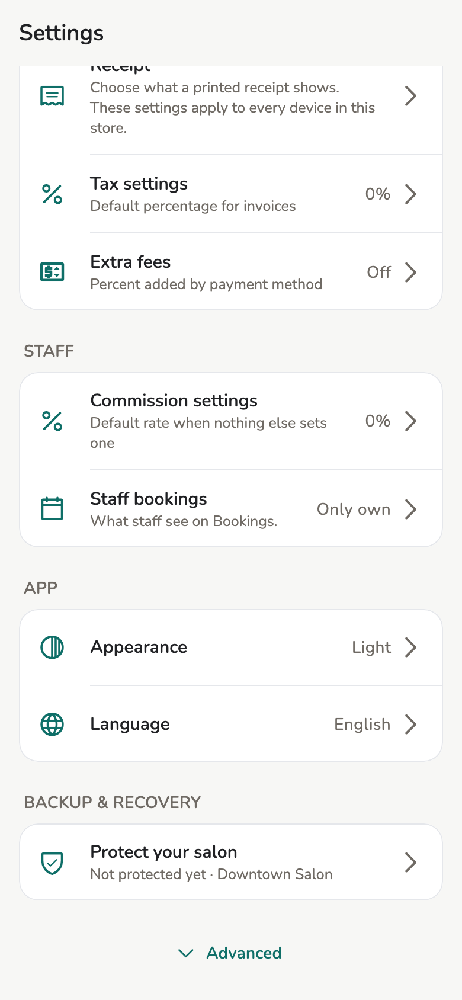
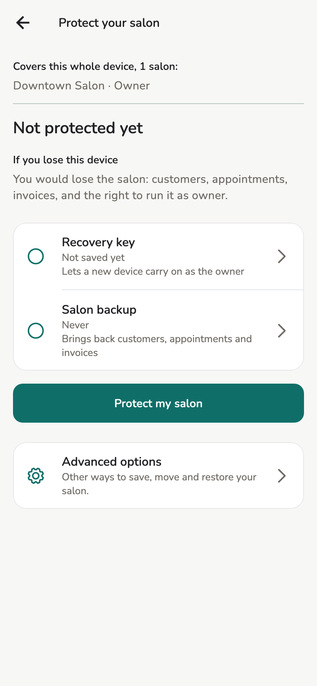
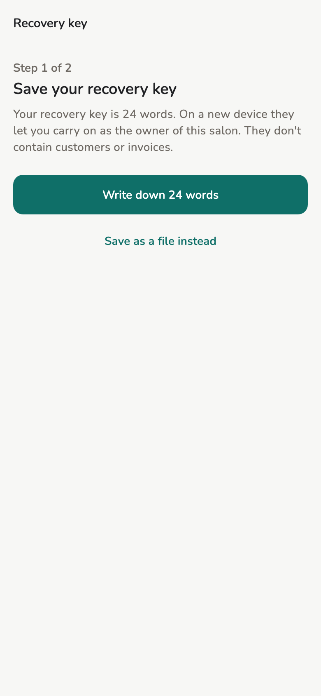
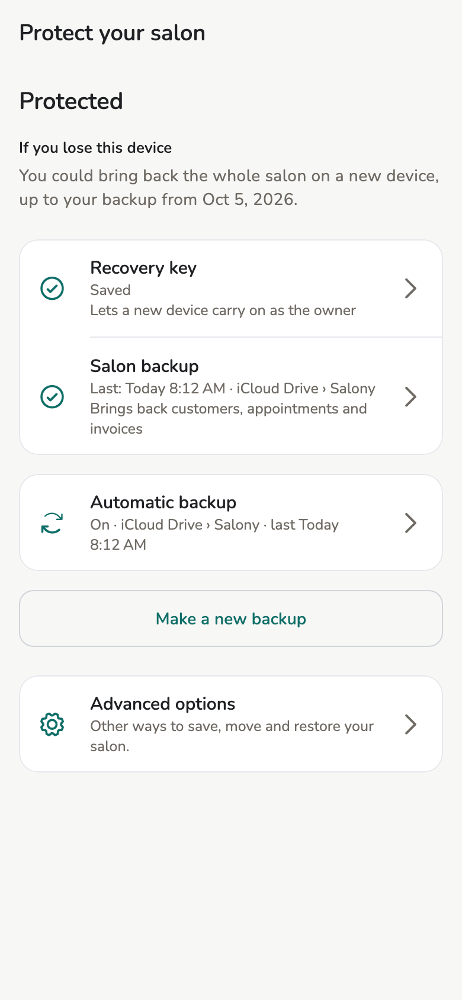
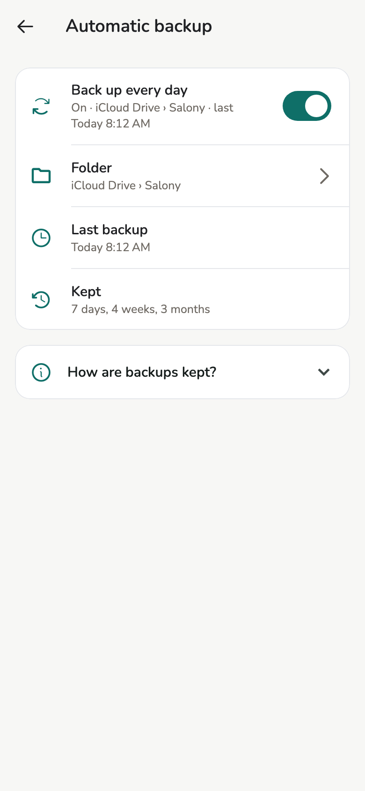
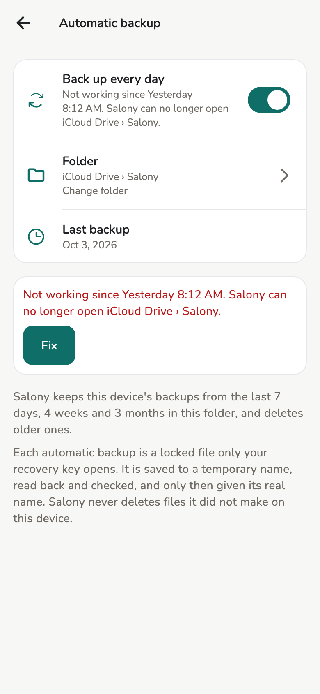
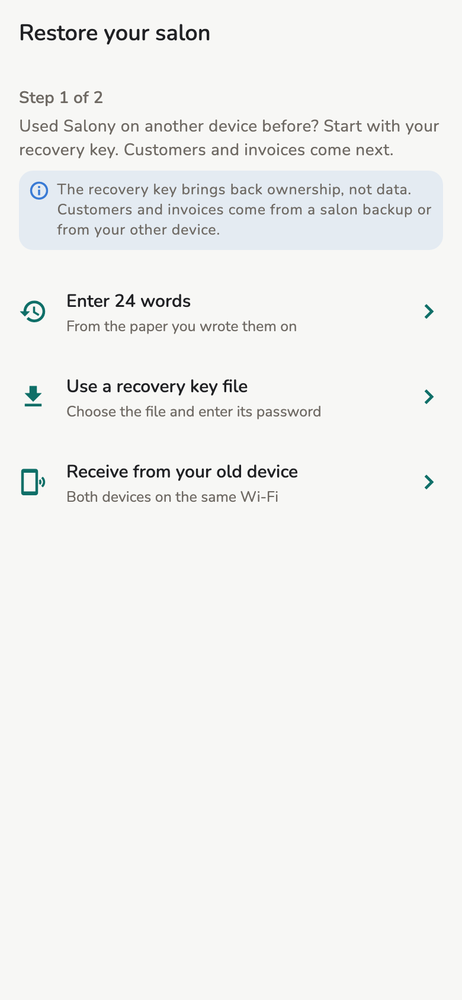
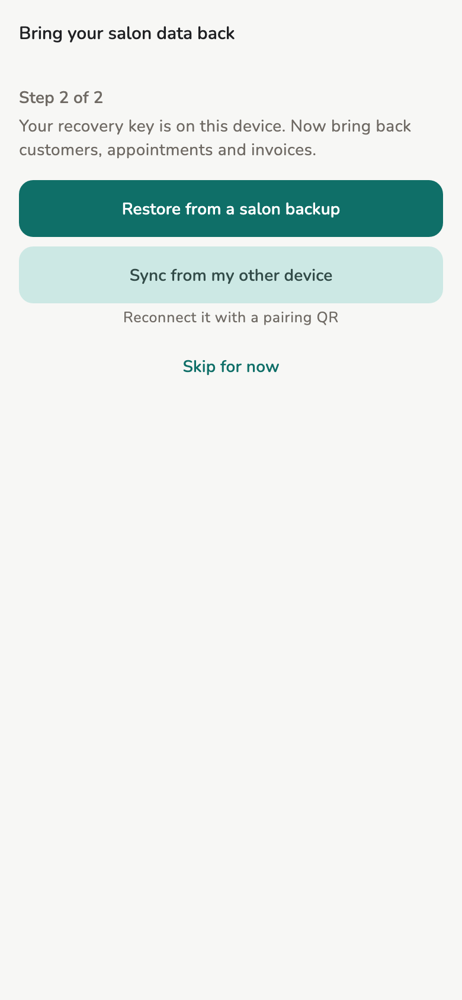
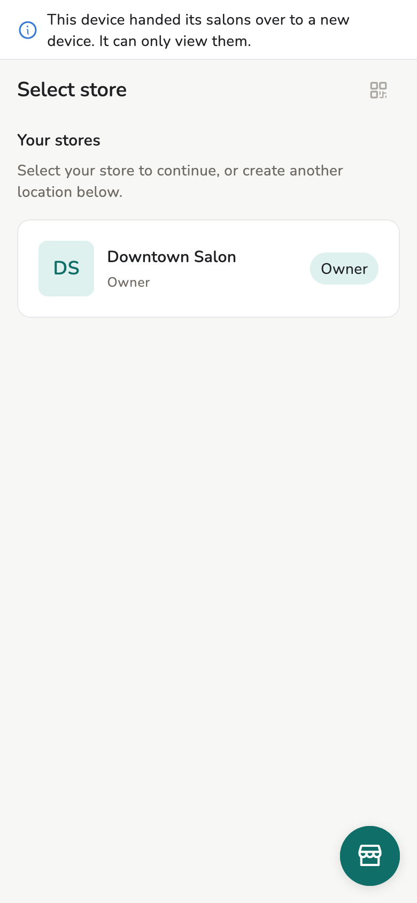
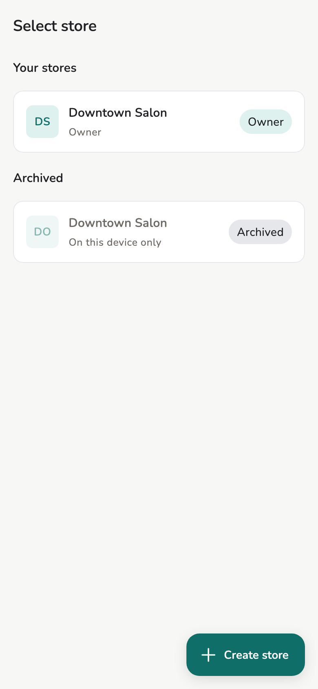

# Protect and restore your salon

Make sure you could get the salon back if this device were lost, and bring it
back on a new one.

## Overview

The salon lives on your device, not in an online account. Two things protect
it, and you need both:

| | **Recovery key** | **Salon backup** |
| --- | --- | --- |
| Brings back | The right to run the salon as owner on a new device | Customers, appointments, invoices, staff and the rest of the salon data |
| What it is | 24 words written on paper, or a recovery key file with a password | A locked file. It opens with your recovery key, or with the backup password you chose when you saved it |
| How often | Once | Every day with **Automatic backup**, or by hand. After 7 days the app calls it out of date |
| Where to keep it | Paper somewhere safe, or where you keep important files | Off this device, for example in iCloud Drive, Drive or on a computer. A backup on this device does not count |

Both are done in one place: the **Protect your salon** screen. Open it from
**Settings → Protect your salon**, or from the **Protect your salon** card
under the salon list on **Select store**. The tile shows the status
underneath: **Protected**, **Partly protected** or **Not protected yet**.

**Protect your salon covers the whole device, not just the salon that is
open.** A device has one recovery key for every salon on it, and each backup
holds every salon on it. So the screen lists the device's salons first, with
your role in each.

**Owners** and **Managers** have this tile. On a manager's device the same
steps protect *manager access* instead of ownership. **Staff** devices do not
have it.

<figure class="shot-phone" markdown>
{ loading=lazy }
<figcaption>Settings → Backup & recovery</figcaption>
</figure>

<figure class="shot-phone" markdown>
{ loading=lazy }
<figcaption>Protect your salon</figcaption>
</figure>

## If you lose this device

The hub answers this under **If you lose this device**, for your salon as it is
today:

| You have | On a new device |
| --- | --- |
| Nothing saved | The salon is lost: customers, appointments, invoices, and the right to run it as owner |
| Recovery key only | You carry on as owner, but customers, appointments and invoices are gone |
| Salon backup only | The data up to the backup's date is there, but the new device cannot carry on as owner of this salon |
| Both | The whole salon comes back, up to the date of your last backup |

The status follows the same rule:

- **Not protected yet**: neither is saved.
- **Partly protected**: only one is saved, or the backup is more than 7 days
  old.
- **Protected**: the recovery key is saved, and a backup *outside this
  device* is less than 7 days old.

A second device that syncs with this one also holds the salon's data, but it
does not change the status. The hub only counts what *this* device has saved.

## Where the backup went

Only a backup kept outside this device protects the salon: if the device is
lost, a backup on it is lost too. After every save the **Salon backup** row
says when and where, for example *Last: Today 8:12 AM · iCloud Drive ›
Salony*.

Salony decides from the folder you picked:

| The folder | Counts towards Protected |
| --- | --- |
| iCloud Drive. On a Mac also Dropbox and the cloud folders in the Finder sidebar, such as Google Drive or OneDrive. On Windows also OneDrive, Dropbox, iCloud Drive and Google Drive | Yes |
| This device's own storage, such as the Mac's or PC's own disk | No |
| Anywhere else, such as *On My iPhone*, another file app, a USB drive or a network folder | Salony asks you once |

When Salony cannot tell, it asks *Is this folder saved outside this device?*
Choose **Yes, outside this device** only if the folder syncs to a cloud
service or another computer. The answer is kept for that folder and not asked
again. If you stop syncing the folder later, choose another folder.

On Android the save dialog does not say where the file went, so the question
comes after every manual save.

A backup on this device still shows on the row, as *Last: {when} · on this
device*, with *Saved on this device only. It won't help if you lose the
device.* It does not change the status. Salony checks the file it wrote, but
cannot see whether iCloud Drive or another service has uploaded it yet.

## Your phone's own backup

Android and iPhone can back up apps by themselves: Android to your Google
account, iPhone to iCloud or to a computer. That copy is not a Salony backup.
Salony cannot see when it ran or what it holds, so it never counts in
**Protect your salon** and never makes the status **Protected**.

What it brings back on a phone:

| The phone's backup | Salon data | Recovery key |
| --- | --- | --- |
| Android, restored on a new phone | Yes, but see the 25 MB limit below | No |
| iCloud, restored on another iPhone | Yes | No |
| iCloud, restored on the same iPhone | Yes | Yes |
| Encrypted backup on a computer, restored on another iPhone | Yes | Yes |
| Unencrypted backup on a computer, restored on another iPhone | Yes | No |

Where the recovery key does not come back, Salony opens on *Your recovery key
is missing*. Tap **Enter recovery key** and use the 24 words or the file. Keep
them even if your phone backs itself up.

- **Android stops at 25 MB.** Android keeps at most 25 MB for each app, and
  above that it skips Salony without telling you. A busy salon gets there in
  about five months. From then on the phone's backup takes in no new salon
  data, and what it holds gets older every day.
- **Settings stay behind with the key.** Where the key does not come back,
  neither does **Automatic backup**: turn it on again and choose the folder.
- **One owner, one phone.** After an encrypted computer backup is restored on
  another iPhone, the new iPhone runs as the same owner. Stop using the old
  one. To run two devices, use **Add another device** instead.
- **The iPhone rows follow Apple's documentation.** They have not yet been
  tried on a real restore. The Android row has.

## Usage

### Protect your salon the first time

1. **Settings → Protect your salon**.
2. Tap **Protect my salon**. The app walks you through two steps.
3. **Step 1 of 2, Save your recovery key.**
    - Tap **Write down 24 words**, then **Show words**, and confirm it's you
      with the device's screen lock.
    - Write the 24 words on paper, in order. Tap **I've written them down**.
    - Prefer a file? Tap **Save as a file instead**: set a **File password**,
      **Repeat password**, then **Save recovery key file** and pick where to
      put it. The file is named `salony-recovery-key-….salonyid`.
4. **Step 2 of 2, Save a salon backup.**
    - Enter a **Backup password**, then **Save backup** and pick a place off
      this device.
    - If Salony cannot tell where the folder is, it asks once (see
      [Where the backup went](#where-the-backup-went)).
5. The hub comes back with *Your salon is protected*.

A backup saved on this device ends step 2 with *Backup saved on this device
only. Save one outside this device too.*, and the hub stays **Partly
protected**.

Back out at any step and nothing changes. The hub then offers the step that is
still missing.

<figure class="shot-phone" markdown>
{ loading=lazy }
<figcaption>Step 1 of 2</figcaption>
</figure>

!!! danger "Anyone with the 24 words can take over the salon"

    Don't take a photo, don't send them to anyone, and keep the paper
    somewhere safe. The same goes for the recovery key file together with its
    password. Salony never keeps a copy, and nobody can open the file or the
    backup without its password.

On **macOS and Windows** the 24 words are not shown. Step 1 offers **Save
recovery key file** only.

### Back up automatically

On iPhone, iPad, Mac and Windows, Salony can make a new backup every day by
itself. Android does not have this yet: back up by hand there.

1. **Settings → Protect your salon**, then tap **Automatic backup**.
2. Turn on **Back up every day**.
    - If the recovery key is not saved yet, the app saves it first. Automatic
      backups open with your recovery key, so it cannot be turned on without
      one.
3. Read **Back up automatically** and tap **Choose folder**. Pick a folder
   that syncs, such as iCloud Drive.
    - A folder on this device shows *This folder is on this device*. Tap
      **Choose another folder**, or **Use it anyway** if you understand those
      backups won't help if you lose the device.
4. The first backup is made straight away: *Automatic backup is on. First
   backup saved to {place}.*

<figure class="shot-phone" markdown>
{ loading=lazy }
<figcaption>Protected, with automatic backup on</figcaption>
</figure>

<figure class="shot-phone" markdown>
{ loading=lazy }
<figcaption>Automatic backup</figcaption>
</figure>

After that:

- **When it runs.** When you open or leave the app and the last backup is a
  day old or more. A backup never holds up the app. If it fails, it tries again
  an hour later.
- **What it writes.** One file per backup, named `salony-….salonybk`. It is
  written under a temporary name, read back and checked, and only then given
  its real name. A backup that fails the check does not count.
- **What it keeps.** Salony keeps this device's backups from the last 7 days,
  4 weeks and 3 months in the folder, never fewer than 3, and deletes older
  ones. It never deletes files it did not make on this device.
- **Change folder.** On **Automatic backup**, tap **Folder**.
- **Turn it off.** Turn off **Back up every day**. Files already in the folder
  stay there.

The tile on the hub shows how it is going, for example *On · iCloud Drive ›
Salony · last Today 8:12 AM*. A new recovery key (for example after **Start
as a new owner**) turns automatic backup off, and the tile reads *Off · save
your recovery key to turn it back on*.

#### When automatic backup stops working

If Salony cannot save to the folder, the tile says *Not working since
{when}* and why, for example *Salony can no longer open iCloud Drive ›
Salony.* Open it: a red box at the top says *Couldn't back up since {when}*,
and the switch shows when the last backup worked.

- When the folder cannot be opened (moved, deleted, or signed out), tap
  **Choose the folder again**.
- Otherwise tap **Retry**, and Salony tries again at once.

**Kept** shows how long backups stay in the folder. **How are backups
kept?** at the bottom explains the rest.

<figure class="shot-phone" markdown>
{ loading=lazy }
<figcaption>Not working, with the folder to choose again</figcaption>
</figure>

### Back up again

Each check row on the hub runs its own step, so you never have to start over:

- Tap **Salon backup**, or the button **Back up now**, to make a new backup.
  When everything is done the button reads **Make a new backup**.
- Tap **Recovery key**, or **Save recovery key**, to save the key again.

A backup only holds what happened up to the day you made it. Back up every
week, or after a busy day.

### Changes that couldn't be merged

When two devices make changes with the same recovery key at the same time,
for example an old phone that was still in use after a restore, one device's
changes cannot be merged. Salony keeps them instead of losing them.

**Protect your salon** and **Settings → Advanced → Sync** then show *Changes that
couldn't be merged* with how many. Open it to see each one: what kind of
change, when, and who made it. Enter again whatever is missing, then tap
**Mark as checked**.

### Reminders

The workspace shows a reminder card when something is missing, at most one at
a time:

- **Save your recovery key**: tap **Save now**.
- **Automatic backup isn't working**: shown once the last backup is more
  than 7 days old. It names the folder. Tap **Fix now**.
- **Your backup is out of date**: tap **Back up now**.

**Remind me later** hides that card for a week. The recovery key card comes
first, because without the key a backup cannot bring back ownership. A backup
on this device does not quiet the out-of-date card.

### Restore your salon on a new device

1. On the new device's first screen, tap **Restore your salon on this
   device**.
2. **Step 1 of 2, Restore your salon.** Bring the recovery key back in one of
   three ways:
    - **Enter 24 words**: type them with one space between each, then
      **Restore**.
    - **Use a recovery key file**: enter the file's password, then **Choose
      file and restore**.
    - **Receive from your old device**: when the old device still works and
      both are on the same Wi-Fi. On the old device open **Protect your salon →
      Advanced options → Move to a new device** and scan the QR the new device
      shows. The salon data travels with it: the new device counts *Receiving
      salon data…* as it arrives. When it is done, tap **Skip for now** in
      step 2. If the hand-over did not finish, bring the data back in step 2
      from a salon backup or another device. See [Move to a new
      device](#move-to-a-new-device).
3. The app confirms *Recovery key added to this device* and goes straight on
   to step 2.
4. **Step 2 of 2, Bring your salon data back.** Choose one:
    - **Restore from a salon backup**: tap **Choose backup file** and pick
      the backup. Because step 1 brought the recovery key back, a backup this
      salon made opens with no password. An older backup, or one from another
      recovery key, asks you to **Enter the backup password**. The app then
      shows when the backup was made, *Restore this backup?*. Tap **Restore**,
      or **Cancel** to choose another. Back out without restoring and you stay
      on step 2.
    - **Sync from my other device**: when another device still has the salon.
      The app shows *Reconnect your other devices*: on each of them, scan a
      new pairing QR once, then tap **Done**. The data arrives after they
      sync. See [Reconnect a device that is already in the store](devices.md#reconnect).
    - **Skip for now**: carry on without the data for now.
5. The first screen comes back. Carry on with **Enable nearby sync** or **Skip
   for now**.

A manager restores the same way. The recovery key brings back manager access,
not ownership.

#### Catching up after a restore

Another device may have kept working while this one was being set up. So,
after the recovery key comes back, the salon shows *Catching up with your other
devices* until this device has synced with another device of the salon. You
can look everything up meanwhile. Adding or changing waits, so nothing you do
clashes with work done elsewhere.

- The banner goes away by itself after the first sync, and the app says *Up to
  date. You can work as usual.*
- No other device has this salon? Tap **No other device has this salon** and
  confirm with **Yes, start working**. Only do this if it is true: changes made
  here may not merge with a device that still has the salon.

Once you are back in, open **Settings → Protect your salon** on the new
device. The recovery key starts at **Not saved yet**, because each device
keeps its own record. Save the key again and make a fresh backup.

<figure class="shot-phone" markdown>
{ loading=lazy }
<figcaption>Step 1 of 2: the recovery key</figcaption>
</figure>

<figure class="shot-phone" markdown>
{ loading=lazy }
<figcaption>Step 2 of 2: the data</figcaption>
</figure>

### Move to a new device { #move-to-a-new-device }

When you replace a phone or tablet and the old one still works:

1. On the new device: **Restore your salon on this device → Receive from your
   old device**. It shows a QR.
2. On the old device: **Protect your salon → Advanced options → Move to a new
   device**, then **Scan the new device QR**.
3. The old device lists every salon that will move, each with its role.
   The title and the button name the count, or the salon's name when there
   is only one. With two or more it says *These salons cannot be moved one
   by one.* A salon this device does not own adds a line asking that
   salon's owner or a manager to scan the new device again.
4. Keep both devices on the same Wi-Fi while the old one shows *Sending salon
   data…*. When the new device has it all, the old one says how many salons
   moved, and that this device can only view them now.
5. The new device opens on your salons and lists what to reconnect. Close
   Salony fully and open it again once, then pair the other devices again
   (see [Reconnect a device that is already in the store](devices.md#reconnect)):
    - for a salon you own, open **Join a store** on each other device and
      scan it here with **Add another device**;
    - for a salon where you are staff or a manager, ask its owner or a
      manager to scan this device again.

The hand-over moves every salon on the device. It cannot move one salon on
its own.

If the Wi-Fi drops before the new device has everything, neither device
changes: the new one does not keep the recovery key, and the old one stays
the working device. Try again.

The old device keeps its salons, read-only. A line at the top says *This
device handed its salons over to a new device. It can only view them.*
**Create store** is not offered. **Protect your salon** reads *Moved to a
new device*, never *Not protected yet*. Nothing can be added or changed
there, so the two devices never write the same invoice numbers.

To make the old device the working one again, enter the 24 words or the
recovery key file on it. It catches up with the new device first (see
[Catching up after a restore](#catching-up-after-a-restore)).

To use the old device for a different salon, tap **Use this device as a new
one** on **Select store** or on **Protect your salon**. It names any salon
that exists only on this device and would be lost, offers **Back up first**,
asks the device to confirm it is you, then erases the salons and the
recovery key. The app opens on the welcome screen. Join a salon, or create
one.

To split two salons across two devices: hand this device over, use the old
device as a new one, join one of the salons, then have that salon's owner
give this device the Owner role.

<figure class="shot-phone" markdown>
{ loading=lazy }
<figcaption>The old device after a hand-over: view only</figcaption>
</figure>

If the old device says *Hand-over didn't finish. Nothing changed on this
device.*, it carries on as before. That happens when the Wi-Fi drops, or when
one of the two devices runs an older Salony. Try again, or bring the data
back on the new device from a salon backup.

### If the recovery key is missing { #recovery-key-missing }

Salony opens on *Your recovery key is missing* when the device has salon data
but the owner's recovery key is gone from it. Tap **Enter recovery key** if you
have the 24 words or the file.

If you have neither, tap **Start as a new owner**, then **Start fresh**:

- **This device starts with a new recovery key.** Your other devices need a
  new pairing QR, and **Automatic backup** is off until you save the new key.
- **A salon you owned moves to Archived.** On **Select store**, it is listed
  under **Archived** with *On this device only*. It opens read-only: lists,
  receipts, reprint and reports still work, and it has no **Restore**.
- **A salon you worked in as manager or staff no longer shows** on this device.
  Ask the owner to invite you again.
- **Until you add or change anything,** you can still go back: **Protect your
  salon → Advanced options → Enter recovery key**, then the old 24 words or
  file. The salon is yours again, and it catches up with your other devices
  first. Once this device has added or changed anything, the old key is
  refused here; restore it on another device instead.

<figure class="shot-phone" markdown>
{ loading=lazy }
<figcaption>The old salon, kept on this device only</figcaption>
</figure>

To carry on, start a new salon from the archived one: see [Start again from
a salon](stop-using.md#start-again).

A salon kept *On this device only* is lost with the device, unless it is in a
salon backup. Every backup made on this device carries it, and it comes back
under **Archived** when the backup is restored onto a device of the new owner.

### Advanced options

At the bottom of the hub, **Advanced options** holds each tool on its own, for
when you need just one:

| Option | Use it to |
| --- | --- |
| **Show recovery key (24 words)** | Write the words down again. Phones and tablets only |
| **Recovery key file** | Save the recovery key as a password-protected file |
| **Move to a new device** | Hand every salon on this device to a new device next to you, when you are replacing this one. This device then only views them. Phones and tablets only |
| **Enter recovery key** | Bring back a recovery key on this device, for example the old one after **Start as a new owner** |
| **Restore from a salon backup** | Bring data back onto this device from a backup file |

Use **Move to a new device** only when replacing a device. To run two devices
side by side, use **Add another device** instead (see
[Devices and sync](devices.md)). **Technical detail** at the bottom of the
screen says how the key and the backup are protected. For the full picture,
see [How the recovery key works](../tech/identity.md).

## Troubleshooting

| Situation | Do |
| --- | --- |
| New phone, old one still works | **Advanced options → Move to a new device**, or restore on the new one from the 24 words or the file |
| Phone lost or broken | On a new device: **Restore your salon on this device**, then the salon backup or another synced device |
| Two devices at the same time | **Add another device**. Do not hand the salon over |
| *Can't open this device's secure storage* on start | Tap **Clear secure storage**, then **Clear and continue**. Salon data stays. The app then shows *Your recovery key is missing* |
| *Catching up with your other devices* | Let this device sync with another device of the salon. If there is none, tap **No other device has this salon** |
| *Changes that couldn't be merged* on Protect your salon | Open it, enter again what is missing, then **Mark as checked** |
| *Your recovery key is missing* on start | Tap **Enter recovery key** and use the 24 words or the file. Choose **Start as a new owner** only if you have neither: see [If the recovery key is missing](#recovery-key-missing) |
| *This device handed its salons over to a new device* | This device can only view. Work on the new device, enter the 24 words here to take it back, or use **Use this device as a new one** to join or create a different salon |
| *Hand-over didn't finish* | Keep both devices on the same Wi-Fi and update Salony on both, then try again |
| A salon under **Archived** reads *On this device only* | It was kept after **Start as a new owner**. Open it to look things up, or start a new salon from it |
| *Wrong password, or the file is damaged* | Check the backup password. Without it nobody can open the backup |
| *This backup belongs to a different recovery key* | Restore that key first (step 1), then choose the backup again. An automatic backup has no password, so only its own recovery key opens it |
| *This backup file is damaged and can't be restored* | Choose another backup. Automatic backup keeps several in the folder |
| **Salon backup** reads *on this device* | Save a backup to a folder that syncs, or turn on **Automatic backup** with one |
| **Automatic backup** reads *Not working since…* | Open it and tap **Choose the folder again** or **Retry** |
| No **Automatic backup** tile | Android, and staff devices, do not have it. Back up by hand |

## Related pages

- [Devices and sync](devices.md)
- [Desktop](desktop.md)
- [First launch](../start/first-launch.md)
- [How the recovery key works](../tech/identity.md) (technical)
