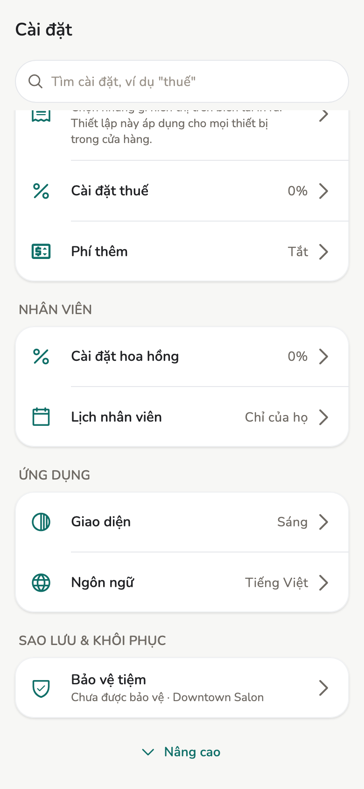
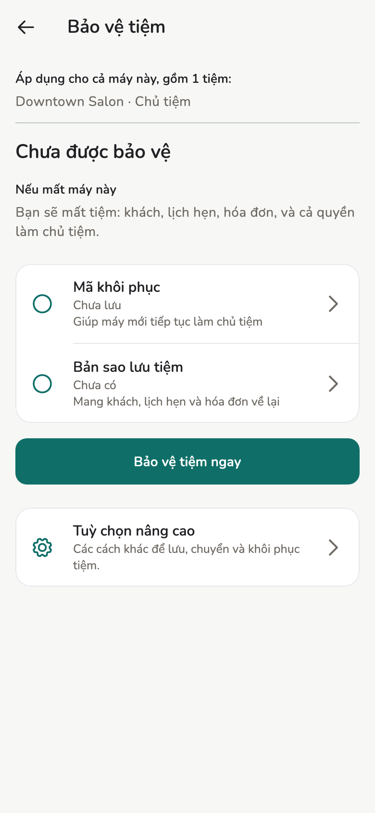
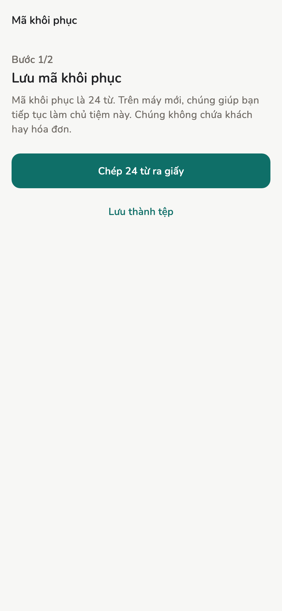
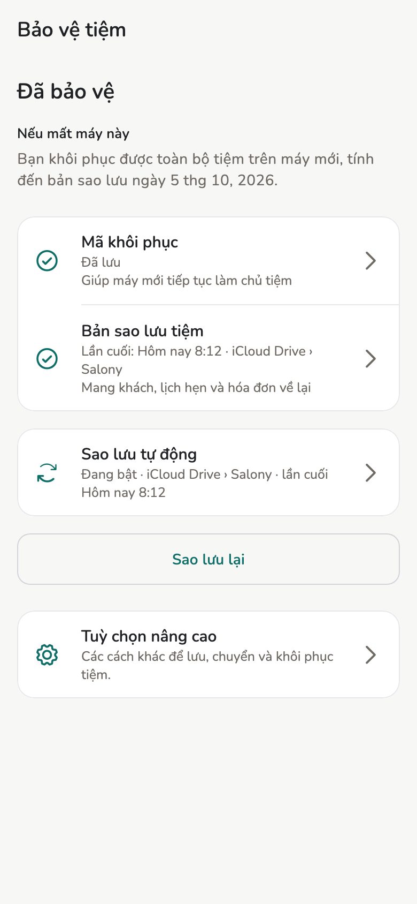
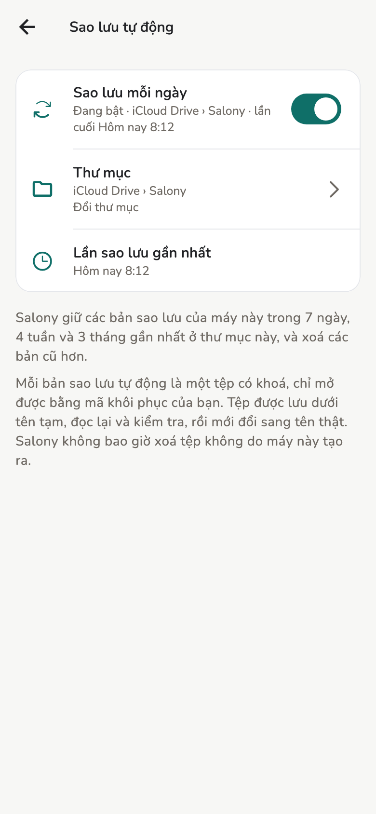
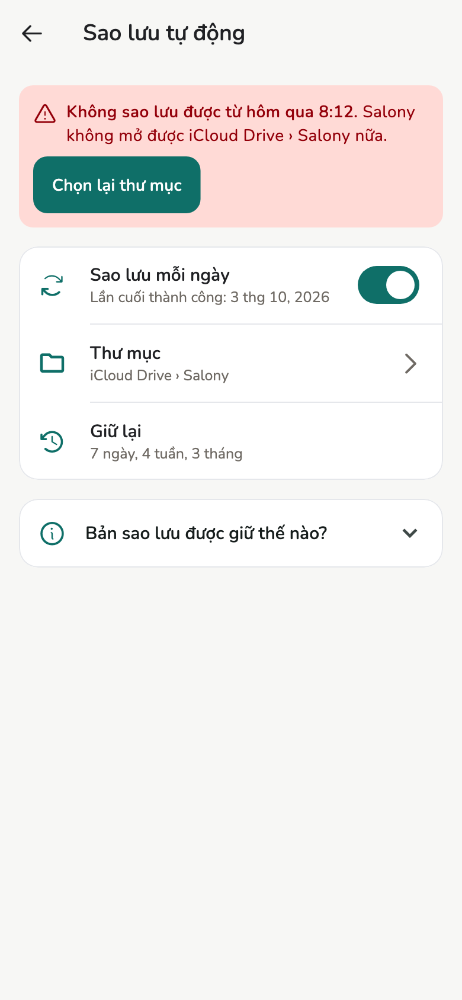
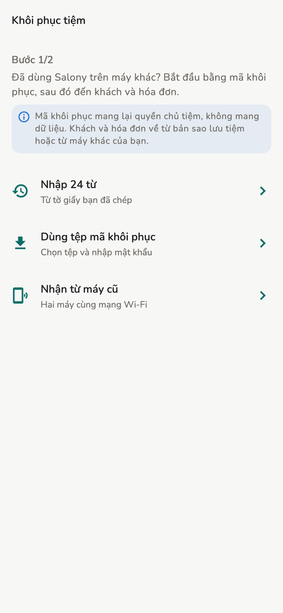
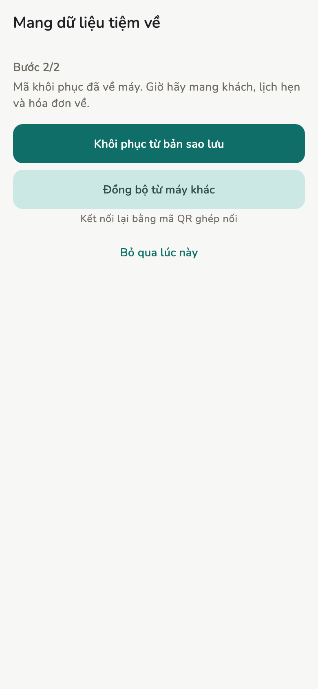
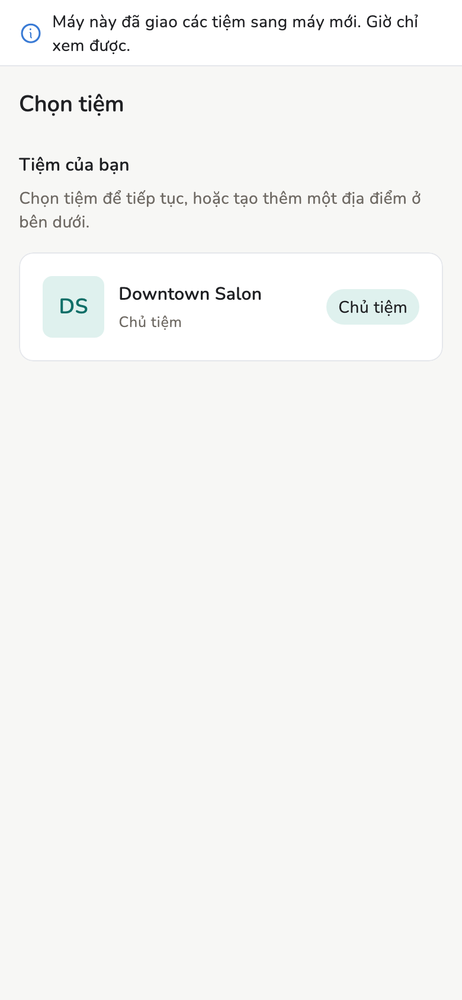
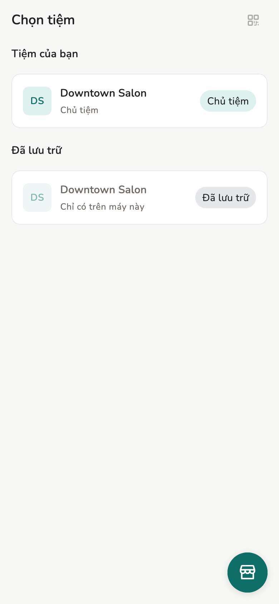

# Bảo vệ và khôi phục tiệm

Lỡ mất máy thì vẫn lấy lại được tiệm, và đưa tiệm về máy mới.

## Tổng quan

Tiệm nằm trên máy của bạn, không nằm trong tài khoản online nào. Có hai thứ
bảo vệ tiệm, và cần đủ cả hai:

| | **Mã khôi phục** | **Bản sao lưu tiệm** |
| --- | --- | --- |
| Lấy lại được | Quyền làm chủ tiệm trên máy mới | Khách, lịch hẹn, hóa đơn, nhân viên và các dữ liệu khác của tiệm |
| Là gì | 24 từ chép ra giấy, hoặc một tệp mã khôi phục có mật khẩu | Một tệp có khoá. Mở bằng mã khôi phục, hoặc bằng mật khẩu sao lưu bạn đặt lúc tự lưu |
| Bao lâu làm một lần | Một lần | Mỗi ngày nếu bật **Sao lưu tự động**, hoặc tự làm tay. Quá 7 ngày app báo bản sao lưu đã cũ |
| Cất ở đâu | Tờ giấy ở nơi an toàn, hoặc chỗ bạn cất giấy tờ quan trọng | Ngoài máy này, ví dụ iCloud Drive, Drive hoặc máy tính. Bản nằm trên máy này không được tính |

Cả hai làm ở cùng một chỗ: màn **Bảo vệ tiệm**. Mở từ **Cài đặt → Bảo vệ
tiệm**, hoặc từ thẻ **Bảo vệ tiệm** dưới danh sách tiệm ở màn **Chọn tiệm**.
Dưới tên mục có ghi tình trạng: **Đã bảo vệ**, **Bảo vệ một phần** hoặc **Chưa
được bảo vệ**.

**Bảo vệ tiệm áp dụng cho cả máy, không riêng tiệm đang mở.** Một máy chỉ có
một mã khôi phục cho mọi tiệm trên máy, và mỗi bản sao lưu chứa mọi tiệm trên
máy. Vì vậy màn này liệt kê các tiệm trên máy ngay ở đầu, kèm vai trò của bạn ở
từng tiệm.

Máy **Chủ tiệm** và **Quản lý** có mục này. Trên máy quản lý, các bước y như
vậy nhưng giữ *quyền quản lý* thay cho quyền chủ tiệm. Máy **Nhân viên** không
có mục này.

<figure class="shot-phone" markdown>
{ loading=lazy }
<figcaption>Cài đặt → Sao lưu & khôi phục</figcaption>
</figure>

<figure class="shot-phone" markdown>
{ loading=lazy }
<figcaption>Bảo vệ tiệm</figcaption>
</figure>

## Nếu mất máy này

Màn **Bảo vệ tiệm** trả lời câu này ngay dưới dòng **Nếu mất máy này**, theo
đúng tình trạng tiệm hôm nay:

| Bạn đã lưu | Trên máy mới |
| --- | --- |
| Chưa lưu gì | Mất tiệm: khách, lịch hẹn, hóa đơn, và cả quyền làm chủ tiệm |
| Chỉ mã khôi phục | Vẫn làm chủ tiệm, nhưng khách, lịch hẹn và hóa đơn mất |
| Chỉ bản sao lưu | Còn dữ liệu đến ngày sao lưu, nhưng máy mới không làm chủ tiệm này được |
| Cả hai | Lấy lại toàn bộ tiệm, tính đến bản sao lưu gần nhất |

Tình trạng cũng tính theo cách đó:

- **Chưa được bảo vệ**: chưa lưu cái nào.
- **Bảo vệ một phần**: mới lưu một trong hai, hoặc bản sao lưu đã quá 7 ngày.
- **Đã bảo vệ**: đã lưu mã khôi phục, và có bản sao lưu *ngoài máy này* chưa
  quá 7 ngày.

Một máy khác đang đồng bộ với máy này cũng có dữ liệu tiệm, nhưng không làm
đổi tình trạng. Màn này chỉ tính những gì *máy này* đã lưu.

## Bản sao lưu nằm ở đâu

Chỉ bản sao lưu nằm ngoài máy mới giữ được tiệm: mất máy thì bản nằm trên máy
cũng mất theo. Sau mỗi lần lưu, dòng **Bản sao lưu tiệm** ghi lúc nào và ở
đâu, ví dụ *Lần cuối: Hôm nay 8:12 · iCloud Drive › Salony*.

Salony xét theo thư mục bạn chọn:

| Thư mục | Có tính là Đã bảo vệ |
| --- | --- |
| iCloud Drive. Trên Mac còn có Dropbox và các thư mục đám mây ở thanh bên Finder, như Google Drive, OneDrive. Trên Windows còn có OneDrive, Dropbox, iCloud Drive và Google Drive | Có |
| Bộ nhớ của chính máy này, như ổ đĩa trong của Mac hay PC | Không |
| Những chỗ khác, như *On My iPhone*, app quản lý tệp khác, ổ USB hay thư mục mạng | Salony hỏi bạn một lần |

Khi không tự biết được, Salony hỏi *Thư mục này có được lưu ra ngoài máy
không?* Chỉ chọn **Có, ra ngoài máy** khi thư mục đồng bộ lên dịch vụ đám mây
hoặc sang máy tính khác. Câu trả lời được nhớ cho đúng thư mục đó và không hỏi
lại. Sau này nếu thư mục đó thôi đồng bộ, hãy chọn thư mục khác.

Trên Android, hộp thoại lưu tệp không cho biết tệp được cất ở đâu, nên lần
nào tự sao lưu xong app cũng hỏi.

Bản nằm trên máy này vẫn hiện trên dòng đó, dạng *Lần cuối: {when} · trên máy
này*, kèm câu *Chỉ lưu trên máy này. Mất máy thì bản này cũng mất.* Tình trạng
không vì thế mà đổi. Salony kiểm tra được tệp mình vừa ghi, nhưng không biết
iCloud Drive hay dịch vụ khác đã tải tệp lên xong chưa.

## Bản sao lưu của chính điện thoại

Android và iPhone tự sao lưu được các app: Android lưu vào tài khoản Google,
iPhone lưu lên iCloud hoặc vào máy tính. Bản đó không phải bản sao lưu của
Salony. Salony không biết nó chạy lúc nào, chứa những gì, nên **Bảo vệ tiệm**
không bao giờ tính nó và không vì nó mà báo **Đã bảo vệ**.

Khôi phục từ bản đó thì lấy lại được gì:

| Bản sao lưu của điện thoại | Dữ liệu tiệm | Mã khôi phục |
| --- | --- | --- |
| Android, khôi phục sang máy mới | Có, nhưng xem giới hạn 25 MB bên dưới | Không |
| iCloud, khôi phục sang iPhone khác | Có | Không |
| iCloud, khôi phục lại đúng iPhone đó | Có | Có |
| Bản sao lưu có mã hoá trên máy tính, khôi phục sang iPhone khác | Có | Có |
| Bản sao lưu không mã hoá trên máy tính, khôi phục sang iPhone khác | Có | Không |

Không lấy lại được mã khôi phục thì Salony mở ra màn *Không tìm thấy mã khôi
phục trên máy*. Bấm **Nhập mã khôi phục** rồi dùng 24 từ hoặc tệp. Vì vậy dù
điện thoại có tự sao lưu, vẫn phải giữ 24 từ hoặc tệp đó.

- **Android dừng ở 25 MB.** Android chỉ giữ tối đa 25 MB cho mỗi app. Quá mức
  đó, máy bỏ qua Salony mà không báo gì. Tiệm đông khách chạm mức này sau
  khoảng năm tháng. Từ đó bản sao lưu của điện thoại không lưu thêm dữ liệu
  tiệm mới, nên ngày càng cũ.
- **Mất mã thì mất luôn cài đặt đi kèm.** Không lấy lại được mã khôi phục thì
  **Sao lưu tự động** cũng tắt. Bật lại và chọn lại thư mục.
- **Mỗi chủ tiệm một máy.** Khôi phục bản sao lưu có mã hoá trên máy tính sang
  iPhone khác thì iPhone mới chạy với tư cách đúng chủ tiệm đó. Thôi dùng máy
  cũ. Muốn chạy hai máy cùng lúc thì dùng **Thêm thiết bị khác**.
- **Các dòng iPhone dựa theo tài liệu của Apple**, chưa thử trên một lần khôi
  phục thật. Dòng Android thì đã thử.

## Cách làm

### Bảo vệ tiệm lần đầu

1. **Cài đặt → Bảo vệ tiệm**.
2. Bấm **Bảo vệ tiệm ngay**. App dẫn bạn qua hai bước.
3. **Bước 1/2, Lưu mã khôi phục.**
    - Bấm **Chép 24 từ ra giấy**, rồi **Hiện các từ**, và mở khoá máy để xác
      nhận là bạn.
    - Chép 24 từ ra giấy, đúng thứ tự. Bấm **Tôi đã chép xong**.
    - Muốn lưu thành tệp? Bấm **Lưu thành tệp**: đặt **Mật khẩu tệp**, **Nhập
      lại mật khẩu**, rồi **Lưu tệp mã khôi phục** và chọn chỗ cất. Tệp có tên
      `salony-recovery-key-….salonyid`.
4. **Bước 2/2, Lưu bản sao lưu tiệm.**
    - Nhập **Mật khẩu sao lưu**, bấm **Lưu bản sao lưu** và chọn chỗ cất ngoài
      máy này.
    - Nếu Salony không biết thư mục đó nằm ở đâu, app hỏi một lần (xem
      [Bản sao lưu nằm ở đâu](#ban-sao-luu-nam-o-au)).
5. App quay về màn **Bảo vệ tiệm** và báo *Tiệm đã được bảo vệ*.

Nếu cất bản sao lưu trên chính máy này, bước 2 kết thúc bằng câu *Bản sao lưu
chỉ nằm trên máy này. Hãy lưu thêm một bản ra ngoài máy.*, và tình trạng vẫn là
**Bảo vệ một phần**.

Thoát giữa chừng thì không có gì thay đổi. Màn **Bảo vệ tiệm** sẽ gợi ý bước
còn thiếu.

<figure class="shot-phone" markdown>
{ loading=lazy }
<figcaption>Bước 1/2</figcaption>
</figure>

!!! danger "Ai có 24 từ đều chiếm được quyền chủ tiệm"

    Đừng chụp ảnh, đừng gửi cho ai, và cất tờ giấy ở nơi an toàn. Tệp mã khôi
    phục cùng mật khẩu của nó cũng vậy. Salony không giữ bản nào. Quên mật
    khẩu thì không ai mở được tệp hay bản sao lưu.

Trên **macOS và Windows** app không hiện 24 từ. Bước 1 chỉ có **Lưu tệp mã
khôi phục**.

### Sao lưu tự động

Trên iPhone, iPad, Mac và Windows, Salony tự sao lưu một bản mới mỗi ngày.
Android chưa có tính năng này, nên trên Android bạn vẫn sao lưu tay.

1. **Cài đặt → Bảo vệ tiệm**, rồi bấm **Sao lưu tự động**.
2. Bật **Sao lưu mỗi ngày**.
    - Nếu chưa lưu mã khôi phục, app cho lưu mã trước. Bản sao lưu tự động mở
      bằng mã khôi phục, nên chưa có mã thì chưa bật được.
3. Đọc **Tự động sao lưu** rồi bấm **Chọn thư mục**. Chọn thư mục có đồng bộ,
   ví dụ iCloud Drive.
    - Chọn thư mục trên máy thì app báo *Thư mục này nằm trên máy*. Bấm **Chọn
      thư mục khác**, hoặc **Vẫn dùng** nếu bạn chấp nhận mất máy là mất luôn
      các bản đó.
4. App sao lưu bản đầu tiên ngay: *Đã bật sao lưu tự động. Bản đầu tiên đã lưu
   vào {place}.*

<figure class="shot-phone" markdown>
{ loading=lazy }
<figcaption>Đã bảo vệ, đang bật sao lưu tự động</figcaption>
</figure>

<figure class="shot-phone" markdown>
{ loading=lazy }
<figcaption>Sao lưu tự động</figcaption>
</figure>

Từ đó:

- **Khi nào chạy.** Khi bạn mở hoặc rời app, nếu bản gần nhất đã được một
  ngày trở lên. Sao lưu không bao giờ làm app chậm lại. Lỗi thì một tiếng sau
  app thử lại.
- **Ghi ra gì.** Mỗi lần một tệp, tên dạng `salony-….salonybk`. Tệp được lưu
  dưới tên tạm, đọc lại và kiểm tra, rồi mới đổi sang tên thật. Bản kiểm tra
  không qua thì không được tính.
- **Giữ bao nhiêu bản.** Salony giữ các bản sao lưu của máy này trong 7 ngày,
  4 tuần và 3 tháng gần nhất ở thư mục, không bao giờ ít hơn 3 bản, và xoá các
  bản cũ hơn. Salony không bao giờ xoá tệp không do máy này tạo ra.
- **Đổi thư mục.** Trong **Sao lưu tự động**, bấm **Thư mục**.
- **Tắt.** Tắt **Sao lưu mỗi ngày**. Các tệp đã có trong thư mục vẫn còn đó.

Dòng **Sao lưu tự động** trên màn **Bảo vệ tiệm** cho biết tình hình, ví dụ
*Đang bật · iCloud Drive › Salony · lần cuối Hôm nay 8:12*. Khi máy đổi sang
mã khôi phục mới (ví dụ sau khi chọn **Bắt đầu như chủ mới**), sao lưu tự động
tự tắt và dòng này ghi *Đang tắt · lưu mã khôi phục để bật lại*.

#### Khi sao lưu tự động không chạy

Nếu Salony không lưu được vào thư mục, dòng **Sao lưu tự động** và màn chi
tiết ghi *Không chạy từ {when}* kèm lý do, ví dụ *Salony không mở được iCloud
Drive › Salony nữa.* Bấm **Sửa**:

- Nếu không mở được thư mục (bị chuyển chỗ, bị xoá, hoặc đã đăng xuất), chọn
  lại thư mục.
- Lỗi khác thì app thử lại ngay.

<figure class="shot-phone" markdown>
{ loading=lazy }
<figcaption>Không chạy, có nút Sửa</figcaption>
</figure>

### Sao lưu lại

Mỗi dòng trên màn **Bảo vệ tiệm** chạy riêng bước của nó, không phải làm lại
từ đầu:

- Bấm **Bản sao lưu tiệm**, hoặc nút **Sao lưu ngay**, để sao lưu lại. Khi đã
  đủ cả hai, nút đổi thành **Sao lưu lại**.
- Bấm **Mã khôi phục**, hoặc **Lưu mã khôi phục**, để lưu lại mã.

Bản sao lưu chỉ có dữ liệu tính đến ngày bạn tạo nó. Nên sao lưu mỗi tuần,
hoặc sau một ngày đông khách.

### Thay đổi không gộp được

Khi hai máy cùng dùng một mã khôi phục và cùng làm thay đổi một lúc, ví dụ
máy cũ vẫn được dùng sau khi đã khôi phục sang máy mới, thì thay đổi của một
máy không gộp được. Salony giữ lại những thay đổi đó chứ không bỏ đi.

Lúc đó **Bảo vệ tiệm** và **Cài đặt → Nâng cao → Đồng bộ** hiện *Thay đổi không gộp
được* kèm số lượng. Mở ra để xem từng cái: loại thay đổi, lúc nào, ai làm.
Nhập lại phần còn thiếu, rồi bấm **Đánh dấu đã xem**.

### Lời nhắc

Khi còn thiếu, màn làm việc hiện một thẻ nhắc, mỗi lần chỉ một thẻ:

- **Lưu mã khôi phục**: bấm **Lưu ngay**.
- **Sao lưu tự động không chạy**: hiện khi bản gần nhất đã quá 7 ngày. Thẻ
  ghi tên thư mục. Bấm **Sửa ngay**.
- **Bản sao lưu đã cũ**: bấm **Sao lưu ngay**.

**Nhắc lại sau** ẩn thẻ đó một tuần. Thẻ mã khôi phục luôn hiện trước, vì
thiếu mã thì bản sao lưu không mang lại được quyền chủ tiệm. Lưu một bản trên
máy này không làm tắt thẻ *Bản sao lưu đã cũ*.

### Khôi phục tiệm trên máy mới

1. Ở màn đầu tiên của máy mới, bấm **Khôi phục tiệm trên máy này**.
2. **Bước 1/2, Khôi phục tiệm.** Đưa mã khôi phục về bằng một trong ba cách:
    - **Nhập 24 từ**: gõ 24 từ, mỗi từ cách nhau một khoảng trắng, rồi bấm
      **Khôi phục**.
    - **Dùng tệp mã khôi phục**: nhập mật khẩu của tệp, rồi bấm **Chọn tệp và
      khôi phục**.
    - **Nhận từ máy cũ**: khi máy cũ còn chạy và hai máy cùng mạng Wi-Fi. Trên
      máy cũ, mở **Bảo vệ tiệm → Tuỳ chọn nâng cao → Chuyển sang máy mới** rồi
      quét mã QR trên máy mới. Dữ liệu tiệm đi kèm: máy mới đếm *Đang nhận dữ
      liệu tiệm…* trong lúc nhận. Nhận xong thì ở bước 2 bấm **Bỏ qua lúc
      này**. Nếu việc giao tiệm chưa xong, ở bước 2 lấy dữ liệu về từ bản sao
      lưu hoặc từ một máy khác. Xem [Chuyển sang máy mới](#move-to-a-new-device).
3. App báo *Đã đưa mã khôi phục vào máy này* và chuyển ngay sang bước 2.
4. **Bước 2/2, Mang dữ liệu tiệm về.** Chọn một:
    - **Khôi phục từ bản sao lưu**: bấm **Chọn tệp sao lưu** và chọn bản sao
      lưu. Bước 1 đã đưa mã khôi phục về, nên bản sao lưu do tiệm này tạo mở
      được mà không cần mật khẩu. Bản cũ hơn, hoặc bản thuộc mã khôi phục
      khác, sẽ hỏi **Nhập mật khẩu sao lưu**. Sau đó app cho biết bản sao lưu
      tạo lúc nào, *Khôi phục bản sao lưu này?*. Bấm **Khôi phục**, hoặc
      **Hủy** để chọn bản khác. Thoát ra mà chưa khôi phục thì vẫn ở bước 2.
    - **Đồng bộ từ máy khác**: khi còn máy khác đang có tiệm. App hiện *Kết
      nối lại các thiết bị khác*: trên mỗi máy khác, quét lại mã QR ghép nối
      một lần, rồi bấm **Xong**. Dữ liệu về sau khi các máy đồng bộ. Xem
      [Kết nối lại một máy đã ở trong tiệm](devices.md#reconnect).
    - **Bỏ qua lúc này**: tạm thời chưa mang dữ liệu về.
5. Màn đầu tiên hiện lại. Đi tiếp bằng **Bật đồng bộ ở gần** hoặc **Bỏ qua
   lúc này**.

Quản lý khôi phục cũng như vậy. Mã khôi phục mang lại quyền quản lý, không
phải quyền chủ tiệm.

#### Bắt kịp sau khi khôi phục

Trong lúc cài máy này, có thể một máy khác vẫn đang làm việc. Vì vậy sau khi
mã khôi phục về, tiệm hiện *Đang bắt kịp các máy khác* cho tới khi máy này
đồng bộ xong với một máy khác của tiệm. Trong lúc đó bạn vẫn xem được mọi
thứ. Việc thêm hay sửa phải chờ, để những gì làm ở đây không đụng với việc
máy kia đã làm.

- Dòng thông báo tự mất sau lần đồng bộ đầu tiên, và app báo *Đã cập nhật.
  Bạn làm việc bình thường được rồi.*
- Không còn máy nào khác có tiệm? Bấm **Không còn máy nào khác có tiệm này**
  rồi xác nhận bằng **Đúng, bắt đầu làm việc**. Chỉ làm vậy khi đúng là không
  còn: những gì làm ở đây có thể không gộp được với máy vẫn còn giữ tiệm.

Vào lại tiệm rồi thì mở **Cài đặt → Bảo vệ tiệm** trên máy mới. Mã khôi phục
sẽ ở trạng thái **Chưa lưu**, vì mỗi máy tự ghi nhận riêng. Hãy lưu lại mã và
sao lưu một bản mới.

<figure class="shot-phone" markdown>
{ loading=lazy }
<figcaption>Bước 1/2: mã khôi phục</figcaption>
</figure>

<figure class="shot-phone" markdown>
{ loading=lazy }
<figcaption>Bước 2/2: dữ liệu</figcaption>
</figure>

### Chuyển sang máy mới { #move-to-a-new-device }

Khi thay điện thoại hay máy tính bảng mà máy cũ vẫn còn chạy:

1. Trên máy mới: **Khôi phục tiệm trên máy này → Nhận từ máy cũ**. Máy mới
   hiện một mã QR.
2. Trên máy cũ: **Bảo vệ tiệm → Tuỳ chọn nâng cao → Chuyển sang máy mới**,
   rồi **Quét mã QR thiết bị mới**.
3. Máy cũ liệt kê từng tiệm sẽ chuyển, kèm vai trò. Tiêu đề và nút ghi số
   tiệm, hoặc tên tiệm khi chỉ có một. Từ hai tiệm trở lên, app nói
   *Không chuyển riêng từng tiệm được.* Tiệm mà máy này không làm chủ thì
   có thêm dòng nhờ chủ tiệm hoặc quản lý quét lại máy mới.
4. Giữ hai máy cùng mạng Wi-Fi trong lúc máy cũ hiện *Đang gửi dữ liệu
   tiệm…*. Khi máy mới nhận đủ, máy cũ báo đã chuyển bao nhiêu tiệm, và máy
   này giờ chỉ xem được.
5. Máy mới mở ra với các tiệm của bạn và liệt kê những gì cần ghép lại.
   Đóng hẳn Salony rồi mở lại một lần, sau đó ghép lại các máy khác (xem
   [Kết nối lại một máy đã ở trong tiệm](devices.md#reconnect)):
    - tiệm bạn làm chủ: trên mỗi máy khác, mở **Tham gia tiệm**, rồi quét bằng
      **Thêm thiết bị khác** trên máy này;
    - tiệm bạn là quản lý hay nhân viên: nhờ chủ tiệm hoặc quản lý quét lại
      máy này.

Việc chuyển mang theo mọi tiệm trên máy, với đúng vai trò của máy ở từng
tiệm. Không chuyển riêng một tiệm được.

Nếu rớt Wi-Fi trước khi máy mới nhận đủ, cả hai máy đều giữ nguyên: máy mới
không giữ mã khôi phục, còn máy cũ vẫn là máy làm việc. Hãy thử lại.

Máy cũ vẫn giữ các tiệm nhưng chỉ xem được. Trên cùng có dòng *Máy này đã
giao các tiệm sang máy mới. Giờ chỉ xem được.* Không còn nút **Tạo tiệm**.
**Bảo vệ tiệm** ghi *Đã chuyển sang máy mới*, không còn *Chưa được bảo vệ*.
Máy cũ không thêm hay sửa được gì nữa, nên hai máy không bao giờ in trùng
số hóa đơn.

Muốn dùng lại máy cũ để làm việc trên đúng các tiệm đó, nhập 24 từ hoặc tệp
mã khôi phục trên máy đó. Máy sẽ bắt kịp máy mới trước (xem
[Bắt kịp sau khi khôi phục](#bat-kip-sau-khi-khoi-phuc)).

Muốn dùng máy cũ cho một tiệm khác, bấm **Dùng máy này như máy mới** ở
**Chọn tiệm** hoặc ở **Bảo vệ tiệm**. App nêu tiệm nào chỉ có trên máy này
và sẽ mất, đưa **Sao lưu trước** lên trước, xin xác nhận của máy, rồi xoá
các tiệm và mã khôi phục. App mở lại màn chào. Từ đó tham gia một tiệm, hoặc
tạo tiệm mới.

Muốn tách hai tiệm ra hai máy: chuyển cả máy, dùng máy cũ như máy mới, tham
gia một tiệm, rồi nhờ chủ tiệm đó giao vai trò Chủ tiệm cho máy này.

<figure class="shot-phone" markdown>
{ loading=lazy }
<figcaption>Máy cũ sau khi giao tiệm: chỉ xem</figcaption>
</figure>

Nếu máy cũ báo *Giao tiệm chưa xong. Máy này chưa thay đổi gì.* thì máy cũ
vẫn dùng như trước. Chuyện này xảy ra khi rớt Wi-Fi, hoặc một trong hai máy
đang dùng Salony bản cũ. Hãy thử lại, hoặc lấy dữ liệu về máy mới từ bản sao
lưu.

### Khi mất mã khôi phục { #recovery-key-missing }

Salony mở lên màn *Không tìm thấy mã khôi phục trên máy* khi máy có dữ liệu
tiệm nhưng mã khôi phục của chủ tiệm không còn. Còn 24 từ hoặc tệp thì bấm
**Nhập mã khôi phục**.

Không còn cả hai thì bấm **Bắt đầu như chủ mới**, rồi **Bắt đầu lại**:

- **Máy dùng một mã khôi phục mới.** Các máy khác phải quét mã QR ghép nối
  mới. **Sao lưu tự động** tắt cho đến khi bạn lưu mã mới.
- **Tiệm bạn làm chủ chuyển sang mục Đã lưu trữ.** Ở **Chọn tiệm**, tiệm nằm
  dưới **Đã lưu trữ** với nhãn *Chỉ có trên máy này*. Mở ra chỉ xem được:
  danh sách, biên lai, in lại và báo cáo vẫn dùng được, và không có nút
  **Khôi phục**.
- **Tiệm bạn làm quản lý hay nhân viên thì không hiện nữa** trên máy này. Nhờ
  chủ tiệm mời lại.
- **Chừng nào chưa thêm hay sửa gì,** bạn vẫn quay lại được: **Bảo vệ tiệm →
  Tuỳ chọn nâng cao → Nhập mã khôi phục**, rồi dùng 24 từ hoặc tệp cũ. Tiệm
  lại là của bạn, và máy bắt kịp các máy khác trước. Khi máy đã thêm hay sửa
  bất cứ gì, mã cũ bị từ chối trên máy này; hãy khôi phục nó trên một máy
  khác.

<figure class="shot-phone" markdown>
{ loading=lazy }
<figcaption>Tiệm cũ, chỉ còn trên máy này</figcaption>
</figure>

Muốn làm tiếp thì mở tiệm mới từ tiệm đã lưu trữ: xem [Bắt đầu lại từ một
tiệm](stop-using.md#start-again).

Tiệm *Chỉ có trên máy này* sẽ mất theo máy nếu không có trong bản sao lưu.
Mọi bản sao lưu tạo trên máy này đều mang theo tiệm đó, và tiệm hiện lại dưới
**Đã lưu trữ** khi khôi phục bản sao lưu lên một máy của chủ mới.

### Tuỳ chọn nâng cao

Cuối màn **Bảo vệ tiệm** có **Tuỳ chọn nâng cao**, gom từng việc riêng lẻ
cho lúc bạn chỉ cần một việc:

| Mục | Dùng để |
| --- | --- |
| **Xem mã khôi phục (24 từ)** | Chép lại các từ thêm lần nữa. Chỉ có trên điện thoại và máy tính bảng |
| **Tệp mã khôi phục** | Lưu mã khôi phục thành tệp có mật khẩu |
| **Chuyển sang máy mới** | Giao mọi tiệm trên máy này sang máy mới đang ở cạnh bạn, khi thay máy. Sau đó máy này chỉ xem được. Chỉ có trên điện thoại và máy tính bảng |
| **Nhập mã khôi phục** | Đưa lại một mã khôi phục vào máy này, ví dụ mã cũ sau khi chọn **Bắt đầu như chủ mới** |
| **Khôi phục từ bản sao lưu** | Đưa dữ liệu từ tệp sao lưu về máy này |

Chỉ dùng **Chuyển sang máy mới** khi thay máy. Muốn chạy hai máy cùng lúc thì
dùng **Thêm thiết bị khác** (xem [Thiết bị và đồng bộ](devices.md)). Phần
**Chi tiết kỹ thuật** cuối màn nói mã và bản sao lưu được bảo vệ ra sao. Muốn
hiểu kỹ hơn, xem [Mã khôi phục hoạt động thế nào](../tech/identity.md).

## Xử lý sự cố

| Tình huống | Làm |
| --- | --- |
| Đổi điện thoại, máy cũ còn chạy | **Tuỳ chọn nâng cao → Chuyển sang máy mới**, hoặc khôi phục trên máy mới bằng 24 từ hay tệp |
| Mất hoặc hỏng điện thoại | Trên máy mới: **Khôi phục tiệm trên máy này**, rồi dùng bản sao lưu hoặc máy khác đang đồng bộ |
| Muốn chạy hai máy cùng lúc | **Thêm thiết bị khác**. Đừng giao tiệm sang |
| Mở app thấy *Không mở được kho bảo mật của máy này* | Bấm **Xoá kho bảo mật**, rồi **Xoá và tiếp tục**. Dữ liệu tiệm vẫn còn. Sau đó app hiện *Không tìm thấy mã khôi phục trên máy* |
| *Đang bắt kịp các máy khác* | Để máy này đồng bộ với một máy khác của tiệm. Không còn máy nào thì bấm **Không còn máy nào khác có tiệm này** |
| **Bảo vệ tiệm** hiện *Thay đổi không gộp được* | Mở ra, nhập lại phần còn thiếu, rồi bấm **Đánh dấu đã xem** |
| Mở app thấy *Không tìm thấy mã khôi phục trên máy* | Bấm **Nhập mã khôi phục** và dùng 24 từ hoặc tệp. Chỉ chọn **Bắt đầu như chủ mới** khi không còn cả hai: xem [Khi mất mã khôi phục](#recovery-key-missing) |
| *Máy này đã giao các tiệm sang máy mới* | Máy này chỉ xem được. Làm việc trên máy mới, nhập 24 từ ở đây để lấy lại, hoặc bấm **Dùng máy này như máy mới** để tham gia hay tạo một tiệm khác |
| *Giao tiệm chưa xong* | Giữ hai máy cùng Wi-Fi, cập nhật Salony trên cả hai, rồi thử lại |
| Một tiệm trong **Đã lưu trữ** ghi *Chỉ có trên máy này* | Tiệm được giữ lại sau khi chọn **Bắt đầu như chủ mới**. Mở ra để tra cứu, hoặc mở tiệm mới từ tiệm đó |
| *Sai mật khẩu hoặc tệp bị hỏng* | Kiểm tra mật khẩu sao lưu. Quên mật khẩu thì không ai mở được bản sao lưu |
| *Bản sao lưu này thuộc một mã khôi phục khác* | Khôi phục mã đó trước (bước 1), rồi chọn lại bản sao lưu. Bản sao lưu tự động không có mật khẩu, chỉ đúng mã khôi phục của nó mới mở được |
| *Tệp sao lưu này bị hỏng, không khôi phục được* | Chọn bản khác. Sao lưu tự động giữ nhiều bản trong thư mục |
| **Bản sao lưu tiệm** ghi *trên máy này* | Lưu một bản vào thư mục có đồng bộ, hoặc bật **Sao lưu tự động** với thư mục đó |
| **Sao lưu tự động** ghi *Không chạy từ…* | Mở ra và bấm **Sửa** |
| Không thấy **Sao lưu tự động** | Android và máy nhân viên chưa có. Hãy sao lưu tay |

## Trang liên quan

- [Thiết bị và đồng bộ](devices.md)
- [Máy tính bàn](desktop.md)
- [Lần đầu mở app](../start/first-launch.md)
- [Mã khôi phục hoạt động thế nào](../tech/identity.md) (kỹ thuật)
