# Online booking

A public page customers can open. They send a **request**. You review it
in the app. That is **not** a confirmed appointment until you confirm it
on a store device.

## Overview

**Settings → Online booking**. Owner turns the public page on. Owner or
Manager publish the brochure, set how many services one request can
include, choose which staff a customer may ask for, and hide a review.
Staff cannot.

<figure class="shot-phone" markdown>
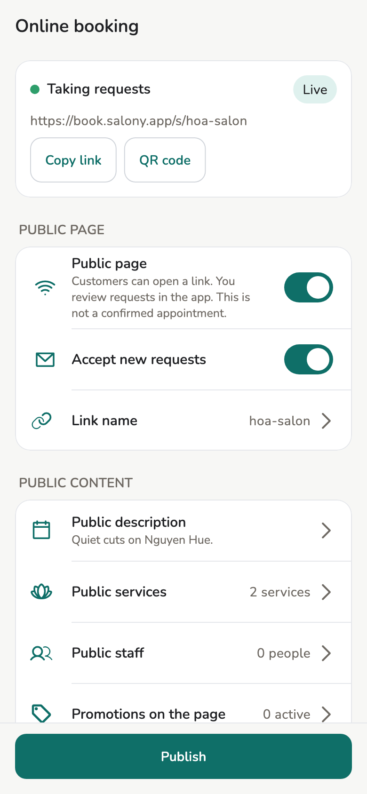{ loading=lazy }
<figcaption>Settings → Online booking</figcaption>
</figure>

The salon books stay on your devices. The public page is a brochure plus
pending requests — not the appointment book. The time the customer picks,
and the person they ask for, are preferences. The price on the page is an
estimate. This device sets the price when you confirm.

## Prerequisites

- Owner: an account under **Settings → Advanced → Sync**, then come back to this
  page. **Open Sync** is on the screen if you are not signed in.
- [Services](../guide/services.md) you want customers to see.
- A network to **Publish**, and later to pull new requests and to update
  the public status page.

Core salon work still runs offline. Customers can send a request while
this store device is offline; the request waits until a store device is
online.

## Usage

### What the customer sees

The public page is a brochure with a request form. The customer picks one
or more services, a day and a time, and the person they would like, then
leaves a name and a phone number. There is no account to create.

<figure markdown>
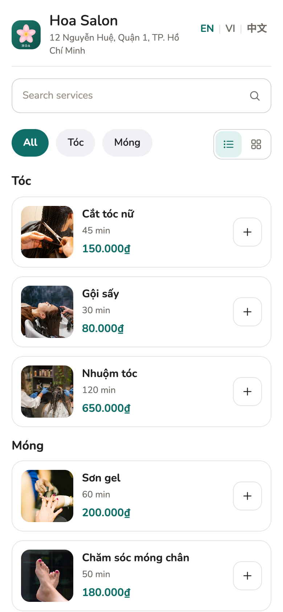{ loading=lazy }
<figcaption>The public page</figcaption>
</figure>

<figure markdown>
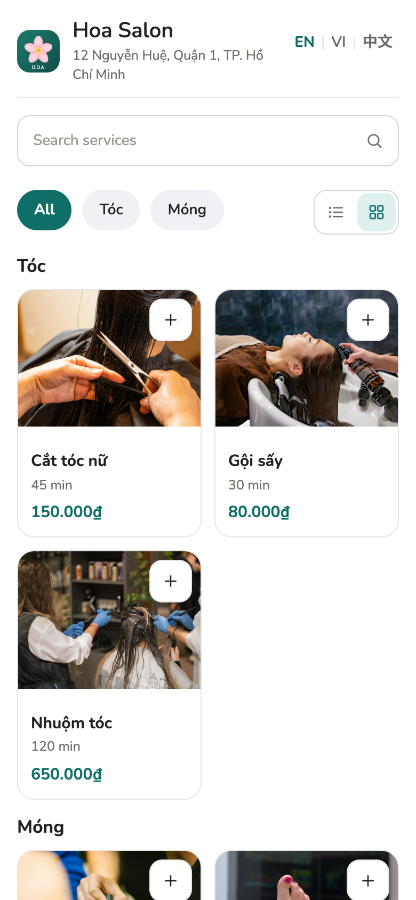{ loading=lazy }
<figcaption>Grid view</figcaption>
</figure>

<figure markdown>
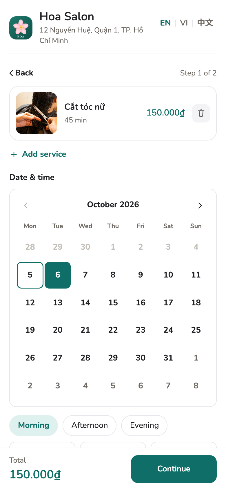{ loading=lazy }
<figcaption>Day and time</figcaption>
</figure>

<figure markdown>
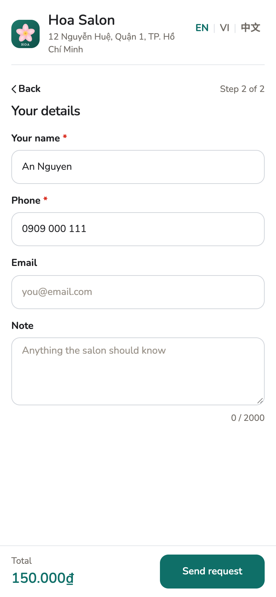{ loading=lazy }
<figcaption>Their details</figcaption>
</figure>

<figure markdown>
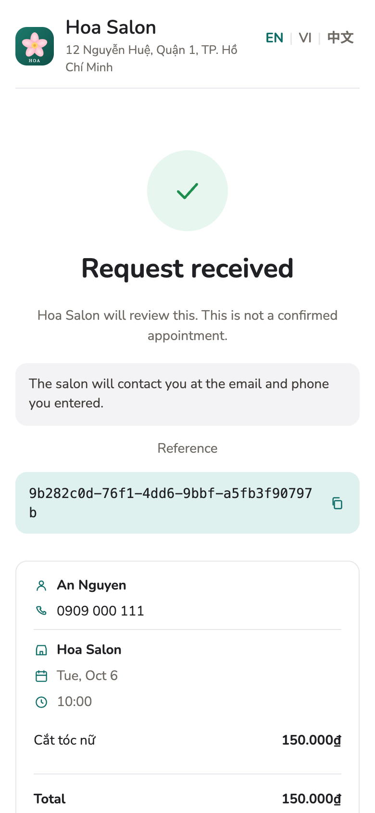{ loading=lazy }
<figcaption>Request sent</figcaption>
</figure>

**[Try the demo page](../demo/booking.html)**: the same page for a sample
salon, in English, Vietnamese, and Chinese. Nothing you type there is sent
anywhere. To see what a customer sees when a store has reached its daily
limit, open the [limit demo](../demo/booking.html?limit=1).

The two buttons next to the categories show the services as a list or as a
grid of larger photos ([grid demo](../demo/booking.html?view=grid)). The
choice belongs to the customer and is remembered on their browser only.

The reference on the last screen is the request's id. The salon does not need
it to find the request: it arrives on **Online requests** by itself.

### Turn the page on

=== "Owner"

    1. **Settings → Online booking**. The card at the top says what
       customers see now: **Not public**, **Not published yet**,
       **Page only, not taking requests**, or **Taking requests**, with
       **Live** once the page is up.
    2. Turn **Public page** on. **Accept new requests** stays off until
       you turn that on too.
    3. Tap **Link name** and type it — letters, numbers, and hyphens,
       2–48 characters. Checking a name does not reserve it. **Publish**
       saves it.
    4. **Public description** and **Public services** — pick what appears
       on the page. An empty service list is allowed; the page then has
       no Book button.
    5. **Publish**. Name, address, phone, hours, and logo come from
       **Store profile** on that publish — not from this screen.

    After a successful publish the link is on the card. **Copy link**, or
    **QR code** to show it large for a customer to scan. The QR is drawn
    on this device and not stored.

    **Most services on one request** opens a list from 1 to 12. Until you
    set one, the page allows 12. **Publish** puts the number on the page.
    Lowering it does not change a request the customer already sent.

    **Notification language** picks the language of the new-request alert
    on this store's devices: English, Tiếng Việt, or 简体中文. Until you
    choose, it is English. **Publish** applies it.

    Turning **Public page** off also turns **Accept new requests** off.
    The link then explains that the salon is not taking requests.
    Existing requests in the app stay.

=== "Manager"

    Cannot turn the page on or change **Link name**. After the owner has
    enabled: edit **Public description**, pick **Public services**, set
    **Most services on one request** and **Notification language**,
    choose **Public staff**,
    **Publish**, copy the link, open **Online requests**, and open
    **Reviews**. Cannot create, join, leave, or dissolve a **Store group**.

=== "Staff"

    The Settings tile is disabled (**Requires owner or manager permission.**).
    There is no inbox and no review list. A staff device
    that is online can still bring requests onto the store in the
    background.

<figure markdown>
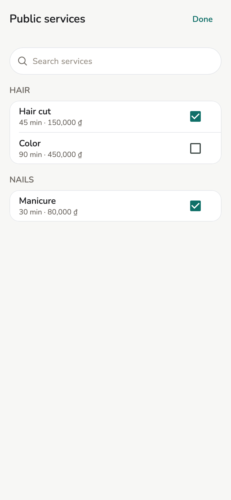{ loading=lazy }
<figcaption>Public services</figcaption>
</figure>

Changing description, services, the service cap, or public staff does
**not** upload until **Publish**. **Unpublished changes** means the live
page is behind what you see here. **Publish** needs a network.

Notes, tax id, customers, and appointments are not on the public page.
A staff phone, email, or note is not on it either. A display name appears
only for a person you list under **Public staff**.

### Staff the customer may ask for

Tap **Public staff** on the same screen, as the owner or manager, after
the page is on. The tile shows how many people are listed.

1. Turn on each person a customer may name.
2. Under **Services this person can perform**, tick the published
   services they do. Someone with no active profile is not listed.
3. **Publish**.

The customer can ask for one person for each service, on the first step.
That choice is a preference. The salon may assign someone else. When every
service names the same person, and that person is still listed and still
active, confirm assigns them. Otherwise the appointment stays unassigned.
The request shows the person asked for on each service. You can change the
assignment on the appointment.

### Price on the page

**Promotions on the page** is a list, not an editor. The page shows the
largest current saving as an estimate. This device sets the price when
you confirm, and the invoice is calculated here. A promotion that is
turned off is not on the page. An empty list says **No active promotion to show.**

### Store group

Owner only: tap **Store group** at the end of the same screen. The tile
shows the group's name once there is one. A manager can see the group
this store is in and cannot change it.

1. **Create a group** and set **Group name**. Creating does not add this
   store to the list.
2. A group lists your own stores. On each store signed in with the same
   account, tap **Join a group**. Then that store is listed. A store of
   another account cannot join. A store is in at most one group. Group
   names and store link names share one list of names.
3. The group link is on the screen. The page lists member stores whose
   public page is on. It has no booking form. A store with the page off
   is left off that list.

**Leave this group** removes this store. The group stays for the others.
**Dissolve group** is only for the owner who created it. Member stores
leave the list and the group link stops working.

### Review requests

On **Bookings**, a banner appears when at least one request is still
pending. Or open **Online requests** from **Settings → Online booking**.

<figure markdown>
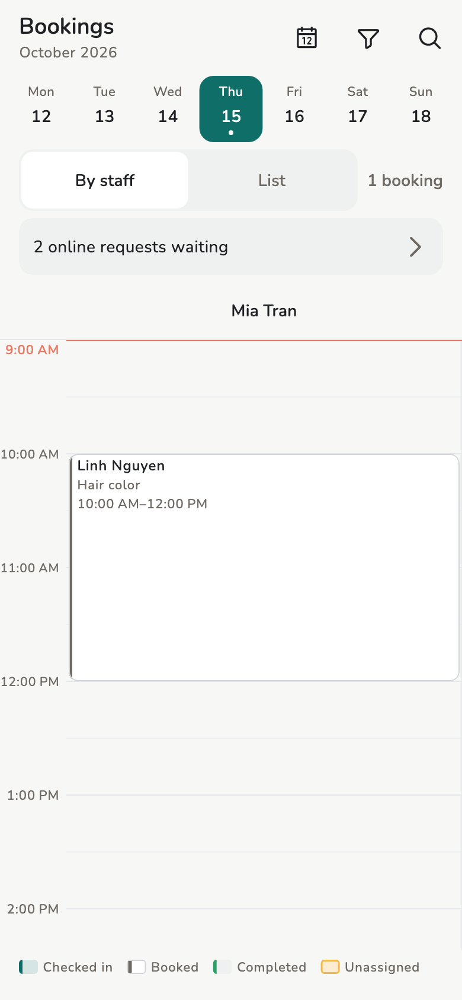{ loading=lazy }
<figcaption>Bookings banner</figcaption>
</figure>

<figure markdown>
{ loading=lazy }
<figcaption>Online requests</figcaption>
</figure>

1. Open the list while online. New requests land here, grouped by the
   day the customer asked for: today, tomorrow, later days, then
   **Earlier**. Each card shows the services, **Returning customer** when
   the phone matches one of your customers, the time, the staff they asked
   for, and the page's estimate. Search by name, phone, or service.
2. Tap a card, or **Review**. The time is a **Preferred time — not a reserved slot.**
   The customer may have chosen more than one service, up to the
   cap you published. Under **Actions**, **Call customer** opens the phone
   app, and tapping **Reference** copies the request's id.
3. **Confirm** adds an [appointment](../guide/appointments.md) on this
   device (and a [customer](../guide/customers.md) if that phone is new).
   **Reject** creates no appointment. Other appointments at that hour do
   not block you.

<figure class="shot-phone" markdown>
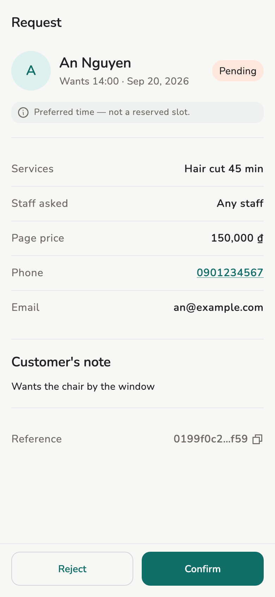{ loading=lazy }
<figcaption>Request</figcaption>
</figure>

Confirm still works if the preferred time has passed. If the service is
no longer in the catalog, **Confirm** is off; you can **Reject**.

If this device is offline, the choice is saved here. The public page
updates when this device is online.

If the customer left an email, they get a message when the request
arrives and another when you confirm or reject it, each with a link to
the status page. Each message shows your store name and address, the
services, and the preferred date and time. No email means no message. Confirming or rejecting
again does not send a second message. Until you confirm, that page says
the salon will review the request. It does not say the time is reserved.
After you confirm, it says the salon confirmed the request. After you
reject, it says the salon cannot take the request.

The confirmation message already carries the link to review the visit.
The review page opens only after the visit is marked complete.

After confirm, **Open appointment** is the usual appointment detail. On
that appointment, **Complete** marks the linked visit done. Do this once.
The status page then says **Visit complete** and shows **Review your
visit**. If the customer's email is still stored, they also get one
reminder with the review link.
Marking complete again does not send a second message. A walk-in that
was not an online request has no review link.

### Reviews

Open **Reviews** from **Settings → Online booking**. Owner or manager.
Staff have no entry.

The list shows the rating, the comment, and the date. It does not show
the customer's name, phone, or email. An empty list says **No reviews yet.**

**Hide** asks first. The review leaves the public list and the public
average. It stays stored. There is no control to show it again. If hide
fails, the row stays visible.

To take every review off the page, turn off **Show reviews on the page**
under **Public content**, then **Publish**. The page drops the reviews and
the average. Customers can still leave a review, and you still see them
here, under a note that they are hidden from the public page. Turn it back
on and **Publish** to show them again.

The customer submits one rating, from 1 to 5, and an optional comment,
only after the visit is marked complete. A second submit does not change
it. An unconfirmed request, or a visit that is not completed, cannot be
reviewed.

### Remove online booking

Owner only, at the end of **Settings → Online booking**, once the page has
been published. Use it when a store stops taking online requests for good.
It gives the account back its place under "Stores with a public link" in
the [safety limits](#safety-limits).

1. Open **Online requests** while online, so every request has reached
   this store. Removal is refused while any is still waiting, and the
   message says how many.
2. Tap **Remove online booking**, type the store name, and confirm.

What happens:

- The public page, its link, and its photos are removed from the cloud, and
  **Public page** and **Accept new requests** turn off on every device of
  the store.
- Requests and appointments already in the app stay.
- The link name stays yours for 30 days. Publish again within that time and
  the same link, and the QR codes you printed, work again. After 30 days
  the name is free for anyone.
- Old links, including the status links customers received by email, show
  a short page saying the salon no longer takes online requests. It shows
  no store details.

<figure markdown>
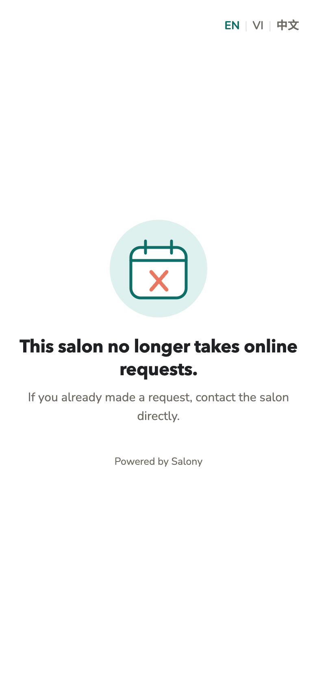{ loading=lazy }
<figcaption>Old links after removal</figcaption>
</figure>

**To undo:** turn **Public page** on and **Publish**. The store counts as one
of the account's stores again.

### Safety limits

The Salony cloud caps what one store, one account, or one customer can
send through it. The caps are the same for every store. They keep the
public page and the email sender working for everyone; they are not a
plan.

| What | Most allowed | When it frees up |
| --- | --- | --- |
| Online requests a store receives | 200 a day | At midnight in the store's time zone |
| Requests from one phone number at one store | 5 a day | At midnight in the store's time zone |
| Requests waiting for a store device | 500 | When a store device opens **Online requests** online and receives them |
| Customer emails from one store | 600 a day | At midnight UTC (07:00 in Vietnam) |
| Emails to one address, from every store | 10 a day | At midnight UTC |
| New-request alerts on store devices | 120 an hour | At the next hour |
| **Publish** | 30 times an hour | At the next hour |
| Photos on the page | 300, and 100 MB in all | A removed photo stops counting 7 days after it was added |
| Stores with a public link, per account | 20 | When the owner uses [Remove online booking](#remove-online-booking); turning the page off is not enough |
| **Store group**: groups per account | 5 | When a group is dissolved |
| **Store group**: stores in one group | 50 | When a store leaves |
| Devices that get the new-request alert | 20 per store | Never refused: the oldest device stops getting it |
| Stores licensed for internet sync, per account | 20 | Stores that already have a licence keep syncing |

What each person sees:

- **The customer**, on the public page, after sending: the store is not
  taking more online requests today. If the store profile has a phone,
  the send button becomes **Call** with that number. The message is the
  same whichever limit it was, so it never says anything about other
  customers. The form keeps what they typed.
  See it in the [limit demo](../demo/booking.html?limit=1).
- **Owner or manager**, on **Online requests**: a banner saying requests
  are paused until tomorrow, or paused while too many wait to reach the
  store. Requests already received are listed as usual. The banner
  clears on the next pull after intake reopens.
- **Owner or manager**, after **Publish**: which limit was reached, and
  when to try again or what frees it. The live page stays as it was.
- **Owner**, on **Store group**: the group or member limit. The name you
  typed stays.
- **Owner**, on **Settings → Advanced → Sync**, under **Get a licence for this
  store**: that the account has licences for 20 stores. That store keeps
  working on its own devices and over Wi-Fi.

<figure class="shot-phone" markdown>
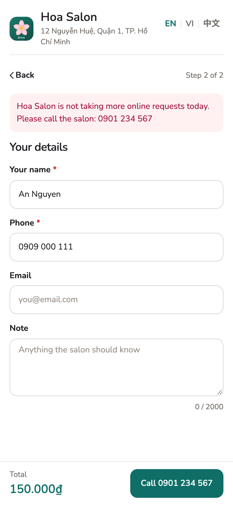{ loading=lazy }
<figcaption>The customer, at the daily limit</figcaption>
</figure>

A customer email or a new-request alert past its limit is skipped. The
request still arrives. Nobody is shown a message for it.

The cloud counts phone numbers and email addresses as keyed hashes,
never the number or address itself, and drops the count a day after its
window ends. See the [Privacy Policy](../legal/privacy.md).

## Concepts

| Status | Meaning |
| --- | --- |
| Pending | The customer asked. Not in the appointment book yet. |
| Confirmed | An appointment was added on a store device. |
| Rejected | No appointment. |

Filters on **Online requests**: **Pending** (default), **Confirmed**,
**Rejected**.

## Limitations

- Staff cannot enable, publish, confirm, reject, or hide a review.
- Customers who send a request do not get a Salony account.
- The [safety limits](#safety-limits) apply to every store. There is no
  setting in the app to raise them.
- Turning the page off keeps the store's link and its place under the
  limits. Only **Remove online booking** gives the place back.
- No guaranteed slot, no deposit, no payment, and no custom domain.
- The time and the staff choice are preferences. The page price is an
  estimate. This device sets the price at confirm.
- Offline: the inbox still shows requests already on this store. New
  ones wait until this device is online. A confirm, reject, or
  completion saved offline reaches the public page when this device is
  online.

## Related pages

- [Appointments](../guide/appointments.md)
- [Store settings](store-settings.md)
- [Customers](../guide/customers.md)
- [Privacy Policy](../legal/privacy.md)
