# Đặt lịch online

Trang công khai khách mở được. Họ gửi **yêu cầu**. Bạn xem trong app.
Đó **chưa** phải lịch hẹn đã xác nhận, cho đến khi bạn xác nhận trên
một máy của tiệm.

## Tổng quan

**Cài đặt → Đặt lịch online**. Chủ tiệm bật trang công khai. Chủ tiệm
hoặc Quản lý đăng brochure, đặt số dịch vụ tối đa một yêu cầu, chọn
nhân viên khách được hỏi, và ẩn đánh giá. Nhân viên không làm được.

<figure class="shot-phone" markdown>
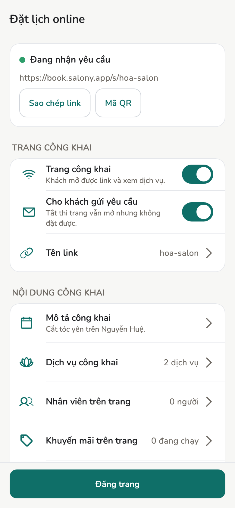{ loading=lazy }
<figcaption>Cài đặt → Đặt lịch online</figcaption>
</figure>

Sách tiệm vẫn trên máy của bạn. Trang công khai là brochure cộng các yêu
cầu đang chờ, không phải sổ lịch hẹn. Giờ khách chọn và người khách
muốn gặp chỉ là mong muốn. Giá trên trang là ước tính. Máy này chốt giá
khi bạn xác nhận.

## Điều kiện

- Chủ tiệm: đăng nhập bằng Apple hoặc Google ngay trên trang này trước khi
  bật trang công khai. Đồng bộ qua internet vẫn ở **Cài đặt → Nâng cao → Đồng bộ**.
- [Dịch vụ](../guide/services.md) muốn khách thấy.
- Có mạng để **Đăng trang**, rồi để kéo yêu cầu mới và để trang trạng
  thái cập nhật.

Việc tiệm vẫn chạy khi mất mạng. Khách vẫn gửi được yêu cầu khi máy tiệm
offline. Yêu cầu chờ đến khi một máy tiệm online.

## Cách làm

### Khách thấy gì

Trang công khai là trang giới thiệu tiệm kèm form gửi yêu cầu. Khách chọn
một hoặc vài dịch vụ, ngày, giờ, người muốn làm, rồi để lại tên và số điện
thoại. Khách không phải tạo tài khoản.

<figure markdown>
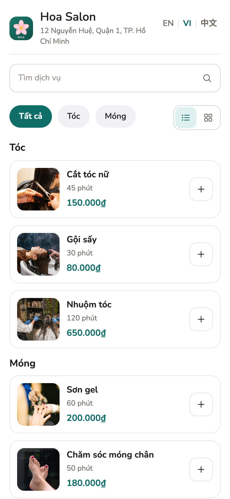{ loading=lazy }
<figcaption>Trang công khai</figcaption>
</figure>

<figure markdown>
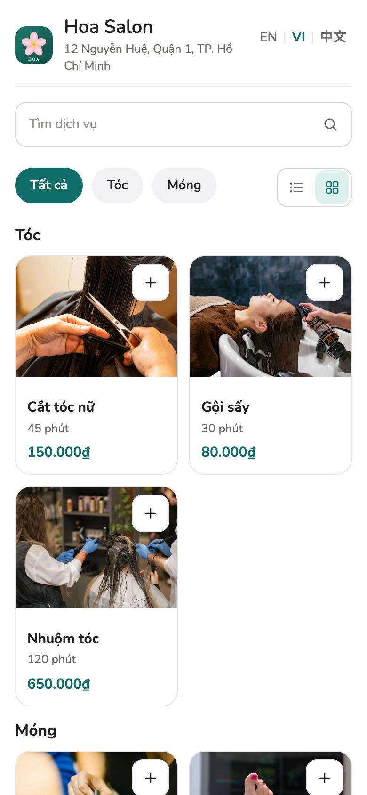{ loading=lazy }
<figcaption>Dạng lưới</figcaption>
</figure>

<figure markdown>
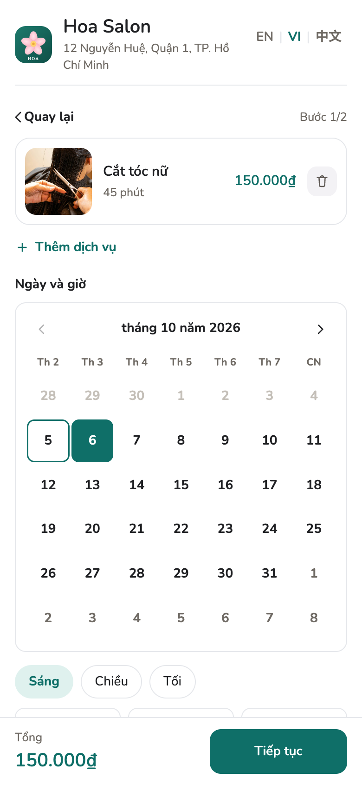{ loading=lazy }
<figcaption>Ngày và giờ</figcaption>
</figure>

<figure markdown>
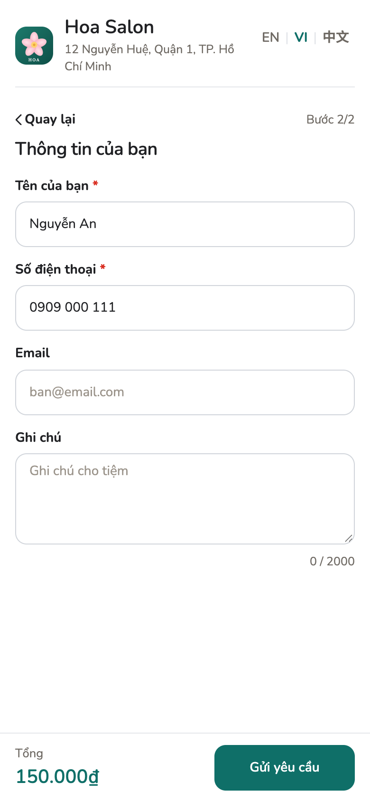{ loading=lazy }
<figcaption>Thông tin của khách</figcaption>
</figure>

<figure markdown>
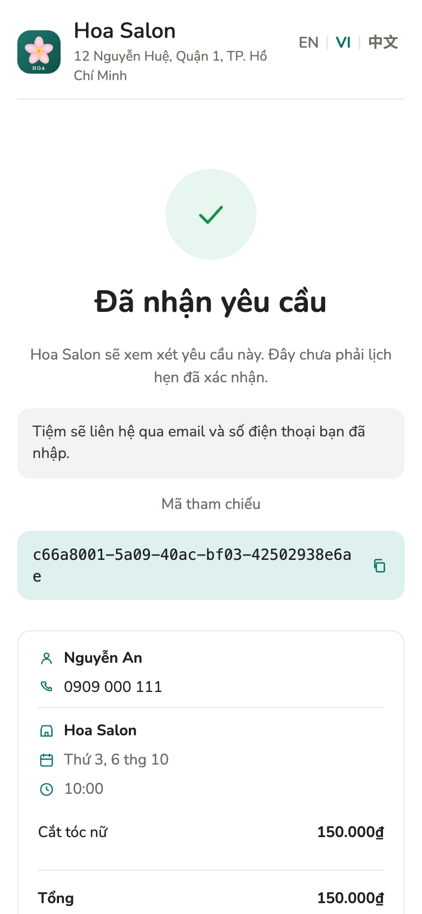{ loading=lazy }
<figcaption>Đã gửi</figcaption>
</figure>

**[Mở trang demo](../demo/booking.html)**: đúng trang đó cho một tiệm mẫu,
có tiếng Việt, tiếng Anh và tiếng Trung. Những gì bạn nhập ở đó không được
gửi đi đâu. Muốn xem khách thấy gì khi tiệm đã chạm giới hạn trong ngày, mở
[demo giới hạn](../demo/booking.html?limit=1).

Hai nút cạnh nhóm dịch vụ đổi cách hiện dịch vụ: dạng danh sách, hoặc dạng
lưới với ảnh lớn hơn ([demo dạng lưới](../demo/booking.html?view=grid)). Đây
là lựa chọn của khách và chỉ được nhớ trên trình duyệt của họ.

Mã tham chiếu ở màn cuối là mã của yêu cầu. Tiệm không cần mã này để tìm:
yêu cầu tự về **Yêu cầu online**.

### Bật trang

=== "Chủ tiệm"

    1. **Cài đặt → Đặt lịch online**. Thẻ trên cùng cho biết khách đang
       thấy gì: **Chưa công khai**, **Chưa đăng**,
       **Chỉ hiện trang, chưa nhận yêu cầu**, hoặc **Đang nhận yêu cầu**,
       kèm nhãn **Đang chạy** khi trang đã lên.
    2. Bật **Trang công khai**. **Nhận yêu cầu mới** vẫn tắt cho đến khi
       bạn bật thêm.
    3. Bấm **Tên link** rồi nhập: chữ, số và dấu gạch ngang, 2–48 ký tự.
       Kiểm tra tên không giữ chỗ. **Đăng trang** mới lưu.
    4. **Mô tả công khai** và **Dịch vụ công khai**: chọn những gì hiện
       trên trang. Danh sách trống vẫn được. Lúc đó trang không có nút
       đặt.
    5. **Đăng trang**. Tên, địa chỉ, điện thoại, giờ mở cửa và logo lấy
       từ **Hồ sơ tiệm** lúc đăng, không sửa trên màn này.

    Đăng thành công thì link hiện trên thẻ. **Sao chép link**, hoặc bấm
    **Mã QR** để hiện mã lớn cho khách quét. Mã QR vẽ trên máy này và
    không được lưu lại.

    **Số dịch vụ tối đa một yêu cầu** mở danh sách từ 1 đến 12. Trang
    chưa ghi mức này thì cho phép 12. **Đăng trang** đưa số đó lên trang.
    Hạ mức này không đổi yêu cầu khách đã gửi.

    **Ngôn ngữ thông báo** chọn ngôn ngữ của thông báo có yêu cầu mới
    trên các máy của tiệm: English, Tiếng Việt, hoặc 简体中文. Chưa chọn
    thì là English. **Đăng trang** áp dụng lựa chọn này.

    Tắt **Trang công khai** thì **Nhận yêu cầu mới** cũng tắt. Link sẽ
    báo tiệm chưa nhận yêu cầu. Các yêu cầu đã có trong app vẫn còn.

=== "Quản lý"

    Không bật trang, không đổi **Tên link**. Sau khi chủ tiệm đã bật:
    sửa **Mô tả công khai**, chọn **Dịch vụ công khai**, đặt
    **Số dịch vụ tối đa một yêu cầu** và **Ngôn ngữ thông báo**, chọn
    **Nhân viên trên trang**,
    **Đăng trang**, sao chép link, mở **Yêu cầu online**, và mở
    **Đánh giá**.
    Không tạo, không vào, không rời, không giải tán **Nhóm tiệm**.

=== "Nhân viên"

    Ô Cài đặt bị khóa (**Cần quyền chủ tiệm hoặc quản lý.**). Không có
    hộp thư, không có danh sách đánh giá. Máy nhân viên đang online vẫn
    có thể kéo yêu cầu về tiệm chạy nền.

<figure markdown>
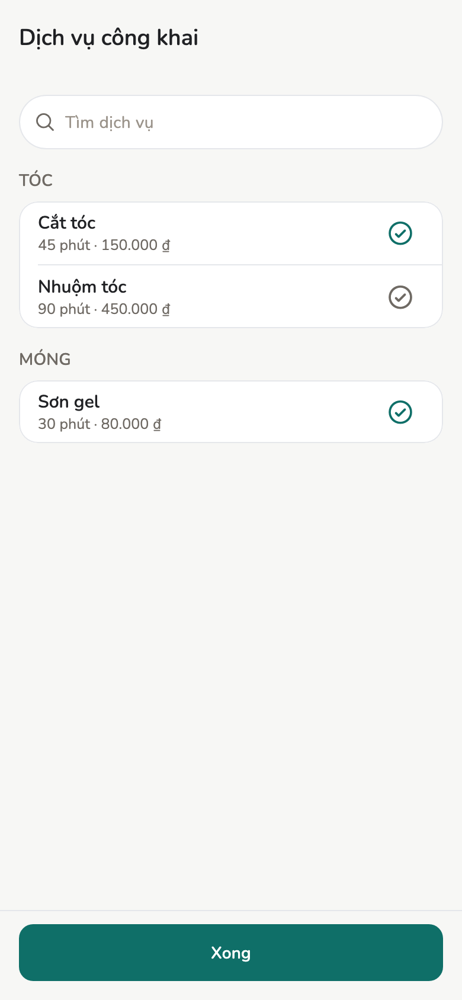{ loading=lazy }
<figcaption>Dịch vụ công khai</figcaption>
</figure>

Sửa mô tả, dịch vụ, số dịch vụ tối đa, hoặc nhân viên trên trang
**không** lên trang cho đến khi **Đăng trang**. **Chưa đăng thay đổi**
nghĩa là trang đang chạy chậm hơn những gì bạn thấy ở đây.
**Đăng trang** cần mạng.

Ghi chú, mã số thuế, khách và lịch hẹn không có trên trang công khai.
Điện thoại, email và ghi chú của nhân viên cũng không. Tên hiển thị chỉ
xuất hiện khi bạn bật người đó trong **Nhân viên trên trang**.

### Nhân viên khách được hỏi

Bấm **Nhân viên trên trang** trên cùng màn hình, dành cho chủ tiệm hoặc
quản lý, sau khi trang đã bật. Ô này ghi có bao nhiêu người đang hiện.

1. Bật từng người khách được chọn.
2. Trong **Dịch vụ người này làm được**, chọn các dịch vụ đã đăng mà
   người đó làm. Người không còn làm thì không có trong danh sách.
3. **Đăng trang**.

Khách chọn một nhân viên cho mỗi dịch vụ, ngay ở bước đầu. Đó là mong
muốn. Tiệm có thể xếp người khác. Khi mọi dịch vụ cùng chọn một người, và
người đó vẫn đang bật và vẫn đang làm, xác nhận sẽ gán người đó. Nếu khách
chọn khác nhau, hoặc người đó không còn, lịch để trống phần nhân viên.
Yêu cầu ghi người được hỏi trên từng dịch vụ. Bạn đổi người trên lịch hẹn.

### Giá trên trang

**Khuyến mãi trên trang** là danh sách, không phải chỗ sửa khuyến mãi.
Trang hiện mức giảm lớn nhất như một ước tính. Máy này chốt giá khi bạn
xác nhận, và hóa đơn tính ở đây. Khuyến mãi đang tắt không lên trang.
Danh sách trống thì hiện **Chưa có khuyến mãi đang bật.**

### Nhóm tiệm

Chỉ chủ tiệm: bấm **Nhóm tiệm** ở cuối cùng màn hình. Khi đã có nhóm, ô
này ghi tên nhóm. Quản lý thấy nhóm tiệm này đang ở, và không đổi được.

1. **Tạo nhóm** và đặt **Tên nhóm**. Tạo nhóm chưa thêm tiệm này vào
   danh sách.
2. Nhóm liệt kê các tiệm của chính bạn. Trên từng tiệm đăng nhập cùng
   tài khoản, bấm **Vào nhóm**. Lúc đó tiệm đó mới được liệt kê. Tiệm
   của tài khoản khác không vào được. Một tiệm chỉ ở một nhóm. Tên nhóm
   và tên link tiệm dùng chung một danh sách tên.
3. Link nhóm hiện trên màn hình. Trang nhóm liệt kê các tiệm có trang
   công khai đang bật. Trang nhóm không nhận đặt lịch. Tiệm tắt trang
   thì không có trong danh sách đó.

**Rời nhóm này** đưa tiệm này ra. Nhóm vẫn còn với các tiệm khác.
**Giải tán nhóm** chỉ dành cho chủ tiệm đã tạo nhóm. Các tiệm rời danh
sách và link nhóm hết dùng.

### Xem yêu cầu

Trên **Lịch hẹn**, banner hiện khi còn ít nhất một yêu cầu đang chờ.
Hoặc mở **Yêu cầu online** từ **Cài đặt → Đặt lịch online**.

<figure markdown>
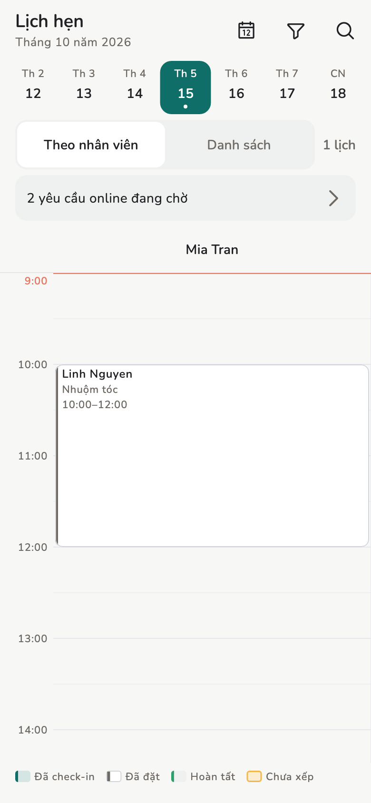{ loading=lazy }
<figcaption>Banner trên Lịch hẹn</figcaption>
</figure>

<figure markdown>
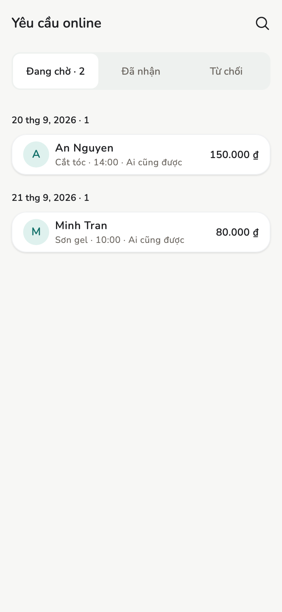{ loading=lazy }
<figcaption>Yêu cầu online</figcaption>
</figure>

1. Mở danh sách khi có mạng. Yêu cầu mới vào đây, xếp theo ngày khách
   chọn: hôm nay, ngày mai, các ngày sau, rồi **Đã qua**. Mỗi thẻ ghi
   dịch vụ, **Khách quen** khi số điện thoại trùng một khách của tiệm,
   giờ, nhân viên khách chọn, và giá ước tính trên trang. Tìm theo tên,
   số điện thoại hoặc dịch vụ.
2. Bấm vào thẻ, hoặc **Xem**. Giờ là **Giờ mong muốn — chưa giữ chỗ.**
   Khách có thể chọn nhiều dịch vụ, không quá mức bạn đã đăng. Trong
   **Thao tác**, **Gọi khách** mở app điện thoại, bấm **Mã tham chiếu**
   để sao chép mã của yêu cầu.
3. **Xác nhận** thêm [lịch hẹn](../guide/appointments.md) trên máy này
   (và [khách](../guide/customers.md) nếu số điện thoại chưa có).
   **Từ chối** không tạo lịch. Trùng giờ với lịch đã có không chặn.

<figure class="shot-phone" markdown>
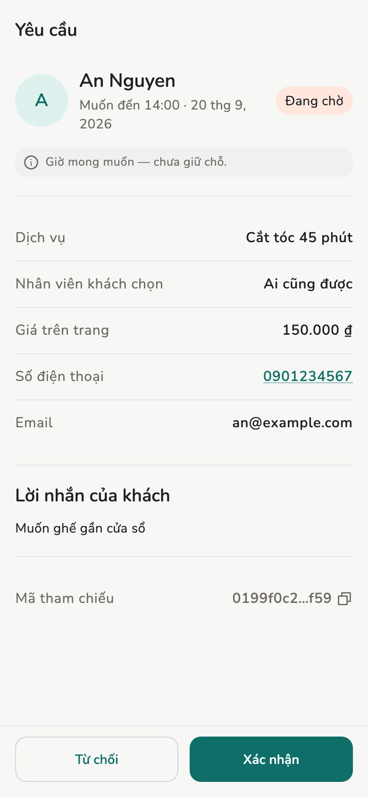{ loading=lazy }
<figcaption>Yêu cầu</figcaption>
</figure>

Giờ mong muốn đã qua vẫn **Xác nhận** được. Dịch vụ không còn trong danh
mục thì **Xác nhận** tắt. Vẫn **Từ chối** được.

Máy này đang offline thì lựa chọn được lưu ở đây. Trang công khai cập
nhật khi máy này có mạng.

Nếu khách để lại email, họ nhận một thư khi yêu cầu đến và một thư nữa
khi bạn xác nhận hoặc từ chối, thư nào cũng kèm link trang trạng thái.
Thư hiện tên và địa chỉ tiệm, các dịch vụ, ngày và giờ mong muốn.
Không có email thì không có thư. Xác nhận hoặc từ chối lần nữa không
gửi thêm thư. Trước khi bạn xác nhận, trang đó nói tiệm sẽ xem xét yêu
cầu. Trang không nói giờ đã được giữ. Sau khi xác nhận, trang nói tiệm
đã xác nhận yêu cầu. Sau khi từ chối, trang nói tiệm không nhận yêu cầu
này.

Thư xác nhận đã kèm sẵn link để đánh giá lần ghé. Trang đánh giá chỉ mở
sau khi lần ghé được đánh dấu hoàn tất.

Sau khi xác nhận, **Mở lịch hẹn** là màn chi tiết lịch như bình thường.
Trên lịch đó, **Hoàn tất** đánh dấu lần ghé đã xong. Làm một lần. Trang
trạng thái khi đó ghi **Đã hoàn tất lần ghé** và hiện **Đánh giá lần ghé**. Nếu email của khách vẫn
còn, họ nhận thêm một thư nhắc kèm link đánh giá. Bấm hoàn tất lần nữa
không gửi thêm thư. Lịch khách đến trực tiếp, không phải yêu cầu online,
không có link đánh giá.

### Đánh giá

Mở **Đánh giá** từ **Cài đặt → Đặt lịch online**. Chủ tiệm hoặc quản lý.
Nhân viên không có mục này.

Danh sách hiện mức, nhận xét và ngày. Không hiện tên, số điện thoại hay
email của khách. Danh sách trống thì hiện **Chưa có đánh giá.**

**Ẩn** hỏi trước. Đánh giá rời danh sách công khai và điểm trung bình.
Dòng vẫn được giữ. Không có nút hiện lại. Nếu ẩn thất bại, dòng vẫn còn
trên danh sách.

Muốn gỡ mọi đánh giá khỏi trang, tắt **Hiện đánh giá trên trang** trong
**Nội dung công khai**, rồi **Đăng trang**. Trang bỏ phần đánh giá và điểm
trung bình. Khách vẫn gửi đánh giá được, và bạn vẫn xem ở đây, kèm ghi chú
đánh giá đang ẩn khỏi trang công khai. Bật lại rồi **Đăng trang** để hiện
như cũ.

Khách gửi một mức từ 1 đến 5, và một nhận xét không bắt buộc, chỉ sau
khi lần ghé đã được đánh dấu hoàn tất. Gửi lần hai không đổi nội dung.
Yêu cầu chưa xác nhận, hoặc lần ghé chưa hoàn tất, không đánh giá được.

### Gỡ đặt lịch online { #go-dat-lich-online }

Chỉ chủ tiệm, ở cuối **Cài đặt → Đặt lịch online**, sau khi trang đã được
đăng. Dùng khi tiệm thôi nhận yêu cầu online hẳn. Tài khoản được trả lại một
chỗ trong mục "Tiệm có link công khai" của [giới hạn an toàn](#gioi-han-an-toan).

1. Mở **Yêu cầu online** lúc có mạng để mọi yêu cầu đã về tiệm. Còn yêu cầu
   chờ thì không gỡ được, và thông báo sẽ nói còn bao nhiêu.
2. Bấm **Gỡ đặt lịch online**, gõ tên tiệm rồi xác nhận.

Sau đó:

- Trang công khai, link và ảnh của trang bị gỡ khỏi cloud.
  **Trang công khai** và **Nhận yêu cầu mới** tắt trên mọi máy của tiệm.
- Yêu cầu và lịch hẹn đã có trong app vẫn còn.
- Tên link vẫn giữ cho bạn 30 ngày. Đăng lại trong thời gian đó thì link cũ
  và mã QR đã in dùng lại được. Sau 30 ngày, ai cũng lấy được tên đó.
- Link cũ, kể cả link trạng thái khách nhận qua email, hiện một trang ngắn
  báo tiệm không còn nhận đặt lịch online. Trang này không hiện thông tin
  tiệm.

<figure markdown>
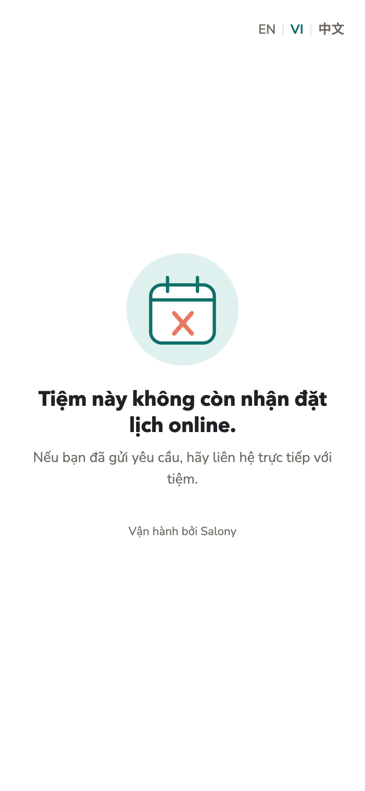{ loading=lazy }
<figcaption>Link cũ sau khi gỡ</figcaption>
</figure>

**Muốn dùng lại:** bật **Trang công khai** rồi **Đăng trang**. Tiệm lại được
tính là một tiệm của tài khoản.

### Giới hạn an toàn

Salony cloud giới hạn những gì một tiệm, một tài khoản hay một khách có
thể gửi qua nó. Giới hạn giống nhau cho mọi tiệm. Mục đích là để trang
công khai và việc gửi email chạy ổn cho tất cả; đây không phải gói cước.

| Việc | Tối đa | Khi nào được tiếp |
| --- | --- | --- |
| Yêu cầu online một tiệm nhận | 200 mỗi ngày | Nửa đêm theo múi giờ của tiệm |
| Yêu cầu từ một số điện thoại ở một tiệm | 5 mỗi ngày | Nửa đêm theo múi giờ của tiệm |
| Yêu cầu đang chờ về máy của tiệm | 500 | Khi một máy của tiệm mở **Yêu cầu online** lúc có mạng và nhận chúng |
| Email gửi khách từ một tiệm | 600 mỗi ngày | Nửa đêm giờ UTC (7 giờ sáng giờ Việt Nam) |
| Email tới một địa chỉ, tính mọi tiệm | 10 mỗi ngày | Nửa đêm giờ UTC |
| Thông báo yêu cầu mới trên máy của tiệm | 120 mỗi giờ | Sang giờ kế tiếp |
| **Đăng trang** | 30 lần mỗi giờ | Sang giờ kế tiếp |
| Ảnh trên trang | 300 ảnh, tổng 100 MB | Ảnh đã gỡ không còn tính sau 7 ngày kể từ lúc thêm |
| Tiệm có link công khai, mỗi tài khoản | 20 | Khi chủ tiệm [gỡ đặt lịch online](#go-dat-lich-online); chỉ tắt trang thì chưa đủ |
| **Nhóm tiệm**: số nhóm mỗi tài khoản | 5 | Khi giải tán một nhóm |
| **Nhóm tiệm**: số tiệm trong một nhóm | 50 | Khi một tiệm rời nhóm |
| Máy nhận thông báo yêu cầu mới | 20 mỗi tiệm | Không bị từ chối: máy cũ nhất thôi nhận |
| Tiệm có giấy phép đồng bộ qua internet, mỗi tài khoản | 20 | Tiệm đã có giấy phép vẫn đồng bộ bình thường |

Mỗi người thấy gì:

- **Khách**, trên trang công khai, sau khi gửi: tiệm đã ngừng nhận yêu
  cầu online trong hôm nay. Nếu hồ sơ tiệm có số điện thoại, nút gửi đổi
  thành **Gọi** kèm số đó. Câu này giống nhau dù chạm giới hạn nào, nên
  không nói gì về khách khác. Những gì khách đã nhập vẫn còn.
  Xem trong [demo giới hạn](../demo/booking.html?limit=1).
- **Chủ tiệm hoặc quản lý**, ở **Yêu cầu online**: một dòng báo đặt lịch
  online tạm dừng đến ngày mai, hoặc tạm dừng vì có quá nhiều yêu cầu đang
  chờ về tiệm. Yêu cầu đã nhận vẫn hiện như thường. Dòng này mất ở lần tải
  kế tiếp sau khi tiệm nhận lại yêu cầu.
- **Chủ tiệm hoặc quản lý**, sau khi **Đăng trang**: chạm giới hạn nào,
  khi nào thử lại hoặc cần làm gì. Trang đang chạy giữ nguyên.
- **Chủ tiệm**, ở **Nhóm tiệm**: giới hạn số nhóm hoặc số tiệm trong
  nhóm. Tên đã nhập vẫn còn.
- **Chủ tiệm**, ở **Cài đặt → Nâng cao → Đồng bộ → Tài khoản**, dưới **Lấy giấy
  phép cho tiệm này**: tài khoản đã có giấy phép cho 20 tiệm. Đăng nhập ở
  **Cài đặt → Đặt lịch online** cũng hiện câu này khi bị từ chối vì lý do đó.
  Tiệm đó vẫn chạy trên máy của tiệm và qua Wi-Fi.

<figure class="shot-phone" markdown>
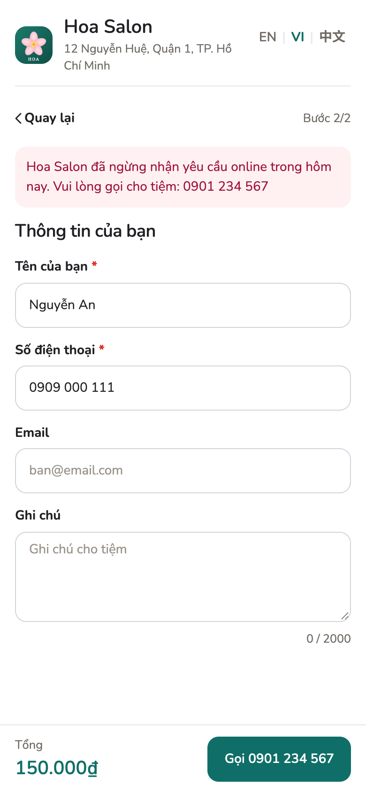{ loading=lazy }
<figcaption>Khách thấy khi tiệm chạm giới hạn</figcaption>
</figure>

Email gửi khách hoặc thông báo yêu cầu mới vượt giới hạn thì bị bỏ qua.
Yêu cầu vẫn về tiệm. Không ai thấy thông báo về việc này.

Cloud đếm số điện thoại và địa chỉ email dưới dạng mã băm có khoá, không
lưu số hay địa chỉ thật, và xoá số đếm một ngày sau khi hết khung thời
gian. Xem [Chính sách quyền riêng tư](../legal/privacy.md).

## Khái niệm

| Trạng thái | Việc |
| --- | --- |
| Đang chờ | Khách đã gửi. Chưa vào sổ lịch hẹn. |
| Đã nhận | Đã thêm lịch trên một máy của tiệm. |
| Từ chối | Không tạo lịch. |

Lọc trên **Yêu cầu online**: **Đang chờ** (mặc định), **Đã nhận**,
**Từ chối**.

## Giới hạn

- Nhân viên không bật, không đăng, không xác nhận, không từ chối, không
  ẩn đánh giá.
- Khách gửi yêu cầu không có tài khoản Salony.
- [Giới hạn an toàn](#gioi-han-an-toan) áp dụng cho mọi tiệm. App không có
  chỗ nào để nâng giới hạn.
- Tắt trang thì tiệm vẫn giữ link và chỗ trong giới hạn. Chỉ **Gỡ đặt lịch
  online** mới trả lại chỗ.
- Không giữ chỗ, không đặt cọc, không thanh toán, không tên miền riêng.
- Giờ và người khách chọn chỉ là mong muốn. Giá trên trang là ước tính.
  Máy này chốt giá lúc xác nhận.
- Offline: hộp thư vẫn hiện yêu cầu đã có trên tiệm. Yêu cầu mới chờ đến
  khi máy này có mạng. Xác nhận, từ chối hoặc hoàn tất đã lưu khi mất
  mạng sẽ lên trang công khai khi máy này có mạng.

## Trang liên quan

- [Lịch hẹn](../guide/appointments.md)
- [Cài đặt tiệm](store-settings.md)
- [Khách hàng](../guide/customers.md)
- [Chính sách quyền riêng tư](../legal/privacy.md)
