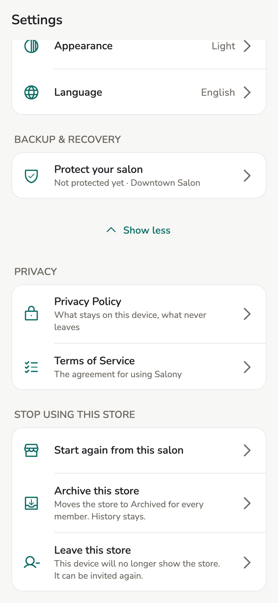
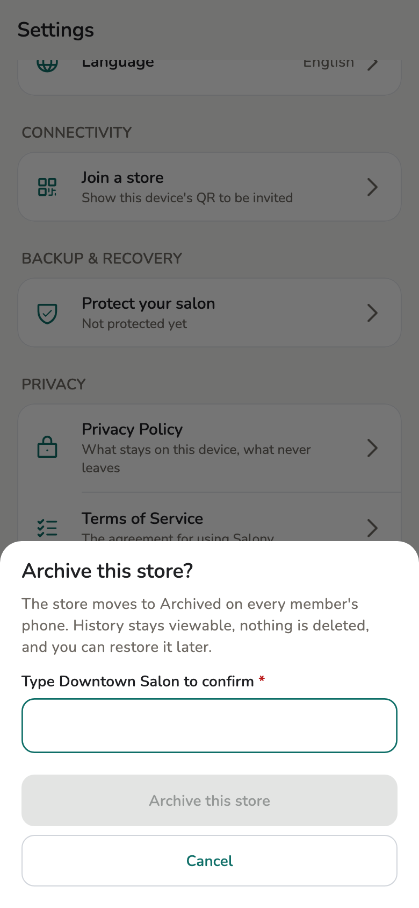
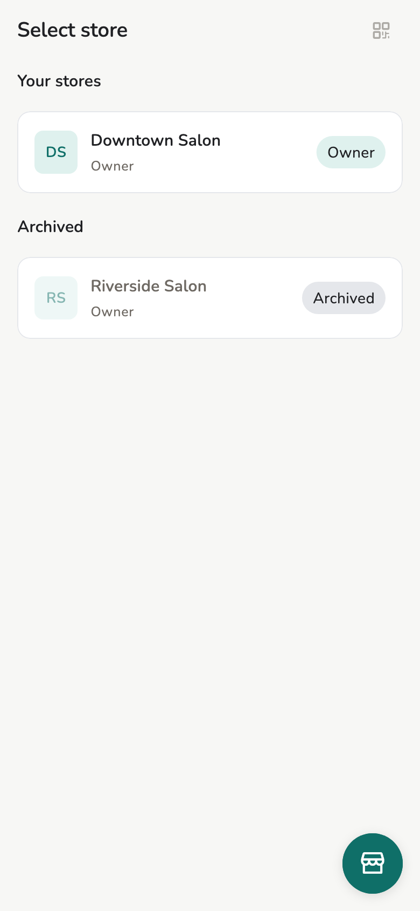
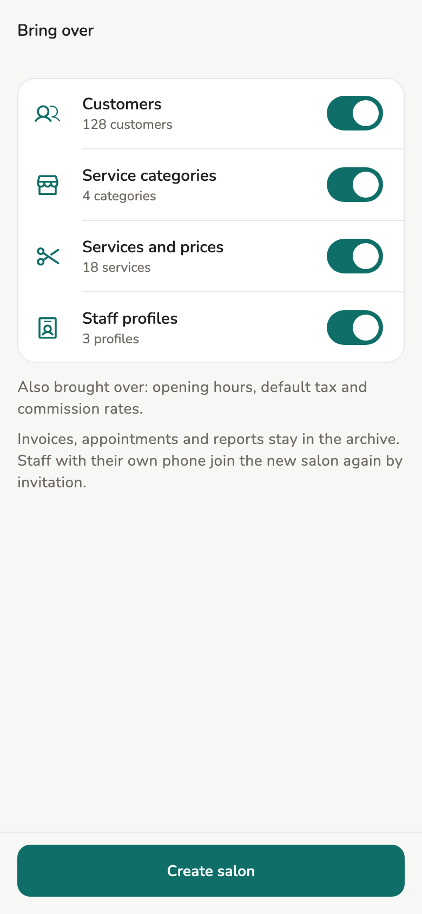

# Stop using a store

Close a store, take your own device out of one, or remove someone else's
device. None of these deletes history, and each can be undone.

## Overview

| Action | Who | Affects |
| --- | --- | --- |
| **Archive this store** | Owner | Every device in the store |
| **Leave this store** | Anyone, on their own device | This device only |
| **Remove from store** | Owner, on someone else's device | The removed device |

**Archive this store** and **Leave this store** sit at the bottom of
**Settings**, under **Stop using this store**. Staff have the same section in
their settings, with **Leave this store** only.

<figure class="shot-phone" markdown>
{ loading=lazy }
<figcaption>Settings → Stop using this store</figcaption>
</figure>

Each confirmation asks you to type a name: the store's, yours, or the removed
device's. The confirm button does nothing until it matches.

## Usage

### Archive this store

For a store that has closed, or one created as a test or by mistake.

1. **Settings → Advanced → Archive this store**.
2. If the store has online booking, the sheet asks
   **Also remove online booking for this store**. It is off. Turn it on
   only if the store will not take online requests again; see
   [Remove online booking](online-booking.md#remove-online-booking).
3. Type the store name, then tap **Archive this store**.

With the switch on, online booking is removed first, then the store is
archived. If it cannot be removed (offline, or requests still waiting), the
store is archived anyway and a message says so. You can remove it later
from **Settings → Online booking**. Restoring the store does not bring a
removed page back; publish again instead.

<figure markdown>
{ loading=lazy }
<figcaption>Type the store name to confirm</figcaption>
</figure>

<figure markdown>
{ loading=lazy }
<figcaption>An archived store sits apart</figcaption>
</figure>

What happens next:

- On **Select store**, the store moves to **Archived**, below the stores in use.
- Opening it still shows appointments, invoices, customers, staff, earnings,
  and reports. A line at the top says *This store is archived. History is
  read-only.*
- Nothing can be created, edited, approved, voided, refunded, or settled.
- Receipts can still be reprinted, and a reprint carries **COPY** as always.
  CSV export and the AI report summary still work.
- Other devices in the store show *The owner archived this store.* once they
  sync. A device that is off or on another Wi-Fi keeps the store as before
  until it next syncs, and what it records in the meantime is kept.
- Nothing is deleted. A salon backup still contains the store, and restoring
  that backup keeps it archived.

**To undo:** the owner opens the archived store and taps **Restore** on the
line at the top. Every device can make changes again once it syncs. Members,
roles, and paired devices are unchanged, so nobody needs a new invitation.

A pending invitation cannot be accepted while the store is archived. Once the
store is restored, it can, without being sent again.

### Start again from a salon { #start-again }

For a salon you cannot run any more, for example after **Start as a new
owner**, or one you would rather start fresh. The old salon stays archived to
look up, and a new one starts with the lists you choose.

1. **Settings → Advanced → Start again from this salon**. In an archived salon the row
   reads **Start a new salon from this one** and skips step 2.
2. *Start again from this salon?* Tap **Start again**. The salon is archived
   on every device, as with **Archive this store**. If it has online booking,
   the sheet offers to remove it too.
3. **New salon**: the name, currency and time zone are filled in from the old
   salon. Change what you like, then tap **Next**.
4. **Bring over**: each switch shows how many there are, and all are on.
    - **Customers**
    - **Service categories**
    - **Services and prices**, with each service's commission
    - **Staff profiles**, the ones the salon manages, with their commission
      and weekly hours
5. Tap **Create salon**. The new salon opens with *New salon ready. {n} brought
   over.*

<figure class="shot-phone" markdown>
{ loading=lazy }
<figcaption>Bring over: choose what the new salon starts with</figcaption>
</figure>

Opening hours, the default tax and the salon-wide commission always come
along. They are new entries in the new salon: the old salon is not changed,
and a customer brought over counts from the day you start again.

Stay in the archive:

- invoices, appointments, payouts and reports, so nothing is counted twice;
- people with their own phone: invite them to the new salon again;
- archived categories, inactive services and deactivated staff profiles;
- days off and changed hours on particular dates.

If some rows could not be brought over, the message says how many; they stay
in the archive. A service with no price is one of them, and so is every
service if you change the currency.

### Leave this store

For when you stop working at the store, or no longer want this device to see
it.

1. **Settings → Advanced → Leave this store**.
2. Type your name in the store, then tap **Leave this store**.

The store disappears from **Select store** on this device. Data already on the
device stays, but the app no longer opens it. To come back, ask an owner or
manager to invite you again.

You can leave an archived store too.

!!! warning "The last owner device cannot leave"

    A store always needs at least one owner device. To leave, make another
    device an owner first, in **Staff** → that person → **Change role**. To
    close the store, use **Archive this store**.

### Remove from store

For when someone leaves the salon or loses their phone, and that device
should stop seeing the store.

1. **Staff** → tap the person.
2. **Remove from store**. Type their name, then tap **Remove from store**.

They leave the working staff list. Past invoices keep their name. When their
device syncs, its app goes back to **Select store** and shows *This device is no
longer a member of that store.*

A device that never syncs again keeps the data it already has. Removing a
device cannot delete data on someone else's phone.

To take them back, invite the same device again as you did the first time.

Only an owner sees **Remove from store**, and only for a person using the app
on their own device. For a staff profile without a device, use
**Deactivate**. For an invitation not yet accepted, use **Cancel invitation**.

## Related pages

- [Staff](../guide/staff.md)
- [Devices and sync](devices.md)
- [Protect and restore your salon](backup.md)
- [Roles](../reference/roles.md)
