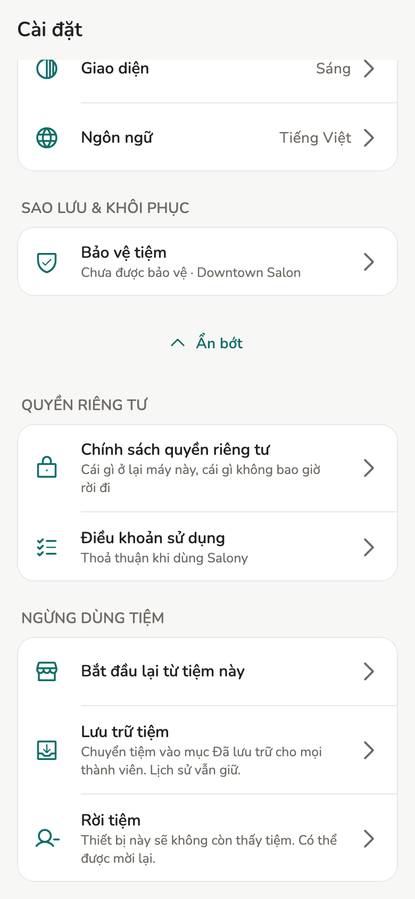
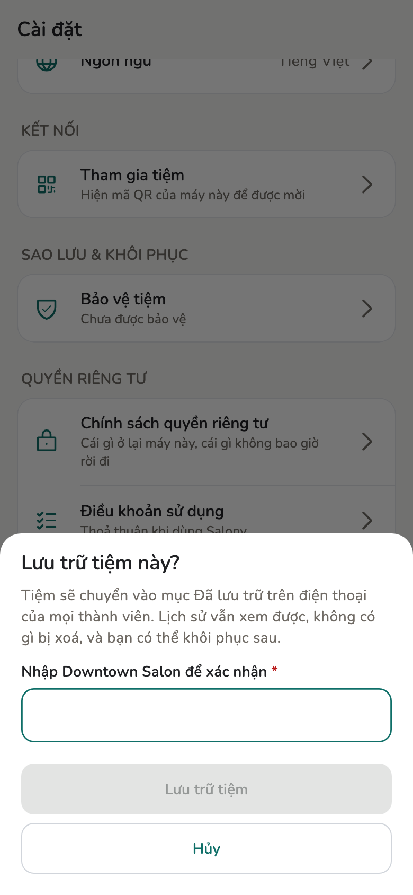
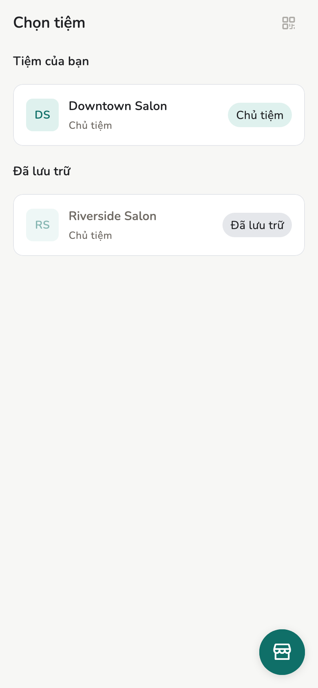
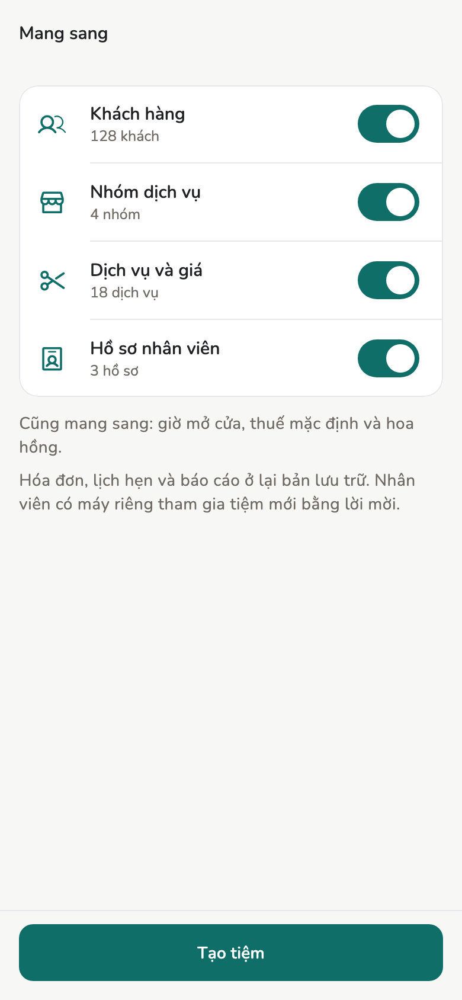

# Ngừng dùng tiệm

Đóng một tiệm, cho máy mình rời tiệm, hoặc gỡ máy của người khác. Không cách
nào xoá lịch sử, và cả ba đều làm lại được.

## Tổng quan

| Việc | Ai làm | Ảnh hưởng tới |
| --- | --- | --- |
| **Lưu trữ tiệm** | Chủ tiệm | Mọi máy trong tiệm |
| **Rời tiệm** | Bất kỳ ai, trên máy của mình | Chỉ máy này |
| **Gỡ khỏi tiệm** | Chủ tiệm, trên máy người khác | Máy bị gỡ |

**Lưu trữ tiệm** và **Rời tiệm** nằm cuối **Cài đặt**, trong mục **Ngừng
dùng tiệm**. Nhân viên cũng có mục này trong cài đặt của họ, nhưng chỉ có
**Rời tiệm**.

<figure class="shot-phone" markdown>
{ loading=lazy }
<figcaption>Cài đặt → Ngừng dùng tiệm</figcaption>
</figure>

Mỗi lần xác nhận, app bắt bạn gõ lại một cái tên: tên tiệm, tên của bạn, hoặc
tên máy bị gỡ. Gõ sai thì nút xác nhận không chạy.

## Cách làm

### Lưu trữ tiệm

Dùng khi tiệm đã đóng cửa, hoặc là tiệm tạo thử hay tạo nhầm.

1. **Cài đặt → Nâng cao → Lưu trữ tiệm**.
2. Nếu tiệm có đặt lịch online, bảng xác nhận có thêm công tắc **Gỡ luôn
   đặt lịch online của tiệm này**, mặc định tắt. Chỉ bật khi tiệm sẽ không
   nhận yêu cầu online nữa; xem
   [Gỡ đặt lịch online](online-booking.md#go-dat-lich-online).
3. Gõ tên tiệm, rồi bấm **Lưu trữ tiệm**.

Bật công tắc thì app gỡ đặt lịch online trước, rồi mới lưu trữ tiệm. Nếu
không gỡ được (mất mạng, hoặc còn yêu cầu chờ), tiệm vẫn được lưu trữ và app
báo cho bạn. Bạn gỡ sau được trong **Cài đặt → Đặt lịch online**. Khôi phục
tiệm không đưa trang đã gỡ trở lại; muốn có lại thì đăng trang lại.

<figure markdown>
{ loading=lazy }
<figcaption>Gõ tên tiệm để xác nhận</figcaption>
</figure>

<figure markdown>
{ loading=lazy }
<figcaption>Tiệm đã lưu trữ nằm riêng</figcaption>
</figure>

Sau đó:

- Trên **Chọn tiệm**, tiệm nằm trong mục **Đã lưu trữ**, bên dưới các tiệm
  đang dùng.
- Mở tiệm ra vẫn xem được lịch hẹn, hóa đơn, khách, nhân viên, thu nhập, báo
  cáo. Đầu màn hiện dòng *Tiệm đã được lưu trữ. Lịch sử chỉ xem được.*
- Không tạo, sửa, duyệt, hủy, hoàn tiền hay chi trả được nữa.
- Vẫn in lại biên lai được. Biên lai in lại có dấu **BẢN SAO** như mọi lần
  in lại. Vẫn xuất CSV và nhờ Trợ lý AI tóm tắt báo cáo được.
- Máy khác trong tiệm nhận tin *Chủ tiệm đã lưu trữ tiệm này* khi đồng bộ
  xong. Máy đang tắt hoặc khác Wi-Fi vẫn thấy tiệm như cũ cho tới lần đồng bộ
  sau. Những gì máy đó ghi trong lúc ấy vẫn được giữ.
- Không có gì bị xoá. Bản sao lưu tiệm vẫn có tiệm này, và khôi phục bản sao
  lưu thì tiệm vẫn ở trạng thái đã lưu trữ.

**Khôi phục:** Chủ tiệm mở tiệm đã lưu trữ, bấm **Khôi phục** trên dòng báo ở
đầu màn. Mọi máy chỉnh sửa lại được sau khi đồng bộ. Thành viên, vai trò, máy
đã ghép vẫn như cũ, không phải mời lại.

Lời mời đang chờ thì không nhận được khi tiệm đang lưu trữ. Khôi phục tiệm
xong thì lời mời đó nhận được, không cần gửi lại.

### Bắt đầu lại từ một tiệm { #start-again }

Cho tiệm bạn không chạy tiếp được, ví dụ sau khi chọn **Bắt đầu như chủ
mới**, hoặc tiệm bạn muốn làm lại từ đầu. Tiệm cũ được lưu trữ để tra cứu, và
một tiệm mới bắt đầu với những danh sách bạn chọn.

1. **Cài đặt → Nâng cao → Bắt đầu lại từ tiệm này**. Trong tiệm đã lưu trữ, dòng này là
   **Mở tiệm mới từ tiệm này** và bỏ qua bước 2.
2. App hỏi *Bắt đầu lại từ tiệm này?*. Bấm **Bắt đầu lại**. Tiệm được lưu trữ
   trên mọi máy, giống **Lưu trữ tiệm**. Nếu tiệm có đặt lịch online, app hỏi
   có gỡ luôn không.
3. **Tiệm mới**: tên, tiền tệ và múi giờ đã điền sẵn theo tiệm cũ. Sửa nếu
   muốn, rồi bấm **Tiếp tục**.
4. **Mang sang**: mỗi công tắc ghi số lượng, và đều đang bật.
    - **Khách hàng**
    - **Nhóm dịch vụ**
    - **Dịch vụ và giá**, kèm hoa hồng của từng dịch vụ
    - **Hồ sơ nhân viên**, là các hồ sơ do tiệm quản lý, kèm hoa hồng và
      lịch làm theo tuần
5. Bấm **Tạo tiệm**. Tiệm mới mở ra với dòng *Tiệm mới đã sẵn sàng. Đã mang
   sang {n} mục.*

<figure class="shot-phone" markdown>
{ loading=lazy }
<figcaption>Mang sang: chọn những gì tiệm mới bắt đầu cùng</figcaption>
</figure>

Giờ mở cửa, thuế mặc định và hoa hồng chung của tiệm luôn được mang sang. Mọi
thứ mang sang là mục mới trong tiệm mới: tiệm cũ không bị đổi gì, và khách
mang sang được tính từ ngày bắt đầu lại.

Ở lại bản lưu trữ:

- hóa đơn, lịch hẹn, chi trả và báo cáo, để không bị tính hai lần;
- người dùng điện thoại riêng: mời họ vào tiệm mới lần nữa;
- nhóm đã lưu trữ, dịch vụ đã ngưng và hồ sơ nhân viên đã ngưng;
- ngày nghỉ và giờ làm đổi theo từng ngày cụ thể.

Nếu có mục không mang sang được, thông báo sẽ ghi bao nhiêu mục; các mục đó ở
lại bản lưu trữ. Dịch vụ không có giá là một trường hợp như vậy, và mọi dịch
vụ cũng thế nếu bạn đổi tiền tệ.

### Rời tiệm

Dùng khi bạn thôi làm ở tiệm, hoặc không muốn máy này thấy tiệm nữa.

1. **Cài đặt → Nâng cao → Rời tiệm**.
2. Gõ tên của bạn trong tiệm, rồi bấm **Rời tiệm**.

Tiệm biến khỏi **Chọn tiệm** trên máy này. Dữ liệu đã có trên máy vẫn còn,
nhưng không mở lại được từ app. Muốn quay lại thì nhờ Chủ tiệm hoặc Quản lý
mời lại.

Tiệm đang lưu trữ vẫn rời được.

!!! warning "Máy Chủ tiệm cuối cùng không rời được"

    Tiệm luôn cần ít nhất một máy Chủ tiệm. Muốn rời thì nâng một máy khác lên
    Chủ tiệm trước, ở **Nhân viên** → chi tiết người đó → **Đổi vai trò**.
    Muốn đóng tiệm thì dùng **Lưu trữ tiệm**.

### Gỡ khỏi tiệm

Dùng khi một nhân viên nghỉ hoặc làm mất máy, và bạn muốn máy đó không còn
thấy tiệm.

1. **Nhân viên** → bấm tên người đó.
2. **Gỡ khỏi tiệm**. Gõ tên của họ, rồi bấm **Gỡ khỏi tiệm**.

Người đó rời danh sách nhân viên đang làm. Hóa đơn cũ vẫn giữ tên họ. Khi máy
họ đồng bộ, app trên máy đó quay về **Chọn tiệm** và báo *Thiết bị này không
còn là thành viên của tiệm đó.*

Máy không bao giờ đồng bộ lại thì vẫn giữ dữ liệu nó đã có. Gỡ khỏi tiệm
không xoá được dữ liệu trên máy người khác.

Muốn nhận lại người đó, mời lại chính máy đó như lần đầu.

Chỉ Chủ tiệm thấy **Gỡ khỏi tiệm**, và chỉ với người dùng app trên máy riêng.
Với hồ sơ nhân viên ảo, dùng **Ngưng hoạt động**. Lời mời chưa được nhận thì
dùng **Hủy lời mời**.

## Trang liên quan

- [Nhân viên](../guide/staff.md)
- [Thiết bị và đồng bộ](devices.md)
- [Bảo vệ và khôi phục tiệm](backup.md)
- [Vai trò](../reference/roles.md)
