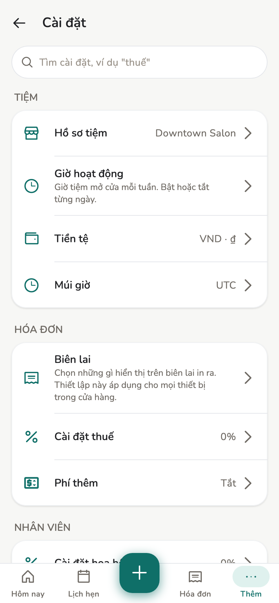
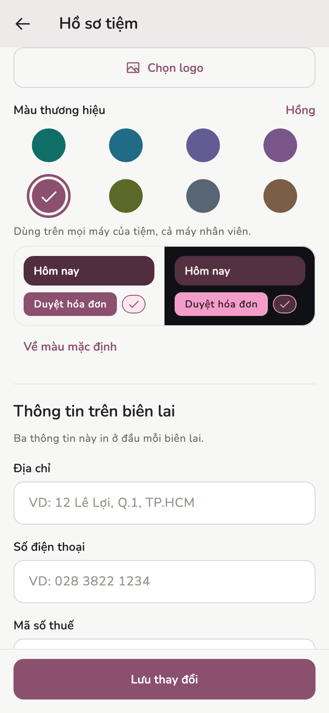

# Cài đặt tiệm

Hồ sơ tiệm, giờ mở cửa, hóa đơn, hoa hồng, ngôn ngữ, giao diện, widget.

## Tổng quan

**Cài đặt** chia mục tiệm thành **Tiệm**, **Hóa đơn** và **Nhân viên**,
rồi **Ứng dụng** cho máy này. Một số mục cần Chủ tiệm hoặc Quản lý, app
sẽ báo **Cần quyền chủ tiệm hoặc quản lý.** Mỗi mục hiện giá trị đang
dùng, như tiền tệ hay thuế suất; ô tìm kiếm trên cùng tìm cài đặt theo tên.

<figure class="shot-phone" markdown>
{ loading=lazy }
<figcaption>Cài đặt</figcaption>
</figure>

Tài khoản **Nhân viên** trên máy này chỉ thấy: Giao diện, Ngôn ngữ, Trợ
lý AI (nếu có), Xem lại hướng dẫn, Đồng bộ, Báo cáo lỗi & sử dụng.

## Cấu hình

**Tiệm**

- **Hồ sơ tiệm** — tên, logo, màu thương hiệu, ghi chú. Lưu từng phần.
- **Màu thương hiệu** — chọn 1 trong 8 màu. Nút, chip đang chọn, thẻ
  **Hôm nay** và thanh trên của máy tính bảng đổi theo màu đó, trên mọi máy
  của tiệm, cả máy nhân viên. Màn hồ sơ đổi màu ngay để xem trước; chỉ lưu
  khi bấm **Lưu thay đổi**. **Về màu mặc định** quay về Xanh ngọc. Màu trạng
  thái, biểu đồ báo cáo và biên lai in không đổi. Chủ tiệm hoặc Quản lý đổi.
- **Giờ hoạt động** — giờ salon mở cửa mỗi tuần.
- Tiền tệ: đổi chỉ đổi *cách hiện*, không đổi số đã chốt trên hóa đơn cũ.
- Múi giờ: đổi **không** dịch chuyển giờ lịch hẹn đã có.
- **Đặt lịch online** — trang công khai và hộp thư yêu cầu. Chủ tiệm bật.
  [Đặt lịch online](online-booking.md).

<figure class="shot-phone" markdown>
{ loading=lazy }
<figcaption>Màu thương hiệu, đang xem trước Hồng</figcaption>
</figure>

**Hóa đơn**

- **Biên lai** — biên lai in ra hiện những gì, áp dụng mọi máy của tiệm. Xem
  [In biên lai](../guide/printing.md).
- **Cài đặt thuế** — thuế suất mặc định. Thuế tính trên tạm tính *sau* giảm
  giá; tip không chịu thuế.
- **Phí thêm** — phần trăm cộng theo cách thanh toán. Tắt cho đến khi bật
  một dòng. Dòng Card fee đã có sẵn trong danh sách.

**Nhân viên**

- **Cài đặt hoa hồng** — % mặc định. Thứ tự ưu tiên: % đặt trên dịch vụ được
  dùng trước, rồi tới % của nhân viên, cuối cùng mới là mặc định của tiệm.
- **Lịch nhân viên** — tài khoản Nhân viên chỉ thấy lịch của họ hay thấy
  hết.
- **Quy tắc lượt** — gợi ý ai làm khách tiếp theo và cách đếm lượt. Xem
  [Lượt nhân viên](../guide/turns.md).

**Ứng dụng** (máy này)

- **Máy in nhiệt** — máy này in ra máy in Bluetooth nào. Khác với Biên lai,
  mục này không dùng chung: mỗi thiết bị có máy in riêng.
- **Ngôn ngữ** và **Giao diện** chỉ trên **thiết bị này**.
- **Trợ lý AI** — [trang riêng](../guide/ai-assistant.md).
- **Báo cáo lỗi & sử dụng** — ẩn danh, không gồm dữ liệu tiệm.

## Giới hạn

Widget lịch chỉ điện thoại. Máy Nhân viên chỉ thấy lịch *của mình* nếu tiệm
đặt **Lịch nhân viên → Chỉ của họ**.

## Trang liên quan

- [Đặt lịch online](online-booking.md)
- [Trợ lý AI](../guide/ai-assistant.md)
- [Dịch vụ và hoa hồng](../guide/services.md)
- [In biên lai](../guide/printing.md)
- [Máy tính bàn](desktop.md)
