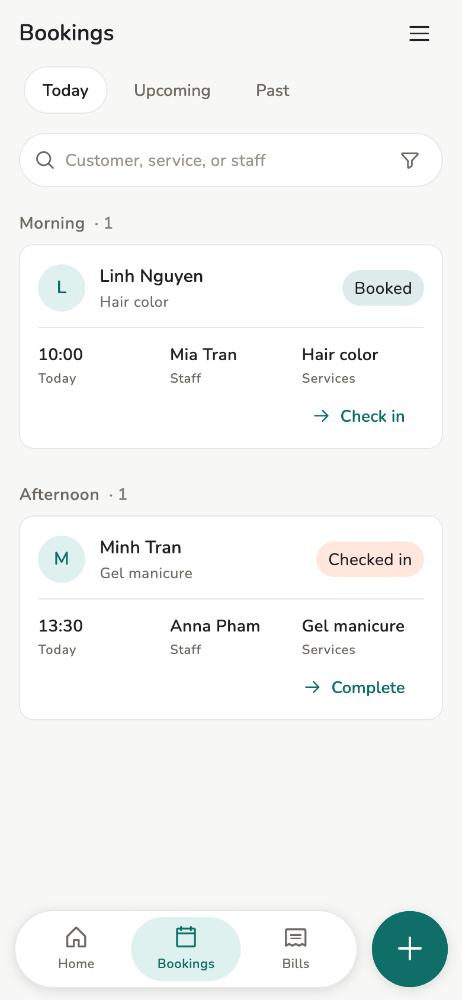
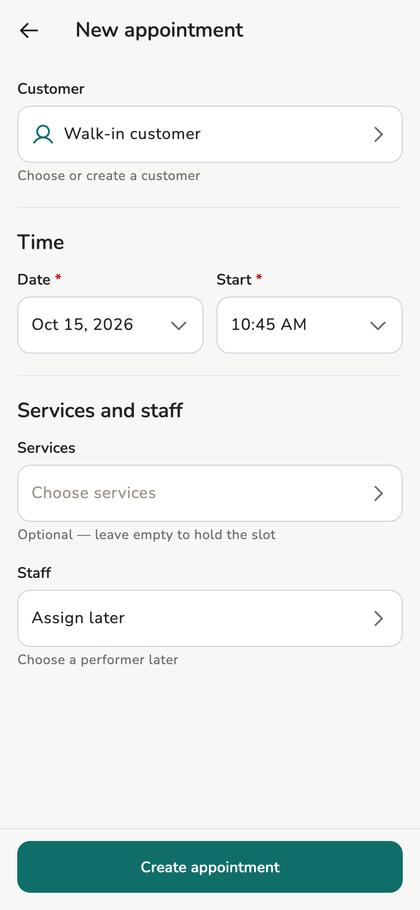
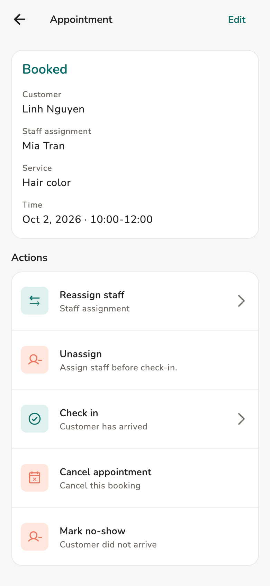

# Appointments

Book, check in, complete, cancel, mark no-show. Owner and Manager create
appointments.

## Overview

**Bookings**, the same tab for every role. **Staff cannot create appointments.**

A strip of days runs across the top; swipe it to move a week, or tap the
calendar icon to jump. **By staff** shows one column per staff member, plus
an **Unassigned** column when a booking has nobody, and a red line at the
current time. **List** shows the same day as rows. Tap an empty slot in a
column to book that time with that person.

On a tablet the month calendar and a staff filter sit on the left, and the
booking you tap opens on the right.

<figure class="shot-phone" markdown>
{ loading=lazy }
<figcaption>Phone</figcaption>
</figure>

<figure class="shot-wide" markdown>
{ loading=lazy }
<figcaption>Tablet and desktop</figcaption>
</figure>

## Prerequisites

Have [services](services.md) and [staff](staff.md) (a person or virtual
staff). The time must match [availability](schedule.md).

## Usage

=== "Owner / Manager"

    Phone: tap **+** in the bottom bar, then **New appointment**. Tablet or
    desktop: **Booking** in the top bar. Then fill in:

    1. Customer (quick-create if needed)
    2. Services — more than one is allowed
    3. Staff — a real person or virtual staff; you can leave **unassigned**
       and assign later
    4. Time — the app checks availability

    If they are not free, the booking is refused; change the time or the
    person.

=== "Staff"

    **Bookings**: appointments assigned to them, or the whole store if
    **Staff bookings** is **Whole store**. They do **not** get **New
    appointment**. They start **New invoice** from **+**.

<figure markdown>
{ loading=lazy }
<figcaption>New appointment</figcaption>
</figure>

<figure markdown>
{ loading=lazy }
<figcaption>Appointment detail</figcaption>
</figure>

## Concepts

| Status | Meaning |
| --- | --- |
| Booked | Not yet arrived |
| Check in | Customer is here |
| Complete | Done — usually continue to an [invoice](invoices.md) |
| Cancelled | Will not happen |
| No-show | Did not arrive |

Unassigned bookings sit in **Needs attention** on Today. Assign / reassign / unassign on
the detail screen — do not create a second booking.

Owner / Manager change status on appointment detail. Staff see bookings they
are allowed to see; they do not run the lifecycle the way a manager does.

Customers can also send a request from the public page. That is **not**
a booked appointment until Owner or Manager **Confirm**. See
[Online booking](../admin/online-booking.md).

## Related pages

- [Online booking](../admin/online-booking.md)
- [Availability](schedule.md)
- [Customers](customers.md)
- [Invoices and receipts](invoices.md)
