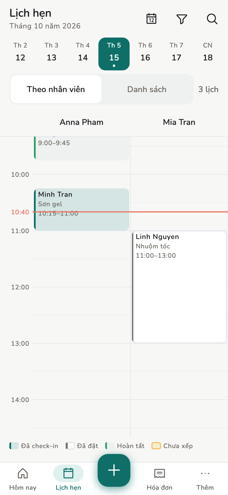
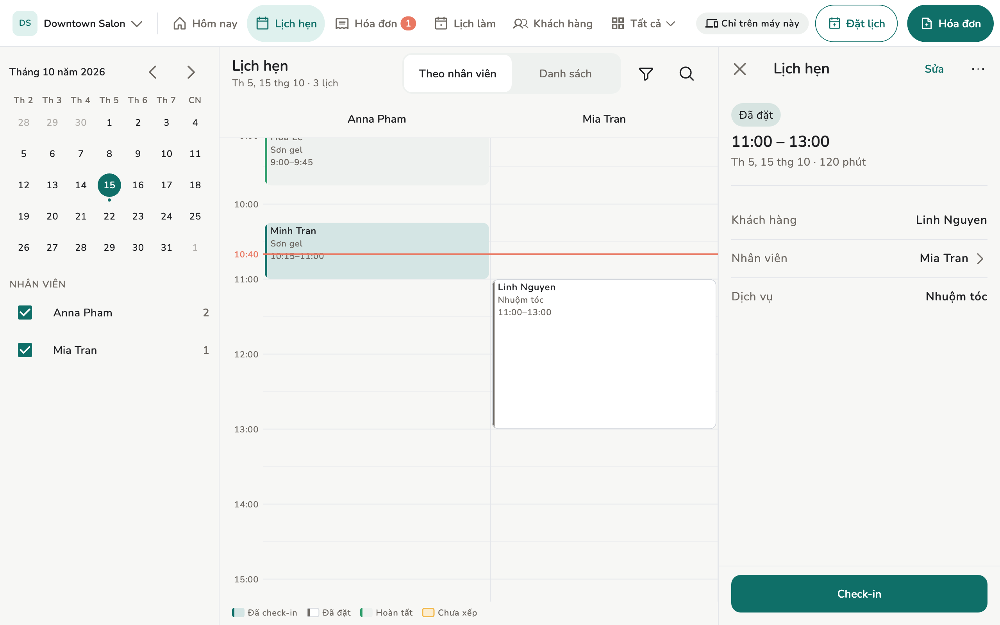
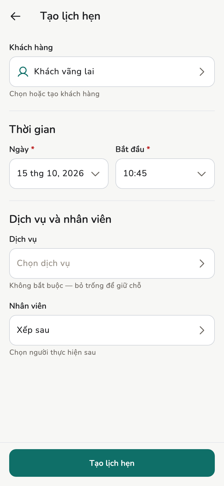
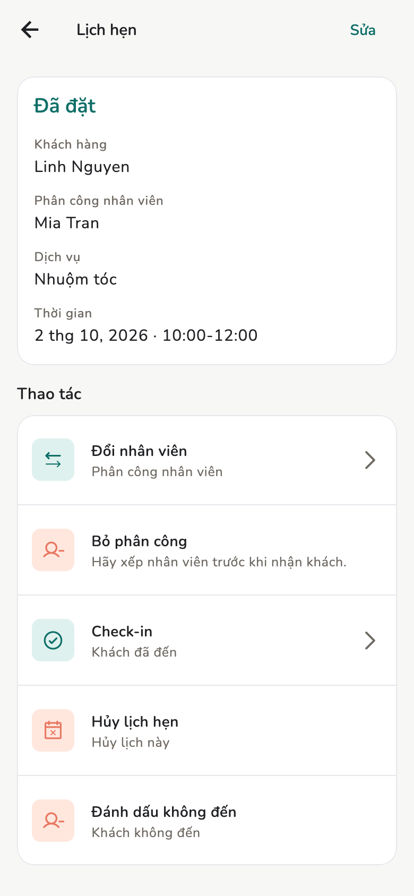

# Lịch hẹn

Đặt lịch, check-in, hoàn tất, hủy, hoặc đánh dấu khách không đến. Chỉ Chủ
tiệm và Quản lý tạo lịch mới.

## Tổng quan

Màn **Lịch hẹn** (Chủ / Quản lý) hoặc **Lịch của tôi** (Nhân viên). Nhân viên
**không** có nút đặt lịch mới.

Trên cùng là dải ngày; vuốt để sang tuần khác, hoặc bấm biểu tượng lịch để
nhảy tới ngày cần xem. **Theo nhân viên** chia mỗi nhân viên một cột, thêm
cột **Chưa xếp** khi có lịch chưa gán ai, và một vạch đỏ ở giờ hiện tại.
**Danh sách** hiện cùng ngày đó thành từng dòng. Bấm vào chỗ trống trong một
cột để đặt lịch đúng giờ đó với người đó.

Trên máy tính bảng, lịch tháng và bộ lọc nhân viên nằm bên trái; lịch bạn
bấm vào mở ra bên phải.

<figure class="shot-phone" markdown>
{ loading=lazy }
<figcaption>Điện thoại</figcaption>
</figure>

<figure class="shot-wide" markdown>
{ loading=lazy }
<figcaption>Máy tính bảng và máy tính bàn</figcaption>
</figure>

## Điều kiện

Có [dịch vụ](services.md) và [nhân viên](staff.md) (người thật hoặc nhân viên
ảo). Giờ phải khớp [lịch làm việc](schedule.md).

## Cách làm

=== "Chủ tiệm / Quản lý"

    Điện thoại: bấm **+** ở thanh dưới, chọn **Đặt lịch mới**. Máy tính bảng
    và máy tính bàn: nút **Đặt lịch** trên thanh trên cùng. Rồi điền:

    1. Khách (tạo nhanh nếu chưa có)
    2. Dịch vụ — có thể nhiều dịch vụ
    3. Nhân viên — người thật hoặc nhân viên ảo; có thể để **chưa gán** rồi
       gán sau
    4. Giờ — app kiểm tra rảnh

    Không rảnh thì không đặt được. Đổi giờ, hoặc đổi người.

=== "Nhân viên"

    Tab **Lịch của tôi**: lịch gán cho họ, hoặc cả tiệm nếu **Lịch nhân viên**
    là **Cả tiệm**. Họ **không** có **Đặt lịch mới**. Họ lập **Hóa đơn mới**
    từ nút **+**.

<figure markdown>
{ loading=lazy }
<figcaption>Đặt lịch mới</figcaption>
</figure>

<figure markdown>
{ loading=lazy }
<figcaption>Chi tiết lịch hẹn</figcaption>
</figure>

## Khái niệm

| Trạng thái | Việc |
| --- | --- |
| Đã đặt | Chưa tới (**Hôm nay** / **Sắp tới** / **Đã qua**) |
| **Check-in** | Khách có mặt |
| **Hoàn tất** | Xong, thường chuyển sang [hóa đơn](invoices.md) |
| Hủy | Không làm |
| **Đánh dấu không đến** | Khách không tới |

Lịch chưa gán: **Cần xếp nhân viên**. **Xếp ngay** / **Xếp sau** trên chi tiết
— không tạo lịch mới.

Chủ tiệm và Quản lý đổi trạng thái ngay trong màn chi tiết. Nhân viên chỉ
xem được lịch trong phạm vi cho phép, không đổi trạng thái.

Khách còn gửi được yêu cầu từ trang công khai. Đó **chưa** phải lịch đã
đặt cho đến khi Chủ tiệm hoặc Quản lý **Xác nhận**. Xem
[Đặt lịch online](../admin/online-booking.md).

## Trang liên quan

- [Đặt lịch online](../admin/online-booking.md)
- [Giờ rảnh](schedule.md)
- [Khách hàng](customers.md)
- [Hóa đơn và biên lai](invoices.md)
