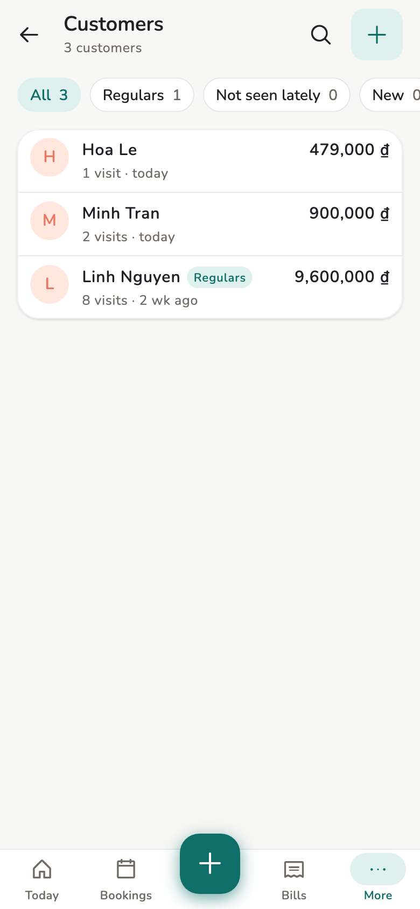
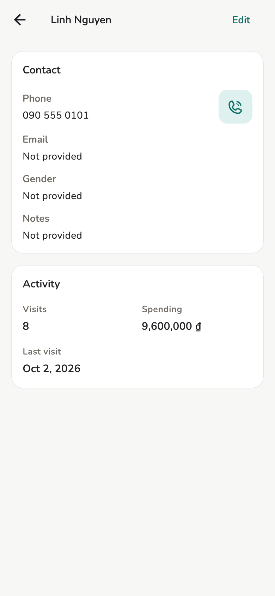

# Customers

This **store’s** contact list. There is no company-wide cloud profile.

## Overview

Name, phone, optional photo. Duplicate phone: the app warns — you decide (no
automatic merge).

Each row shows visits, when they last came, and what they have spent. The
chips sort the list into **Regulars**, **Not seen lately**, and **New**, with
a count on each.

<figure class="shot-phone" markdown>
{ loading=lazy }
<figcaption>Customers</figcaption>
</figure>

## Usage

=== "Owner / Manager"

    **More → Customers** on a phone, the **Customers** tab on a tablet or
    desktop, or from the booking / bill form.

=== "Staff"

    No Customers row under **More**. Create a customer from the **New
    invoice** form.

Customer detail: **Call**, **Book**, and **New bill** at the top, then
visits, spending, and history from store data on the device.

<figure markdown>
{ loading=lazy }
<figcaption>Customer detail</figcaption>
</figure>

An invoice with no customer can count as walk-in — **Customer mix** on
[Reports](reports.md) splits that group.

## Related pages

- [Appointments](appointments.md)
- [Invoices and receipts](invoices.md)
- [Reports](reports.md)
