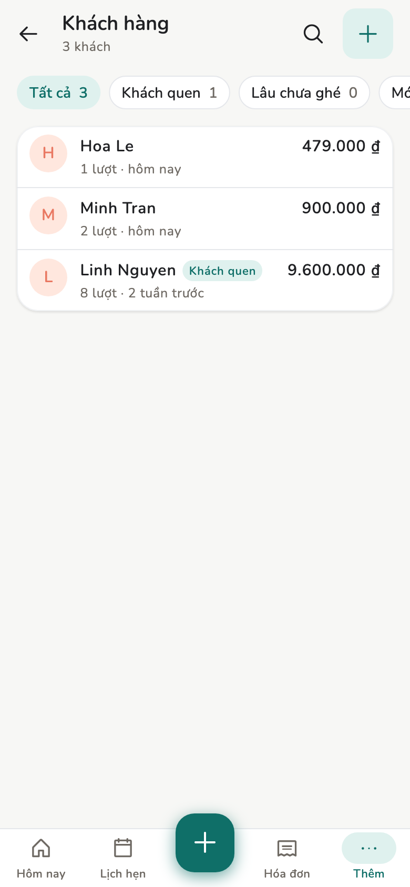
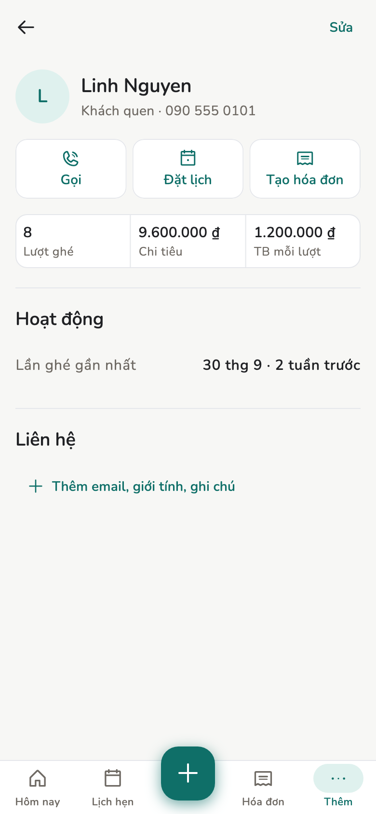

# Khách hàng

Danh bạ khách **của tiệm này**. Không có hồ sơ khách dùng chung trên cloud.

## Tổng quan

Tên, số điện thoại, ảnh nếu muốn. Trùng số thì app cảnh báo, bạn tự quyết
có dùng luôn hay tạo mới (không gộp tự động).

Mỗi dòng hiện số lượt, lần ghé gần nhất và tổng chi tiêu. Các nút lọc chia
danh sách thành **Khách quen**, **Lâu chưa ghé** và **Mới**, mỗi nút kèm số
khách.

<figure class="shot-phone" markdown>
{ loading=lazy }
<figcaption>Khách hàng</figcaption>
</figure>

## Cách làm

=== "Chủ tiệm / Quản lý"

    Điện thoại: **Thêm → Khách hàng**. Máy tính bảng / máy tính bàn: tab
    **Khách hàng**. Hoặc ngay trên form đặt lịch / hóa đơn.

=== "Nhân viên"

    Không có ô Khách hàng trong **Thêm**. Tạo khách từ form **Hóa đơn mới**.

Chi tiết khách có ba nút **Gọi**, **Đặt lịch**, **Tạo hóa đơn** ở trên cùng,
rồi số lượt, chi tiêu và lịch sử, lấy từ dữ liệu tiệm trên máy.

<figure markdown>
{ loading=lazy }
<figcaption>Chi tiết khách</figcaption>
</figure>

Hóa đơn không gắn khách có thể là khách vãng lai. Báo cáo **Cơ cấu khách** tách
nhóm này.

## Trang liên quan

- [Lịch hẹn](appointments.md)
- [Hóa đơn và biên lai](invoices.md)
- [Báo cáo](reports.md)
