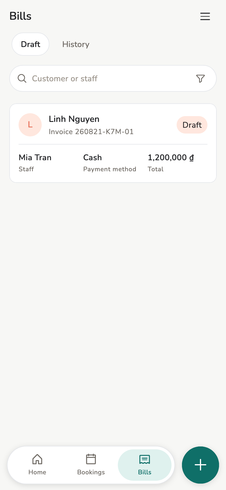
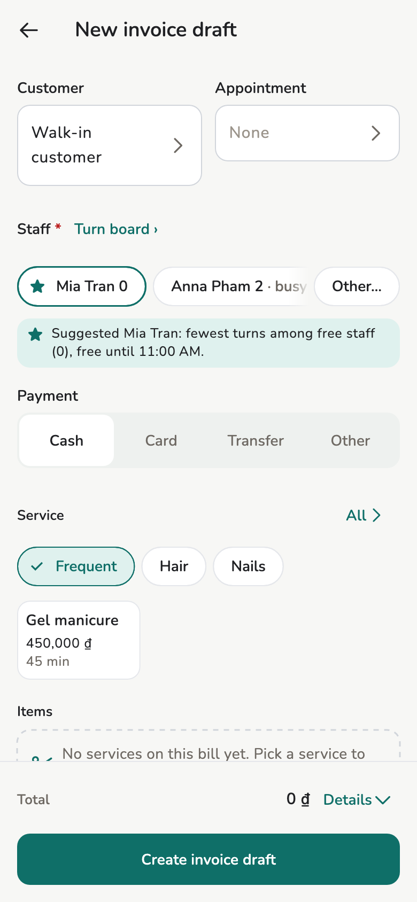
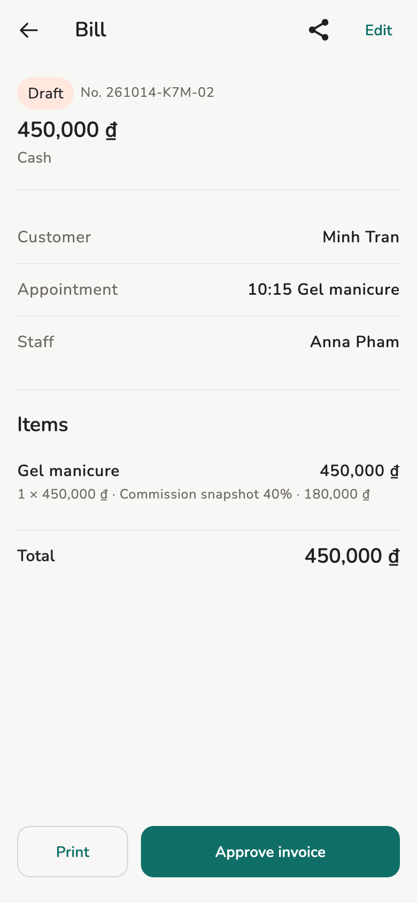

# Invoices and receipts

Draft, approve, print. Staff create drafts; Owner / Manager approve.

## Overview

**Bills**; Staff see only their own. On approve, price, tax, extra fees, and commission
**freeze**.

The top card shows what was approved today and how it splits by payment
method. Drafts come next under **Waiting for approval**, then the bills
already approved, grouped by day. The chips filter by drafts or payment
method.

An Owner or Manager can tap **Approve** on a draft row without opening it.
**Undo** stays on screen for five seconds, and nothing is written until it
goes. On a tablet, bills are a table and the one you tap opens on the right.

<figure class="shot-phone" markdown>
{ loading=lazy }
<figcaption>Phone</figcaption>
</figure>

<figure class="shot-wide" markdown>
{ loading=lazy }
<figcaption>Tablet and desktop</figcaption>
</figure>

## Usage

**+** → **New invoice** on a phone, **Bill** in the top bar on a tablet or
desktop, or after completing an appointment. The form is one screen, with
the total always at the bottom:

- Optional customer (walk-in if empty) and appointment
- Staff, picked from chips. With suggestions on, the chips are in turn
  order and the person who should take the next customer has a star; see
  [Staff turns](turns.md)
- Payment method, picked from chips
- Services: tap one to add it. **Frequent** shows the ones used most; the
  other chips are your categories, and **All** opens the full list
- Discount, tax (store default if enabled), tip, extra fees under
  **Adjustments**; **Details** under the total shows how it adds up

An extra fee is a store add-on — not a service, not tax, not a bank charge.
Turn it on in **Settings → Billing → Extra fees** (the row after Tax). It is
off until you enable one. A Card fee applies when the bill is Card. On a
draft you can waive it for that bill. The receipt prints the stored name
and amount, then the total.

### Promotions on a bill

Promotions price the bill on their own. A promoted line shows the usual price
struck through and the sale price. Anyone who can edit the draft can take a
promotion off a line. Details: [Promotions](promotions.md#bill).

!!! tip "Voice on a phone"

    **Hold to talk** on the bill form. Needs **Settings → AI assistant →
    Voice commands** and the microphone. It fills the open form — **it does
    not approve**. Nothing is recorded or sent. Spoken service prices are
    ignored.

<figure markdown>
{ loading=lazy }
<figcaption>New invoice</figcaption>
</figure>

<figure markdown>
{ loading=lazy }
<figcaption>Invoice detail</figcaption>
</figure>

Owner / Manager: **Approve invoice**. Staff submit drafts; they do not
approve their own.

After approval, there is no overwrite:

- **Void invoice** — cancel the whole bill when no money was kept
- Refund — return part or a tip within the remaining limit

## Configuration

**Print** at the foot of an invoice, and what **Settings → Receipt** puts on
the paper, have their own page: [Printing](printing.md). That is also where
the **PROVISIONAL BILL** and **COPY** stamps are explained.

## Related pages

- [Printing](printing.md)
- [Promotions](promotions.md)
- [Store settings](../admin/store-settings.md)
- [Appointments](appointments.md)
- [AI assistant](ai-assistant.md)
- [Earnings](earnings.md)
