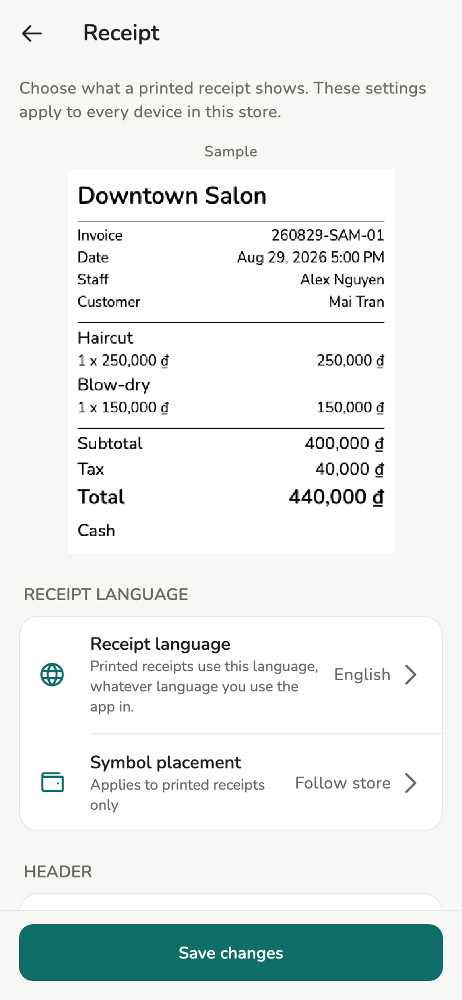

# Printing

What comes out of the printer, and what decides it.

## Overview

**Print** sits at the bottom of every invoice. There are two ways it can go
out: as a PDF through your device's own print dialog, which needs no setup at
all, or straight to a Bluetooth thermal printer you have paired with Salony.

<figure class="shot-phone" markdown>
{ loading=lazy }
<figcaption>Print at the foot of an invoice</figcaption>
</figure>

## Usage

Which document you get depends on the invoice, not on a menu:

| Invoice | What prints |
| --- | --- |
| Draft | **PROVISIONAL BILL** — what is owed, with no payment method and no amount paid |
| Approved, printed for the first time | The receipt, no banner |
| Approved, printed before | The same receipt stamped **COPY** |

A voided or refunded invoice also carries **VOIDED**, **REFUNDED** or
**PARTIALLY REFUNDED** across it, so the paper matches the record.

Applied extra fees print as their own lines, using the name stored on the
bill, then the total. A waived or zero fee is omitted, like a zero tip. The
paper does not call it a bank or card-processor fee.

!!! warning "Why reprints are stamped"

    An unmarked reprint can be brought back to claim a second refund. Only
    the first print of an approved invoice comes out unmarked, and Salony
    remembers which one that was. Provisional bills do not count: print the
    draft as many times as the customer asks and the receipt is still an
    original.

The share icon in the invoice title bar sends the same PDF and records
nothing. Sending a customer their receipt in a chat does not use up the
original, so the paper copy you print afterwards is still unmarked.

## Thermal printers

Salony sends a receipt straight to a thermal printer, over Bluetooth or the
salon network. Which printers work, how to pair one, and how to test it:
[Thermal printers](printers.md).

## Configuration

**Settings → Receipt**, Owner or Manager. It applies to every device in the
store, not only the one you change it on.

<figure class="shot-phone" markdown>
{ loading=lazy }
<figcaption>Settings → Receipt</figcaption>
</figure>

- **Receipt language** — separate from the app language. Staff working in
  English still hand out Vietnamese receipts.
- **Symbol placement** — printed receipts only. **Follow store** keeps the
  store's setting.
- **Header** — Store logo, Address, Phone number, Tax ID.
- **Details** — Staff name, Customer name, Tax breakdown, Payment method.
  Payment method never prints on a provisional bill.
- **Header text** and **Footer text** — free lines under the store name and
  at the foot, for example a thank-you.

A sample receipt at the top of the screen updates as you change these,
before you save. It is not a real invoice and does not use up the original.

One **Save changes** at the bottom covers the whole screen.

## Limitations

The sample on Settings → Receipt is the template preview. A thermal printer
still has **Print a test receipt** the first time, which times the hardware
rather than showing the layout.

The receipt language offers two options, English and Vietnamese. The reason is
the PDF path: its font has no Chinese glyphs, so a Chinese receipt would come
out as empty boxes. The thermal path paints pixels and in principle would not
have that problem, but nobody has printed one on paper to confirm it, and the
two paths share one setting. So the list stops at two.

## Related pages

- [Invoices and receipts](invoices.md)
- [Thermal printers](printers.md)
- [Store settings](../admin/store-settings.md)
- [Desktop](../admin/desktop.md)
