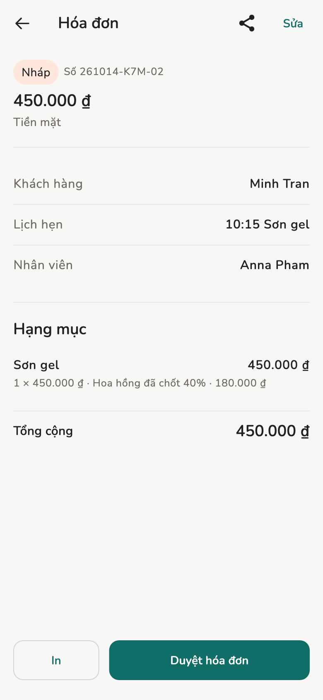
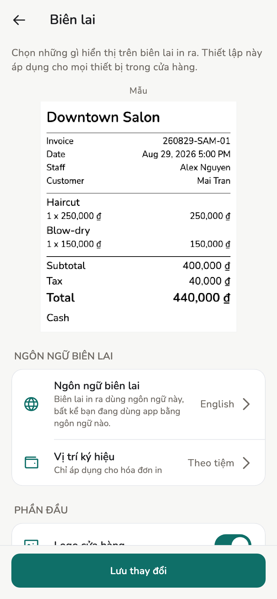

# In biên lai

Máy in ra tờ gì, và cái gì quyết định điều đó.

## Tổng quan

Nút **In** nằm dưới cùng mỗi hóa đơn. Có hai đường ra: xuất PDF rồi giao cho
hộp thoại in của máy, cách này không cần cài gì; hoặc gửi thẳng tới máy in
nhiệt bạn đã ghép với Salony, qua Bluetooth hoặc qua mạng của tiệm.

<figure class="shot-phone" markdown>
{ loading=lazy }
<figcaption>Nút In dưới cùng hóa đơn</figcaption>
</figure>

## Cách làm

In ra tờ gì là do trạng thái hóa đơn quyết định, không phải do bạn chọn:

| Hóa đơn | In ra |
| --- | --- |
| Nháp | **PHIẾU TẠM TÍNH**: số tiền phải trả, không có phương thức thanh toán, không có số đã thu |
| Đã duyệt, in lần đầu | Biên lai, không đóng dấu gì |
| Đã duyệt, đã in rồi | Vẫn biên lai đó nhưng đóng dấu **BẢN SAO** |

Hóa đơn đã hủy hoặc đã hoàn tiền còn in kèm dòng **ĐÃ HỦY**, **ĐÃ HOÀN TIỀN**
hoặc **ĐÃ HOÀN MỘT PHẦN**, để tờ giấy khớp với sổ sách.

Phí thêm đã áp in thành dòng riêng, dùng tên lưu trên hóa đơn, rồi tới tổng.
Phí đã miễn hoặc bằng 0 thì không in, giống tip bằng 0. Tờ giấy không gọi đó
là phí ngân hàng hay phí máy thẻ.

!!! warning "Vì sao bản in lại bị đóng dấu"

    Một bản in lại không đánh dấu có thể bị mang tới đòi hoàn tiền lần thứ
    hai. Chỉ lần in đầu tiên của hóa đơn đã duyệt mới sạch dấu, và Salony nhớ
    lần đó là lần nào. Phiếu tạm tính không tính: in nháp bao nhiêu lần khách
    muốn cũng được, biên lai sau đó vẫn là bản gốc.

Nút chia sẻ trên thanh tiêu đề hóa đơn gửi đúng file PDF đó nhưng không ghi
nhận gì. Gửi biên lai cho khách qua tin nhắn không tiêu mất bản gốc, nên tờ
giấy bạn in sau đó vẫn sạch dấu.

## Máy in nhiệt

Salony gửi thẳng biên lai tới máy in nhiệt, qua Bluetooth hoặc qua mạng của
tiệm. Máy nào dùng được, cách ghép và cách in thử: [Máy in nhiệt](printers.md).

## Cấu hình

**Cài đặt → Biên lai**, cần Chủ tiệm hoặc Quản lý. Sửa ở một máy là áp dụng
cho mọi máy của tiệm.

<figure class="shot-phone" markdown>
{ loading=lazy }
<figcaption>Cài đặt → Biên lai</figcaption>
</figure>

- **Ngôn ngữ biên lai**: tách riêng khỏi ngôn ngữ app. Nhân viên xài app
  tiếng Anh vẫn đưa khách biên lai tiếng Việt.
- **Vị trí ký hiệu**: chỉ áp dụng cho hóa đơn in. Chọn **Theo tiệm** thì giữ
  nguyên thiết lập của tiệm.
- **Phần đầu**: Logo cửa hàng, Địa chỉ, Số điện thoại, Mã số thuế.
- **Chi tiết**: Tên nhân viên, Tên khách hàng, Chi tiết thuế, Phương thức
  thanh toán. Phương thức thanh toán không bao giờ in trên phiếu tạm tính.
- **Chữ phần đầu** và **Chữ chân trang**: dòng tự do đặt dưới tên tiệm và ở
  cuối tờ, ví dụ lời cảm ơn.

Một biên lai mẫu ở đầu màn hình đổi theo từng chỉnh, trước khi lưu. Đó
không phải hóa đơn thật và không tính là bản gốc.

Một nút **Lưu thay đổi** ở dưới cùng lưu cả màn hình.

## Giới hạn

Mẫu trên **Cài đặt → Biên lai** là xem trước template. Máy in nhiệt vẫn có
**In thử một biên lai** lần đầu, để đo tốc độ máy chứ không phải để xem
layout.

Ngôn ngữ biên lai chỉ có hai lựa chọn: tiếng Anh hoặc tiếng Việt. Lý do nằm ở
đường PDF, vì font nó dùng không có chữ Trung, nên một tờ biên lai tiếng Trung
sẽ ra toàn ô vuông. Đường in nhiệt vẽ điểm ảnh nên về nguyên tắc không vướng
chỗ đó, nhưng chưa ai in thử ra giấy để xác nhận, mà hai đường lại dùng chung
một thiết lập. Vì vậy danh sách ngôn ngữ dừng ở hai.

## Trang liên quan

- [Hóa đơn và biên lai](invoices.md)
- [Máy in nhiệt](printers.md)
- [Cài đặt tiệm](../admin/store-settings.md)
- [Máy tính bàn](../admin/desktop.md)
