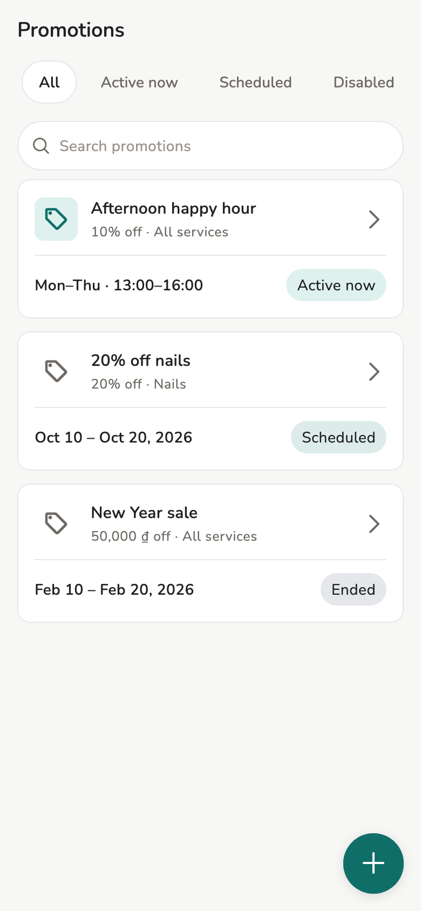
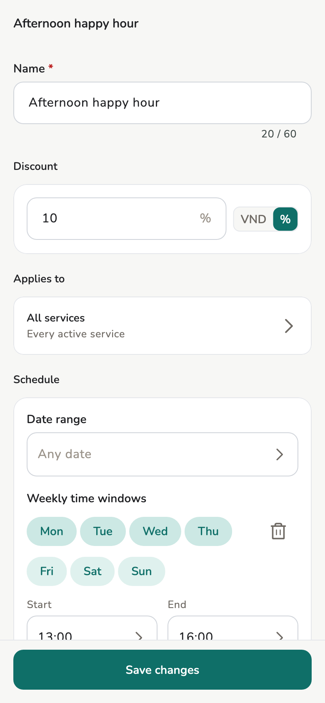

# Promotions

Sale campaigns by date and happy hours by weekly time window. The app prices
the bill on its own, so nobody has to remember a sale or work it out.

## Overview

Owner / Manager: **More → Promotions**, the row right after Services. On a
tablet or desktop it is the **Promotions** tile on Home, right after
Services. Staff have no Promotions entry.

<figure class="shot-phone" markdown>
{ loading=lazy }
<figcaption>More → Promotions</figcaption>
</figure>

## Usage

### Add a promotion

To add one, tap **+** at the bottom; on an empty list, tap **Add
promotion**. Then fill in:

- **Name** — printed on bills and receipts exactly as typed, up to 60
  characters. It is never translated.
- **Discount** — a percent, or an amount in the store currency. An amount
  never makes a cheap service free.
- **Applies to** — all services, chosen categories, or chosen services.
- **Date range** for a sale campaign ("Oct 10 – Oct 20"), **Weekly time
  windows** for a happy hour ("Mon–Thu 13:00–16:00"), or both. At least one
  is required. End 00:00 means midnight at the end of the day.
- Dates and times follow the store time zone, not the phone's.

<figure markdown>
{ loading=lazy }
<figcaption>A happy hour by weekly time window</figcaption>
</figure>

### The list

The list shows each promotion as **Active now**, **Scheduled**, **Ended**,
or **Disabled**. The pills at the top filter by status. Search finds a
promotion by its name or by what it applies to, so "nails" finds a sale on
the Nails category. There is no delete: turn **Enabled** off to stop one.

A bill line gets **one** promotion: the one that saves the most. Promotions
never stack. Editing a promotion changes drafts only when they are saved
again, and never changes an approved bill.

## On the bill and the receipt { #bill }

Promotions price the bill on their own; nobody picks them. A matched line shows the usual price struck
through, the sale price, the promotion name, and what the line saves.
Subtotal and total use the sale price. A manual discount comes off that
promoted subtotal, as today.

- **Which time counts**: a bill linked to an appointment uses the
  appointment start, so a 15:30 happy-hour booking keeps its price even if
  the bill is made at 16:10. A walk-in uses the time the bill was created.
  The form says which, above the lines.
- **Remove / Re-apply**: anyone who can edit the draft, staff included, can
  take the promotion off a line. The line goes back to the usual price and
  stays marked "Removed on this bill" so the approver sees it. Approving
  such a bill shows a reminder.
- **Prices changed**: if a promotion or the appointment time changed since
  the draft was saved, the form shows the new prices and the saved total
  before you save. If the price moves while a new bill is open (a happy hour
  ends at 16:00), the first tap on save stops and shows why; tap again.
- Voice-added services get the same promotion as tapped ones.

The receipt prints each promoted item at its usual price, then a line
`<promotion name> -<saving>`, and one **You saved** line after the total.
A removed promotion does not print.

Reports have a **Promotion savings** section: see [Reports](reports.md).
Commission on a promoted line is based on the sale price: see
[Services and commission](services.md).

## Related pages

- [Invoices and receipts](invoices.md)
- [Services and commission](services.md)
- [Reports](reports.md)
- [Printing](printing.md)
