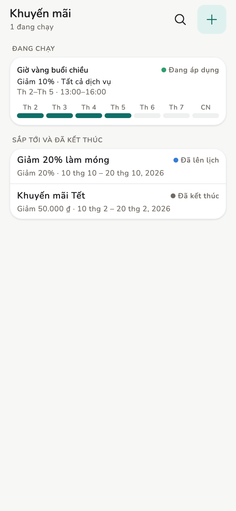
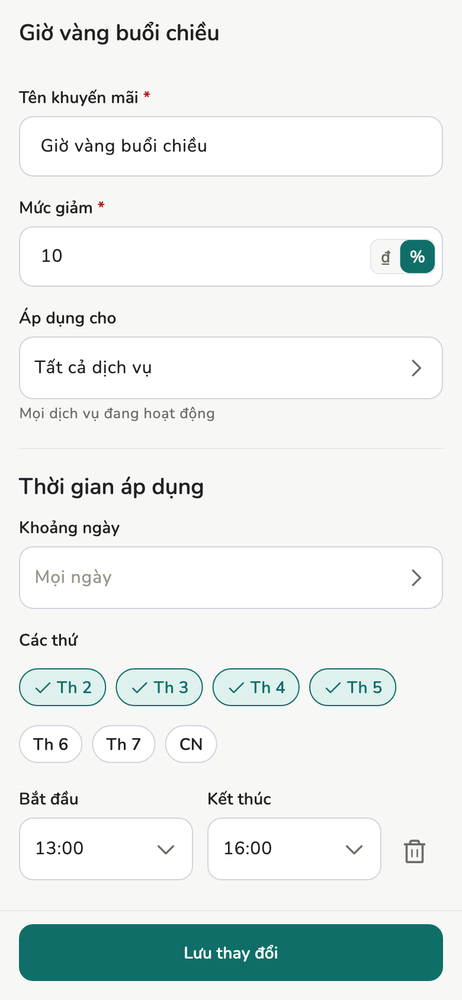

# Khuyến mãi

Đợt giảm giá theo ngày và giờ vàng theo khung giờ trong tuần. App tự tính
vào hóa đơn, không ai phải nhớ hay tự trừ.

## Tổng quan

Chủ / Quản lý: **Thêm → Khuyến mãi**, dòng cuối nhóm **Tiền**. Trên máy tính
bảng / máy tính bàn, mở **Tất cả → Khuyến mãi** trên thanh trên cùng. Nhân
viên không có mục Khuyến mãi.

<figure class="shot-phone" markdown>
{ loading=lazy }
<figcaption>Thêm → Khuyến mãi</figcaption>
</figure>

## Cách làm

### Thêm khuyến mãi

Để thêm, bấm **+** ở dưới; khi danh sách còn trống, bấm **Thêm khuyến mãi**.
Rồi điền:

- **Tên**: in trên hóa đơn và biên lai đúng như gõ, tối đa 60 ký tự. Không
  bao giờ được dịch.
- **Giảm giá**: theo phần trăm, hoặc một số tiền theo tiền tệ của tiệm. Giảm
  theo số tiền không bao giờ làm dịch vụ rẻ thành miễn phí.
- **Áp dụng cho**: mọi dịch vụ, một số danh mục, hoặc một số dịch vụ.
- **Khoảng ngày** cho đợt giảm giá ("10/10 – 20/10"), **Khung giờ hằng tuần**
  cho giờ vàng ("T2–T5, 13:00–16:00"), hoặc cả hai. Phải có ít nhất một. Giờ
  kết thúc 00:00 nghĩa là nửa đêm cuối ngày.
- Ngày giờ tính theo múi giờ của tiệm, không theo điện thoại.

<figure markdown>
{ loading=lazy }
<figcaption>Giờ vàng theo khung giờ hằng tuần</figcaption>
</figure>

### Danh sách

Danh sách ghi trạng thái từng khuyến mãi: **Đang áp dụng**, **Đã lên lịch**,
**Đã kết thúc**, hoặc **Đã tắt**. Các nút ở trên lọc theo trạng thái. Ô tìm
kiếm tìm theo tên hoặc theo nơi áp dụng, nên gõ "móng" sẽ ra đợt giảm giá cho
danh mục Móng. Không có xoá: muốn ngừng thì gạt công tắc **Bật** sang tắt.

Mỗi dòng hóa đơn chỉ nhận **một** khuyến mãi, là cái giảm nhiều nhất. Không
cộng dồn. Sửa khuyến mãi chỉ đổi hóa đơn nháp khi nháp đó được lưu lại, và
không bao giờ đổi hóa đơn đã duyệt.

## Trên hóa đơn và biên lai { #bill }

Khuyến mãi tự tính vào hóa đơn, không ai phải chọn. Dòng được giảm hiện giá gốc gạch ngang, giá sau giảm, tên
khuyến mãi, và số tiền dòng đó được bớt. Tạm tính và tổng dùng giá sau giảm.
Giảm giá tay vẫn trừ tiếp trên tạm tính đó như trước.

- **Tính theo giờ nào**: hóa đơn gắn lịch hẹn dùng giờ bắt đầu lịch hẹn, nên
  khách hẹn 15:30 trong giờ vàng vẫn giữ giá dù 16:10 mới lập hóa đơn. Khách
  vãng lai dùng lúc tạo hóa đơn. Form ghi rõ giờ nào, ngay trên các dòng.
- **Bỏ / Áp dụng lại**: ai sửa được nháp, kể cả nhân viên, đều bỏ được khuyến
  mãi trên một dòng. Dòng đó về giá gốc và vẫn ghi "Đã bỏ trên hóa đơn này"
  để người duyệt thấy. Khi duyệt hóa đơn như vậy app sẽ nhắc.
- **Giá đã đổi**: nếu khuyến mãi hoặc giờ hẹn đổi từ lần lưu nháp trước, form
  hiện giá mới cùng tổng đã lưu trước khi bạn lưu. Nếu giá đổi trong lúc đang
  mở hóa đơn mới (giờ vàng hết lúc 16:00), lần bấm lưu đầu sẽ dừng lại và
  báo lý do; bấm lần nữa.
- Dịch vụ thêm bằng giọng nói được giảm như dịch vụ bấm tay.

Biên lai in từng dịch vụ được giảm theo giá gốc, kèm dòng
`<tên khuyến mãi> -<số tiền giảm>`, rồi một dòng **Bạn đã tiết kiệm** sau
tổng. Khuyến mãi đã bỏ thì không in.

Báo cáo có mục **Tiết kiệm nhờ khuyến mãi**: xem [Báo cáo](reports.md). Hoa
hồng của dòng có khuyến mãi tính trên giá sau giảm: xem
[Dịch vụ và hoa hồng](services.md).

## Trang liên quan

- [Hóa đơn và biên lai](invoices.md)
- [Dịch vụ và hoa hồng](services.md)
- [Báo cáo](reports.md)
- [In biên lai](printing.md)
