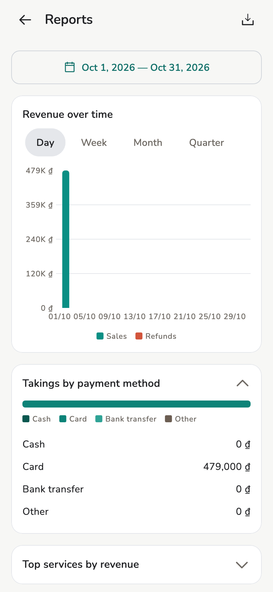

# Reports

Revenue, customer mix, CSV, on-device AI summary.

## Overview

Owner / Manager see the whole store. Staff: **My reports** — *theirs*, not
the store.

<figure class="shot-phone" markdown>
{ loading=lazy }
<figcaption>Reports</figcaption>
</figure>

## Usage

The page has: revenue by day / week / month / quarter / year (gross, refunds,
net); **Extra fees collected** under Gross revenue (part of gross, not
subtracted); average ticket; tax, tips, commission, payouts; top services
(service lines only — extra fees are not a service); missed appointments;
**Customer mix**; payment mix (invoice total, extra fees included); staff
performance (owner/manager).

**Promotion savings** (after top services) shows how much promotions took
off bills approved in the period, in total and per promotion, with how many
bills used each. It is not revenue — the customer was never charged it — so
gross and net revenue, payment mix, and average ticket stay as they are.
Top services already count the sale price. A refund does not reduce
savings. The section is hidden when the period has none. Staff see their
own bills in **My reports**.

An empty range means there is no data in that window.

**Export** downloads a CSV on your device — not a cloud report emailed to
you. Invoice CSV has a **Fees** column between Tip and Commission; void and
refund rows are negative. A **Promotion savings** column sits between
Currency and Tax; it is 0 on void and refund rows and on bills without
promotions.

**Analyse with AI** / **Automatic summary** runs on the device after the
model is downloaded. See [AI assistant](ai-assistant.md).

## Related pages

- [AI assistant](ai-assistant.md)
- [Earnings](earnings.md)
- [Customers](customers.md)
