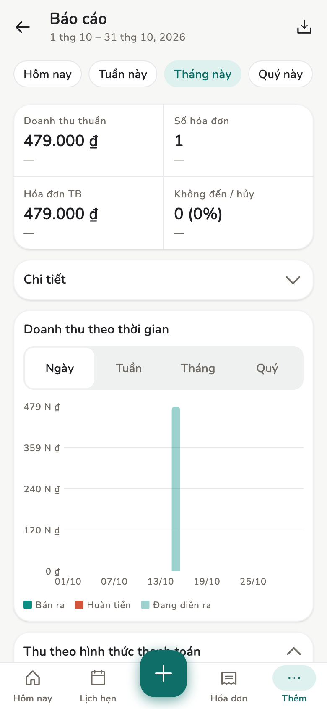

# Báo cáo

Doanh thu, cơ cấu khách, xuất CSV, tóm tắt AI ngay trên máy.

## Tổng quan

Chủ / Quản lý xem số cả tiệm. Nhân viên chỉ thấy **Báo cáo của tôi**.

<figure class="shot-phone" markdown>
{ loading=lazy }
<figcaption>Báo cáo</figcaption>
</figure>

## Cách làm

Trang này có doanh thu theo ngày, tuần, tháng, quý, năm (tổng thu, tiền hoàn,
thực thu). **Phí thêm đã thu** nằm ngay dưới doanh thu gộp (nằm trong tổng
thu, không bị trừ ra). Kèm theo: trung bình mỗi hóa đơn; thuế, tip, hoa hồng,
chi trả; dịch vụ chạy nhất (chỉ dòng dịch vụ, không gồm phí thêm); lịch khách
không tới; **Cơ cấu khách**; cơ cấu thanh toán (tổng hóa đơn, đã gồm phí
thêm); và hiệu suất nhân viên (chỉ Chủ tiệm và Quản lý thấy).

**Tiết kiệm nhờ khuyến mãi** (sau dịch vụ chạy nhất) cho biết khuyến mãi đã
bớt bao nhiêu trên các hóa đơn được duyệt trong kỳ, tính tổng và theo từng
khuyến mãi, kèm số hóa đơn đã dùng. Đây không phải doanh thu vì khách chưa
từng trả khoản này, nên doanh thu gộp, thực thu, cơ cấu thanh toán, trung bình
mỗi hóa đơn giữ nguyên. Dịch vụ chạy nhất vốn đã tính theo giá sau giảm. Hoàn
tiền không làm giảm số tiết kiệm. Kỳ không có khuyến mãi thì mục này ẩn. Nhân
viên xem phần của mình trong **Báo cáo của tôi**.

Khoảng trống nghĩa là chưa có dữ liệu trong khoảng ngày đó.

**Xuất** tải CSV trên máy bạn, không phải báo cáo cloud gửi email. CSV hóa
đơn có cột **Fees** giữa Tip và Commission; dòng hủy và hoàn là số âm. Cột **Promotion savings** nằm giữa Currency và
Tax; dòng hủy, dòng hoàn và hóa đơn không có khuyến mãi ghi 0.

**Phân tích bằng AI** và **Tóm tắt tự động** chạy ngay trên máy, sau khi tải
mô hình về. Xem [Trợ lý AI](ai-assistant.md).

## Trang liên quan

- [Trợ lý AI](ai-assistant.md)
- [Thu nhập và chi trả](earnings.md)
- [Khách hàng](customers.md)
