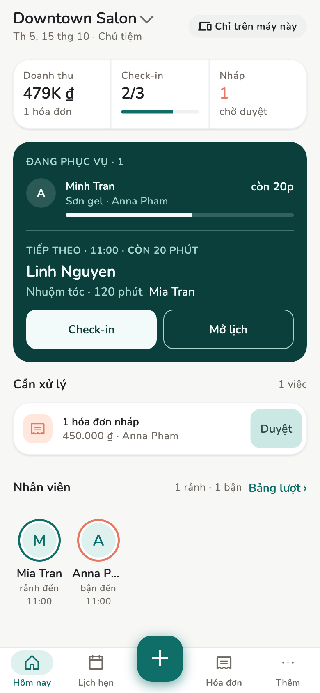
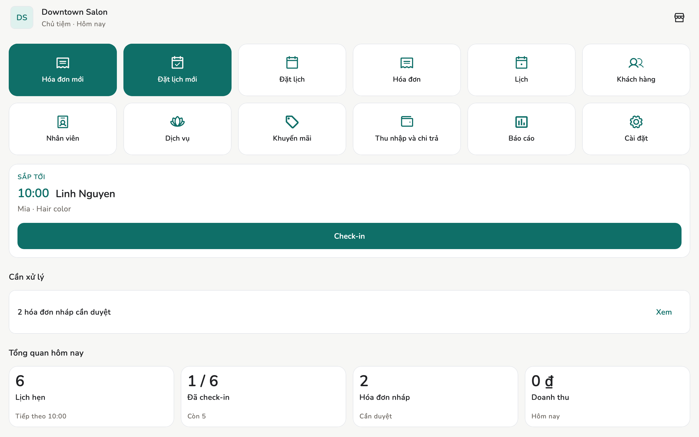
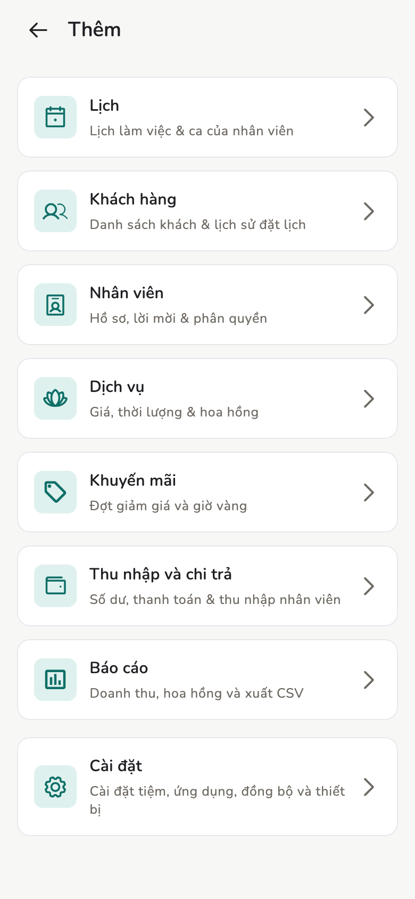

# Một ngày làm việc

Mở app buổi sáng: lịch kế tiếp, việc cần xử lý, thao tác nhanh.

## Tổng quan

Tab **Home** trong app là màn hình mở đầu ngày của **Chủ tiệm** và **Quản
lý**. Nhân viên có Home riêng, chỉ hiện lịch và thu nhập *của họ*.

Trên máy tính bảng hay máy tính bàn, Home của Chủ tiệm và Quản lý có thêm một
dải ô lối tắt phía trên phần tổng quan ngày. Nhân viên thì máy nào cũng thấy
giao diện điện thoại: trên máy tính bảng hay máy tính, app nằm trong một cột
rộng bằng điện thoại ở giữa màn hình.

<figure class="shot-phone" markdown>
{ loading=lazy }
<figcaption>Điện thoại</figcaption>
</figure>

<figure class="shot-wide" markdown>
{ loading=lazy }
<figcaption>Máy tính bảng và máy tính bàn</figcaption>
</figure>

## Khái niệm

- **Sắp tới** — lịch kế tiếp, nút **Check-in** khi tới lượt
- **Cần xử lý** — hóa đơn nháp chờ duyệt, lịch chưa gán nhân viên
- **Thao tác nhanh** — **Tạo lịch hẹn**, **Hóa đơn vãng lai**, Check-in,
  lịch hôm nay. Chỉ có trên điện thoại; máy tính bảng dùng dải ô lối tắt thay
  cho phần này

Điện thoại: thanh dưới **Home**, **Đặt lịch**, **Hóa đơn**, nút **+**. Menu
**Thêm** (icon góc phải) mở khách, nhân viên, dịch vụ, lịch, báo cáo, cài đặt.

Máy tính bảng / máy tính bàn: không có menu bên trái. Dải ô lối tắt trên
Home bắt đầu bằng **Hóa đơn mới** và **Đặt lịch mới**, tiếp theo là từng
màn, **Cài đặt** ở cuối. Đầu mỗi màn có nút **Home** và **Chuyển màn**; nút
**Chuyển màn** mở lại các ô đó, bấm một lần là sang màn khác. Nút quay lại
(hoặc phím Esc) đóng mục đang mở bên phải trước, bấm lần nữa thì về Home.

Giao diện tối: **Cài đặt → Giao diện → Tối**. Ảnh trong tài liệu này chụp app
ở chế độ sáng.

<figure markdown>
{ loading=lazy }
<figcaption>Menu Thêm trên điện thoại</figcaption>
</figure>

## Trang liên quan

- [Lịch hẹn](appointments.md)
- [Hóa đơn và biên lai](invoices.md)
- [Cài đặt tiệm](../admin/store-settings.md)
