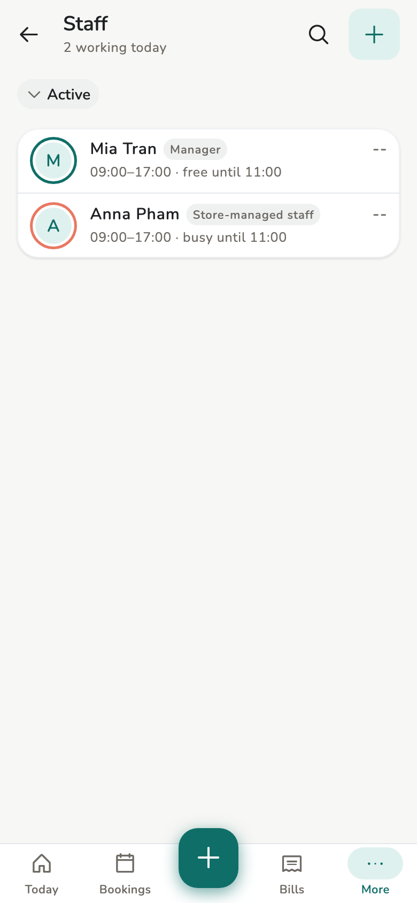
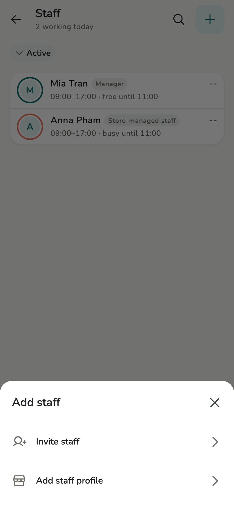
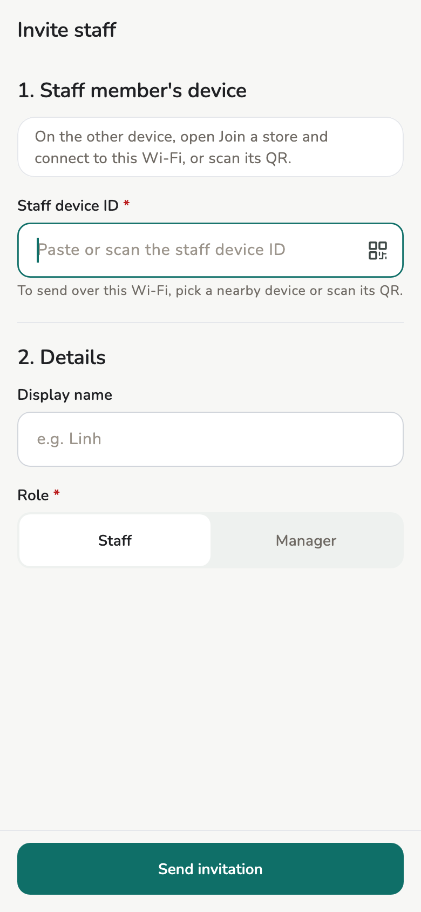
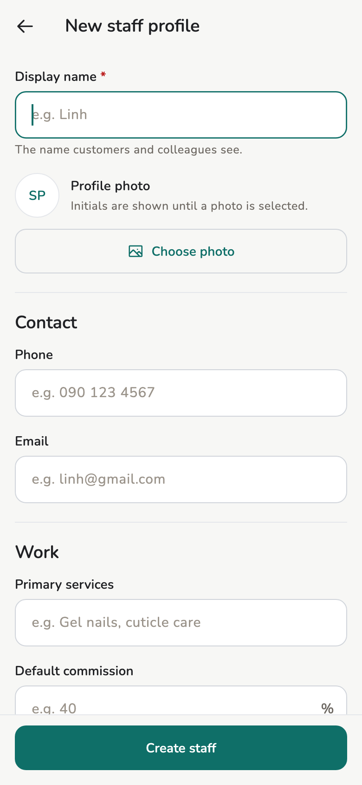
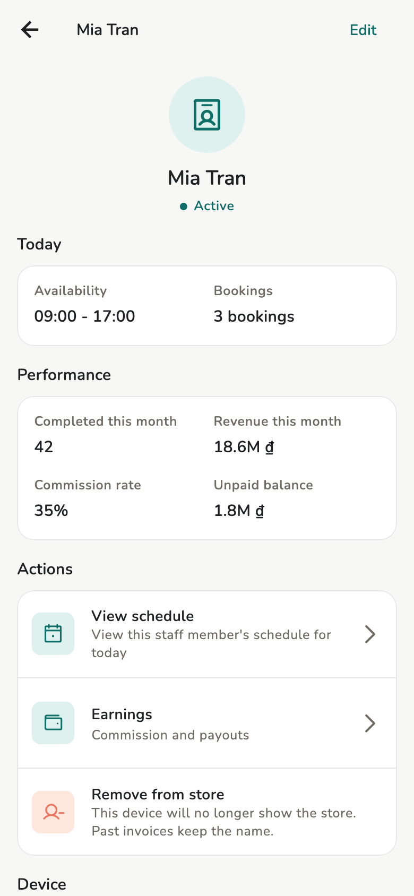

# Staff

Invite a real person, add a virtual profile, change roles. Do this before you
book.

## Overview

Owner and Manager **invite** people and create virtual staff. **Change role**
and **Staff bookings** are **Owner** only.

<figure class="shot-phone" markdown>
{ loading=lazy }
<figcaption>Staff</figcaption>
</figure>

## Concepts

Full matrix: [Roles](../reference/roles.md).

- The role belongs to the store, not the device. The same phone can be
  Owner in store A and Staff in store B.
- A **real person** runs Salony on their own device and joins the store from
  it. What they record carries their name.
- **Virtual staff** is a profile for bookings and commission. It has no
  device and never opens the app. Do not confuse it with *your* second
  device — [Devices and sync](../admin/devices.md).
- **Staff bookings**: **Only own** or **Whole store**. It does not change who
  can create appointments.

## Usage

Open **Staff**, tap **+** / **Add staff**. Two choices:

<figure markdown>
{ loading=lazy }
<figcaption>Add staff</figcaption>
</figure>

### Invite staff (a real person)

**Staff → Add staff → Invite staff**, with their device open on **Settings →
Join a store**. Pair the two devices as in
[Pair two devices](../admin/devices.md#pair). On the form, the display name is
optional and **Role** is required: **Staff** or **Manager**. Tap **Invite**;
they accept on their device.

<figure class="shot-phone" markdown>
{ loading=lazy }
<figcaption>Invite staff</figcaption>
</figure>

!!! tip "Promote to Owner later"

    The invite form only offers **Staff** / **Manager**. Change to Owner on
    the profile detail, when you already are Owner.

### Add a staff profile (virtual)

When they will not run Salony on a phone:

1. **Staff → Add staff → Add staff profile**.
2. **Display name** is required.
3. Phone, email, primary services, default commission % — optional.
4. **Create staff**.

<figure markdown>
{ loading=lazy }
<figcaption>Virtual staff profile</figcaption>
</figure>

Assign bookings and commission to this profile like a real person. They do
not open the app.

### Detail and change role

Tap a row for today, performance, earnings, schedule.

<figure markdown>
{ loading=lazy }
<figcaption>Staff detail</figcaption>
</figure>

Owner changes role on the detail screen. Staff **cannot** create appointments
regardless of that setting.

When someone leaves the salon, the owner taps **Remove from store** on their
detail. A virtual profile is stopped with **Deactivate** instead. See
[Stop using a store](../admin/stop-using.md).

## Related pages

- [Roles](../reference/roles.md)
- [Stop using a store](../admin/stop-using.md)
- [Availability](schedule.md)
- [Earnings](earnings.md)
