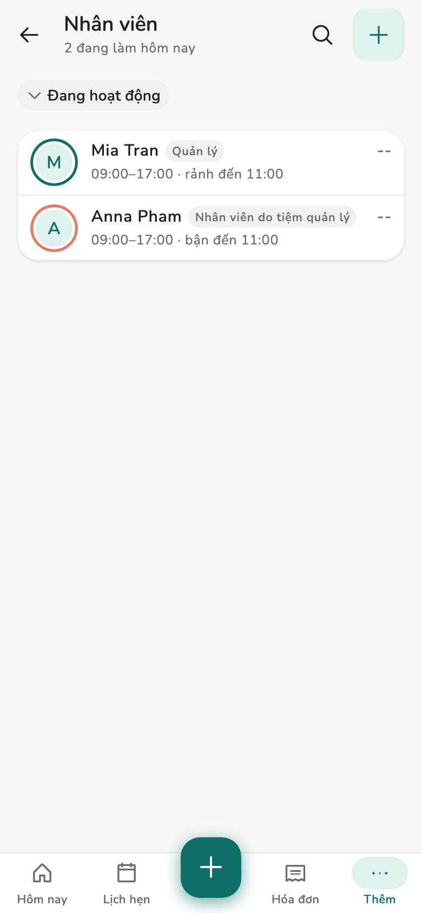
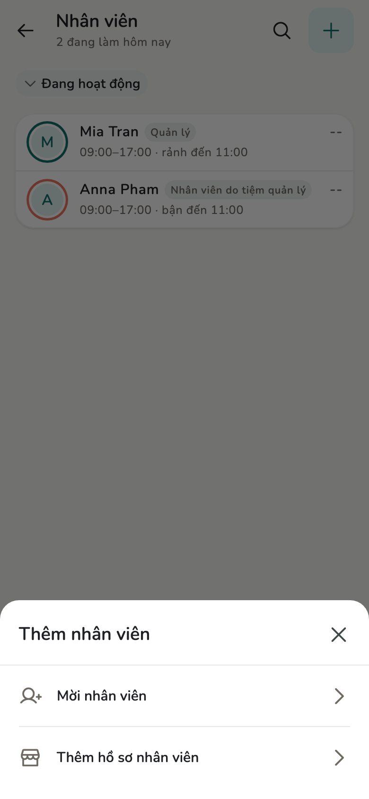
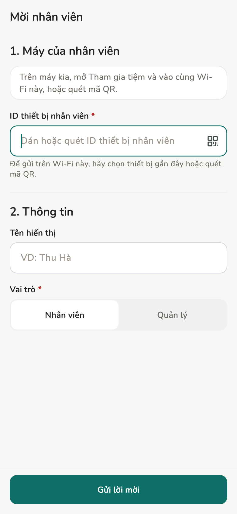
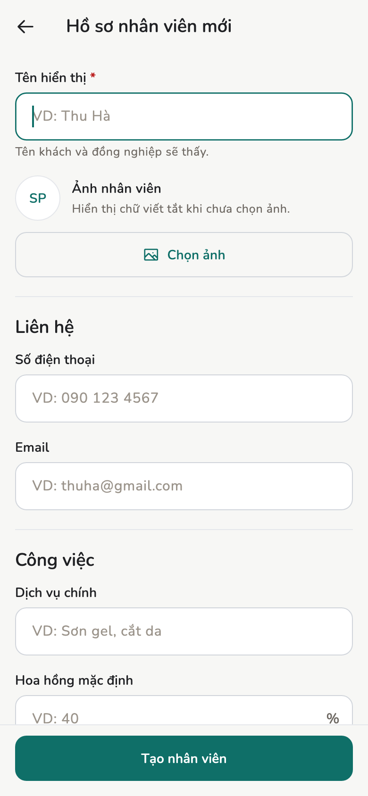
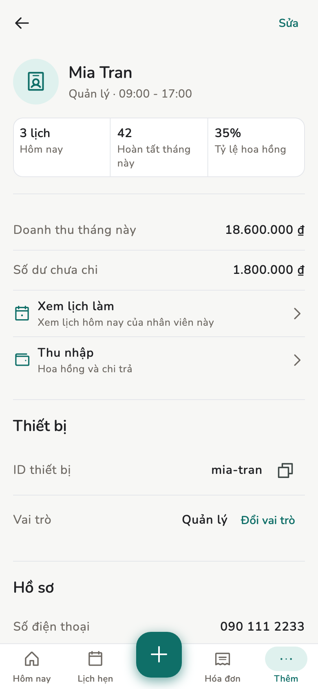

# Nhân viên

Mời người dùng app, tạo hồ sơ nhân viên ảo, đổi vai trò. Làm việc này trước
khi đặt lịch.

## Tổng quan

Chủ tiệm và Quản lý mời người và tạo nhân viên ảo. Chỉ **Chủ tiệm** đổi vai
trò và chỉnh **Lịch nhân viên**.

<figure class="shot-phone" markdown>
{ loading=lazy }
<figcaption>Nhân viên</figcaption>
</figure>

## Khái niệm

Bảng đầy đủ: [Vai trò](../reference/roles.md).

- Vai trò thuộc về tiệm, không thuộc về máy. Cùng một điện thoại có thể là
  Chủ tiệm ở tiệm A mà chỉ là Nhân viên ở tiệm B.
- **Người thật** dùng Salony trên máy của họ và vào tiệm bằng chính máy đó.
  Việc họ ghi trong app mang tên họ.
- **Nhân viên ảo** là hồ sơ để gán lịch và hoa hồng. Không có máy, không bao
  giờ mở app. Đừng nhầm với máy thứ hai của *bạn*: xem
  [Thiết bị và đồng bộ](../admin/devices.md).
- **Lịch nhân viên**: **Chỉ của họ** hoặc **Cả tiệm**. Không đổi quyền tạo lịch
  hẹn.

## Cách làm

Mở **Nhân viên**, bấm **+** / **Thêm nhân viên**. Có hai lựa chọn:

<figure markdown>
{ loading=lazy }
<figcaption>Thêm nhân viên</figcaption>
</figure>

### Mời nhân viên (người thật)

**Nhân viên → Thêm nhân viên → Mời nhân viên**, trong lúc máy họ mở sẵn
**Tham gia tiệm** (nút mã QR trên màn **Chọn tiệm**). Ghép hai máy như trong
[Ghép hai máy](../admin/devices.md#pair). Trên form, tên hiển thị tuỳ chọn,
**Vai trò** bắt buộc: **Nhân viên** hoặc **Quản lý**. Bấm **Mời**; họ nhận lời
mời trên máy họ.

<figure class="shot-phone" markdown>
{ loading=lazy }
<figcaption>Mời nhân viên</figcaption>
</figure>

!!! tip "Nâng lên Chủ tiệm sau"

    Form mời chỉ **Nhân viên** / **Quản lý**. Đổi thành Chủ trên chi tiết hồ
    sơ, khi đã là Chủ tiệm.

### Thêm hồ sơ nhân viên (ảo)

Khi người đó không mang điện thoại chạy Salony:

1. **Nhân viên → Thêm nhân viên → Thêm hồ sơ nhân viên**.
2. **Tên hiển thị** bắt buộc.
3. Điện thoại, email, dịch vụ chính, % hoa hồng mặc định — tuỳ chọn.
4. **Tạo nhân viên**.

<figure markdown>
{ loading=lazy }
<figcaption>Hồ sơ nhân viên ảo</figcaption>
</figure>

Gán lịch và hoa hồng cho hồ sơ này như người thật. Họ không mở app.

### Chi tiết và đổi vai trò

Bấm một hàng để mở chi tiết: ca hôm nay, hiệu suất, thu nhập, lịch làm.

<figure markdown>
{ loading=lazy }
<figcaption>Chi tiết nhân viên</figcaption>
</figure>

Chủ tiệm đổi vai trò trên chi tiết. Nhân viên **không** tạo lịch hẹn dù vai
trò thế nào.

Khi có người nghỉ, Chủ tiệm bấm **Gỡ khỏi tiệm** trên chi tiết người đó. Hồ sơ
nhân viên ảo thì dùng **Ngưng hoạt động**. Xem
[Ngừng dùng tiệm](../admin/stop-using.md).

## Trang liên quan

- [Vai trò](../reference/roles.md)
- [Ngừng dùng tiệm](../admin/stop-using.md)
- [Giờ rảnh](schedule.md)
- [Thu nhập và chi trả](earnings.md)
