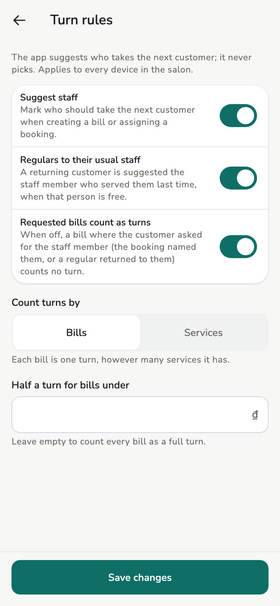

# Staff turns

The app suggests who should take the next customer, so the salon does not
have to keep the queue in its head. It only suggests: whoever creates the
bill still taps the staff member.

## Overview

- **New bill.** Staff chips are in turn order. The suggested person has a
  star, with a line that says why.
- **Turn board.** Shows who has the fewest turns and who is next. Owners and
  managers can adjust turns there.
- **Bookings.** An unassigned booking today suggests staff in the same order.

Turns count for the day only and reset at 0:00.

<figure markdown>
{ loading=lazy }
<figcaption>Turn board</figcaption>
</figure>

<figure markdown>
{ loading=lazy }
<figcaption>Turn rules</figcaption>
</figure>

## How the suggestion is chosen

1. **The booking.** A bill linked to a booking, or for a customer with a
   checked-in booking, picks that booking's staff member, as before.
2. **Free first.** Someone serving a checked-in customer, or with an open
   draft bill, comes after those who are free.
3. **Regulars.** With **Regulars to their usual staff** on, a returning
   customer is suggested whoever served them last, when that person is free.
4. **Fewest turns.** Then whoever has had the fewest turns today.
5. **Longest since the last turn.** On a tie, whoever had their last turn
   longest ago. Someone with no turn yet ranks by shift start.

The chips only reorder when the customer or the booking changes. Picking
services never moves a chip; the reason line just says whether the
suggested person has time.

## Counting turns

- Each bill opened today is a turn for its staff member, drafts included.
  Voided bills do not count.
- **Count turns by services** makes each service on a bill a turn.
- **Half a turn for bills under** an amount counts smaller bills as ½.
- With **Requested bills count as turns** off, a bill where the customer
  asked for the staff member counts no turn. A bill counts as requested when
  the booking named the staff member, or a regular came back to the same
  person.

## The turn board

Open it from **Turn board ›** on the bill form, from the **Staff** header on
Today, or from the **Today's turns** panel on a tablet.

- Staff on shift are numbered in turn order. Busy staff keep their place.
- **Next** is the first free person: the one a new bill suggests for a
  walk-in.
- Staff not on shift yet sit at the bottom, dimmed.

Owners and managers tap **⋯** on a row to adjust:

- **Skip (+1)** — the person passes on this turn.
- **Give back (−1)** — returns a turn that was counted.
- **Move to back** — puts the person after whoever has the most turns.

There is no confirm step: undo a slip with the opposite action. **Adjusted
today** lists the time, person, action and who made it, so another device
can see why the order moved. Two devices adjusting while offline agree once
they sync.

## Turn rules

**Settings → Staff → Turn rules** (owners and managers). One **Save
changes** applies to every device in the salon. With **Suggest staff** off,
the staff chips go back to how they were: no counts and no board.

## See also

- [Invoices and receipts](invoices.md)
- [Appointments](appointments.md)
- [Store settings](../admin/store-settings.md)
