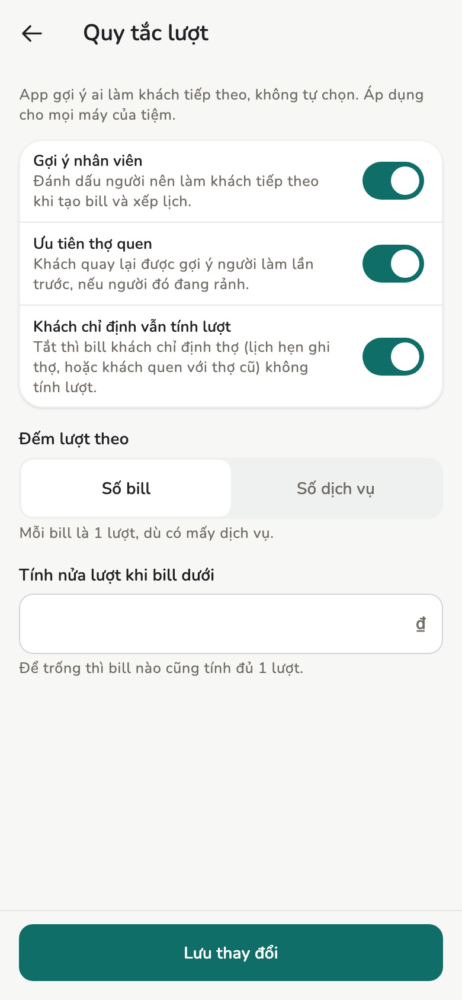

# Lượt nhân viên

App gợi ý ai nên làm khách tiếp theo, để tiệm không phải nhớ lượt bằng tay.
App chỉ gợi ý, không tự chọn: người tạo hóa đơn vẫn bấm chọn nhân viên.

## Tổng quan

- **Hóa đơn mới.** Chip nhân viên xếp theo lượt. Người được gợi ý có ngôi
  sao, kèm một dòng giải thích lý do.
- **Bảng lượt.** Cho biết ai đang ít lượt nhất và ai là người kế tiếp.
  Chủ / Quản lý chỉnh lượt được ngay trên bảng.
- **Lịch hẹn.** Lịch hôm nay chưa có nhân viên được gợi ý theo cùng thứ tự.

Lượt chỉ tính trong ngày và tự tính lại lúc 0:00.

<figure markdown>
{ loading=lazy }
<figcaption>Bảng lượt</figcaption>
</figure>

<figure markdown>
{ loading=lazy }
<figcaption>Quy tắc lượt</figcaption>
</figure>

## Gợi ý được chọn thế nào

1. **Theo lịch hẹn.** Hóa đơn gắn với một lịch hẹn, hoặc khách đang có lịch
   đã check-in, thì nhân viên của lịch đó được chọn sẵn như trước.
2. **Đang rảnh trước.** Người đang làm cho khách đã check-in, hoặc đang có
   hóa đơn nháp, xếp sau người đang rảnh.
3. **Thợ quen.** Nếu bật **Ưu tiên thợ quen**, khách quay lại được gợi ý
   người làm lần trước, khi người đó đang rảnh.
4. **Ít lượt nhất.** Sau đó là người ít lượt nhất hôm nay.
5. **Lượt trước lâu nhất.** Cùng số lượt thì ai có lượt trước lâu hơn đứng
   trước. Người chưa có lượt nào xếp theo giờ vào ca.

Chip chỉ đổi thứ tự khi đổi khách hoặc lịch hẹn. Chọn dịch vụ không làm chip
nhảy chỗ; dòng giải thích chỉ cho biết người được gợi ý có đủ thời gian
không.

## Đếm lượt

- Mỗi hóa đơn mở trong ngày là một lượt của nhân viên trên hóa đơn đó, kể
  cả hóa đơn nháp. Hóa đơn đã hủy không tính.
- **Đếm lượt theo số dịch vụ** thì mỗi dịch vụ trên hóa đơn là một lượt.
- **Tính nửa lượt khi bill dưới** một số tiền: hóa đơn nhỏ hơn số đó tính ½.
- Tắt **Khách chỉ định vẫn tính lượt** thì hóa đơn khách chỉ định thợ không
  tính lượt. App coi là chỉ định khi lịch hẹn ghi tên thợ, hoặc khách quay
  lại với đúng người làm lần trước.

## Bảng lượt

Mở từ **Bảng lượt ›** trên form hóa đơn, từ mục **Nhân viên** ở trang Hôm
nay, hoặc từ khung **Lượt hôm nay** trên máy tính bảng.

- Người trong ca được đánh số theo thứ tự lượt. Người đang bận vẫn giữ chỗ.
- **Kế tiếp** là người rảnh đầu tiên: người mà hóa đơn mới sẽ gợi ý cho khách
  vãng lai.
- Người chưa vào ca nằm dưới cùng, chữ mờ.

Chủ / Quản lý bấm **⋯** trên một dòng để chỉnh:

- **Bỏ lượt (+1)** — người đó nhường lượt này.
- **Trả lượt (−1)** — trả lại một lượt đã tính.
- **Xuống cuối** — đưa người đó ra sau người nhiều lượt nhất.

Không cần xác nhận: bấm nhầm thì bấm thao tác ngược lại. Mục **Đã chỉnh hôm
nay** ghi giờ, người, thao tác và ai chỉnh, để máy khác biết vì sao thứ tự
đổi. Hai máy chỉnh cùng lúc khi chưa đồng bộ vẫn ra cùng kết quả sau khi
đồng bộ.

## Quy tắc lượt

**Cài đặt → Nhân viên → Quy tắc lượt** (Chủ / Quản lý). Một lần **Lưu thay
đổi** áp dụng cho mọi máy của tiệm. Tắt **Gợi ý nhân viên** thì chip nhân
viên trở về như cũ, không có số lượt và không có bảng lượt.

## Xem thêm

- [Hóa đơn và biên lai](invoices.md)
- [Lịch hẹn](appointments.md)
- [Cài đặt tiệm](../admin/store-settings.md)
