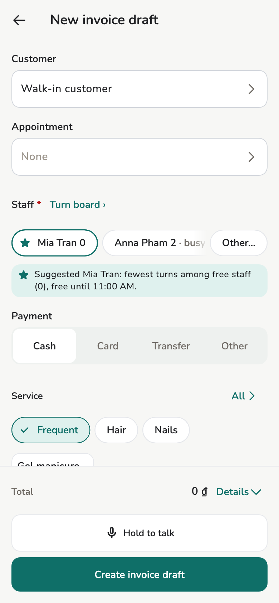
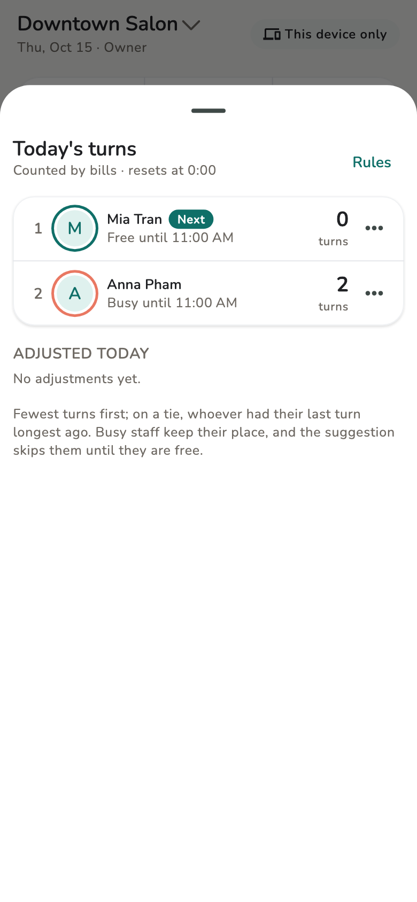
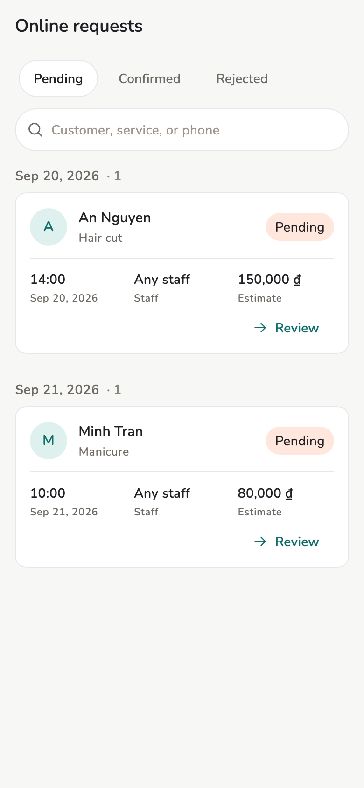
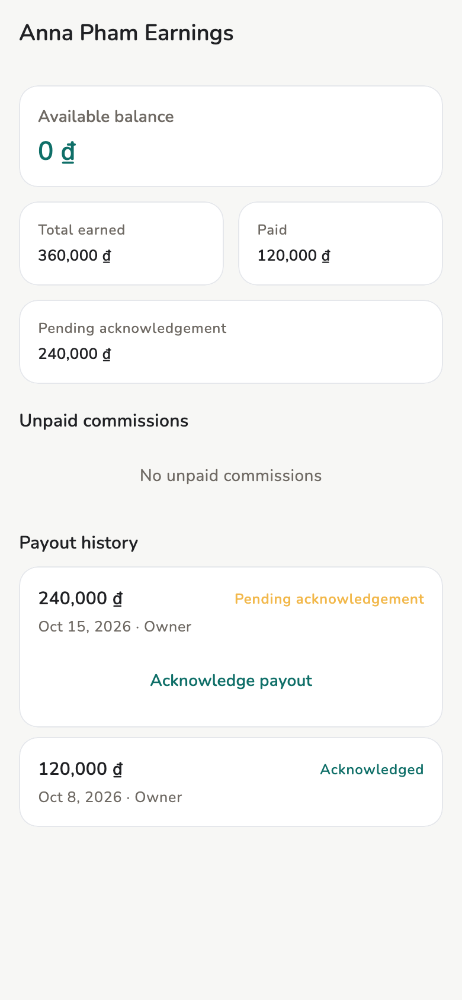

<video id="video" class="home-video" controls playsinline preload="none" poster="assets/video/salony-intro-en.jpg" aria-label="Salony intro video">
  <source src="assets/video/salony-intro-en.mp4" type="video/mp4">
</video>

# Your whole salon, in one app.

Bookings, bills, staff turns and commission for hair and nail salons. Your
data stays **on the salon's own devices**, works offline, and needs no
account.

[Download](admin/downloads.md){ .md-button .md-button--primary }
[See how to start](start/index.md){ .home-text-button }

No accountWorks offlineNo copy in the cloudEnd-to-end encrypted

## Everything at the front desk, in one app { #features }

It replaces the booking notebook, the calculator and
whatever the person at the desk was keeping in their head.

Today

### The whole day, on one screen

Today's revenue, who's in the chair, who's next, bills waiting for approval,
and which staff are free. Open the app and you know. No flipping pages.

[A day at the salon :octicons-arrow-right-24:](guide/run-the-day.md)

Bills

### Ring up a bill in seconds

The app suggests who's free. Pick the service, or turn on voice commands
and just hold and speak. Approve with one tap, with five seconds to undo.
Approving locks the price and the commission.

[Invoices and receipts :octicons-arrow-right-24:](guide/invoices.md)

Staff turns

### Share clients fairly, in plain sight

The app suggests who takes the next client from today's turns. A turn
board for manual changes, and turn rules your salon chooses. Nobody keeps
count in their head.

[Staff turns :octicons-arrow-right-24:](guide/turns.md)

Online booking

### Clients book on the web, you confirm in the app

Share a link or a QR code. Clients pick a service, a day and a time, and
leave a name and phone number, with nothing to install. Requests land in
the app and become bookings only when you confirm them.

[Online booking :octicons-arrow-right-24:](admin/online-booking.md)

Commission and payouts

### Staff see what they earn

Approving a bill locks each staff member's commission. The owner records a
payout, staff see it on their own phone and tap **Acknowledge payout**.
Both sides agree, so there is nothing to argue about at month end.

[Earnings and payouts :octicons-arrow-right-24:](guide/earnings.md)

-   :material-sale:{ .lg .middle } **Promotions that apply themselves**

    ---

    Date-range sales and weekly happy hours. The bill takes them off.

    [:octicons-arrow-right-24: Promotions](guide/promotions.md)

-   :material-chart-line:{ .lg .middle } **Reports and AI summary**

    ---

    Revenue by day, week, month and quarter. CSV export. An AI summary
    that runs on the device.

    [:octicons-arrow-right-24: Reports](guide/reports.md)

-   :material-account-heart:{ .lg .middle } **Customers**

    ---

    Visits, last visit and total spend. Filter regulars, lapsed and new
    customers.

    [:octicons-arrow-right-24: Customers](guide/customers.md)

-   :material-printer:{ .lg .middle } **Receipts**

    ---

    Print to the salon's printer or save a PDF. Receipts print in English
    or Vietnamese, set apart from the app language.

    [:octicons-arrow-right-24: Printing receipts](guide/printing.md)

## One app, every screen { #screens }

Phones in your staff's pockets, a tablet or a computer
at the front desk. Big screens lay out bookings by staff member and open
details alongside.

<figure class="device device--phone" markdown>

</figure>

<figure class="device device--tablet" markdown>

</figure>

<figure class="device device--laptop" markdown>

</figure>

## Install, pair, and go { #getting-started }

-   **Get the app**

    Version 1.3.0 for Android, installed straight from the file.

    [Downloads](admin/downloads.md)

-   **Create a salon, or pair**

    The owner names the salon. Staff phones pair with the salon's device:
    hold them close, or scan a QR.

    [First launch](start/first-launch.md)

-   **Welcome clients**

    Add services and staff, then book and bill. Save your recovery code.

    [First day](start/first-day.md)

No account, no email, no password, no complicated
setup.

## Your salon, your data { #privacy }

-   :material-cellphone-check:{ .lg .middle } **Data on your device**

    ---

    Bookings, bills and customers live on the salon's own phones and
    computers. Salony keeps no copy in the cloud.

    [:octicons-arrow-right-24: Local-first](tech/local-first.md)

-   :material-signal-off:{ .lg .middle } **Works offline**

    ---

    Book, bill and check earnings as usual. Devices sync when they meet
    again.

    [:octicons-arrow-right-24: Run the day](guide/run-the-day.md)

-   :material-shield-lock:{ .lg .middle } **End-to-end encrypted sync**

    ---

    Devices in your salon sync over the salon's Wi-Fi, encrypted from one
    device to the other. This version does not sync over the internet yet.

    [:octicons-arrow-right-24: Devices and sync](admin/devices.md)

-   :material-key-variant:{ .lg .middle } **No sign-in**

    ---

    No email, no password. Lose a phone and you get the salon back with the
    recovery code and a backup.

    [:octicons-arrow-right-24: Protect and recover your salon](admin/backup.md)

## How it works { #how-it-works }

The publisher keeps no copy of your salon: nothing to read, nothing to sell,
and nothing to restore for you. In exchange, keeping the salon safe is
yours: the recovery key and a salon backup, both in **Settings → Protect your
salon**. Lose the device with no backup and no other device in the store, and
that device's data is gone.

:material-cellphone: **Your device**

Appointments, invoices, and customers live here. Works offline.

**Pair nearby or with QR**

Salon Wi-Fi · end-to-end encrypted

:material-tablet: **A device you paired**

Until you pair it, that device can read nothing.

:material-shield-lock: **No server holds the salon**

The salon is not in the cloud. No email account. [Why](tech/local-first.md)

## Try Salony at your salon

Install it on one device and run a day with it. Bring the rest of the
salon along once it fits.

[Download](admin/downloads.md){ .md-button .md-button--primary }
[Read the guide](start/index.md){ .md-button }

