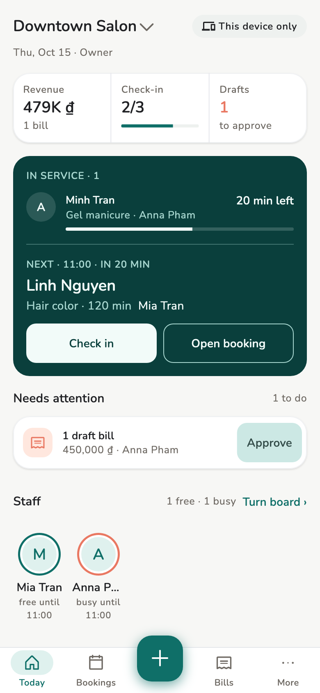
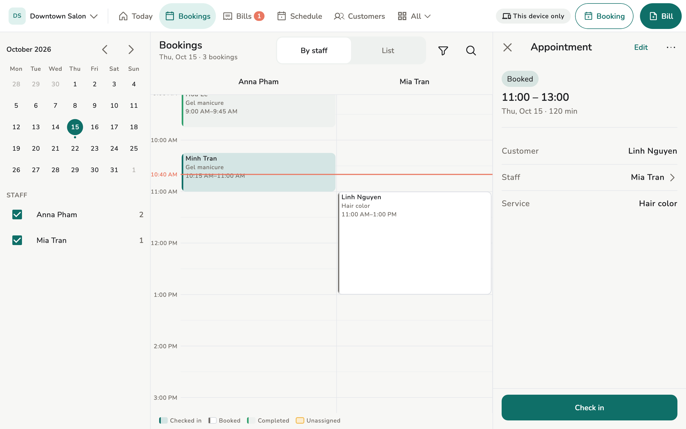
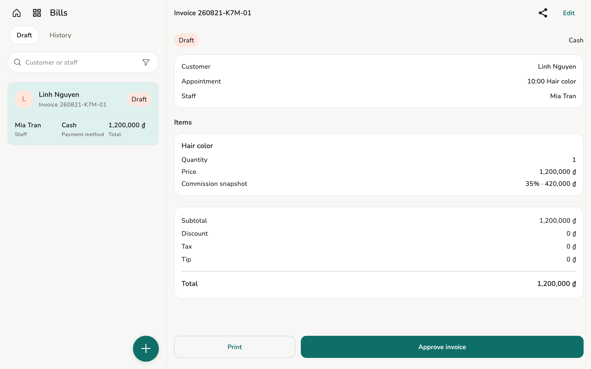

<figure class="device device--phone" markdown>

<figcaption>Phone · Home</figcaption>
</figure>

<figure class="device device--tablet" markdown>

<figcaption>Tablet · Bookings</figcaption>
</figure>

<figure class="device device--laptop" markdown>

<figcaption>Laptop · Bills</figcaption>
</figure>

# Salony

Salon software on your phone and computer. Appointments, invoices, and
customers stay **on your device** — not in the cloud.

[Get started](start/index.md){ .md-button .md-button--primary }
[Download](admin/downloads.md){ .home-text-button }

## Key features { #features }

-   :material-laptop:{ .lg .middle } **Data on the device**

    ---

    Bookings, invoices, and customers live on the phone or computer you are
    holding. Salony does not keep a cloud copy.

    [:octicons-arrow-right-24: Local-first](tech/local-first.md)

-   :material-signal-off:{ .lg .middle } **Works offline**

    ---

    Book, bill, and read earnings as usual. Sync when the network is back.

    [:octicons-arrow-right-24: Run the day](guide/run-the-day.md)

-   :material-shield-lock:{ .lg .middle } **End-to-end encrypted sync**

    ---

    The devices in a store sync over the salon Wi-Fi, encrypted from one
    device to the other. This version does not sync over the internet.

    [:octicons-arrow-right-24: Devices and sync](admin/devices.md)

-   :material-key-variant:{ .lg .middle } **No login account**

    ---

    No email, no password. Add a device by pairing two devices side by side,
    or by scanning a QR. Lose the phone and the recovery key brings the
    salon back.

    [:octicons-arrow-right-24: Protect and restore your salon](admin/backup.md)

## Getting started { #getting-started }

-   :material-download:{ .lg .middle } **Install**

    ---

    Test build for Android and Windows. No macOS or iOS yet.

    [:octicons-arrow-right-24: Downloads](admin/downloads.md)

-   :material-rocket-launch:{ .lg .middle } **First launch**

    ---

    Choose a language, set up this device, then open or join a store.

    [:octicons-arrow-right-24: First launch](start/first-launch.md)

-   :material-flag-checkered:{ .lg .middle } **Before customers arrive**

    ---

    Protect your salon: save the recovery key and a salon backup. Then add
    staff and services.

    [:octicons-arrow-right-24: First day](start/first-day.md)

## How it works { #how-it-works }

The publisher keeps no copy of your salon: nothing to read, nothing to sell,
and nothing to restore for you. In exchange, keeping the salon safe is
yours: the recovery key and a salon backup, both in **Settings → Protect your
salon**. Lose the device with no backup and no other device in the store, and
that device's data is gone.

:material-cellphone: **Your device**

Appointments, invoices, and customers live here. Works offline.

**Pair nearby or with QR**

Salon Wi-Fi · end-to-end encrypted

:material-tablet: **A device you paired**

Until you pair it, that device can read nothing.

:material-shield-lock: **No server holds the salon**

The salon is not in the cloud. No email account. [Why](tech/local-first.md)

