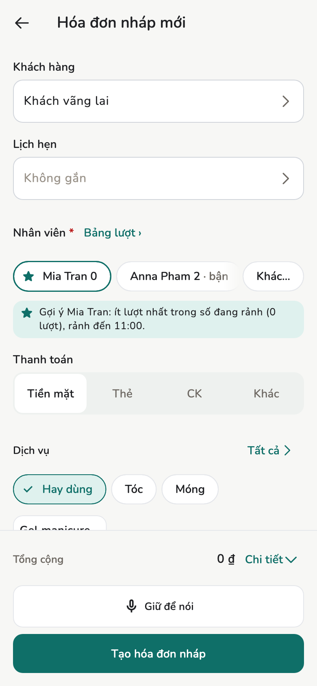
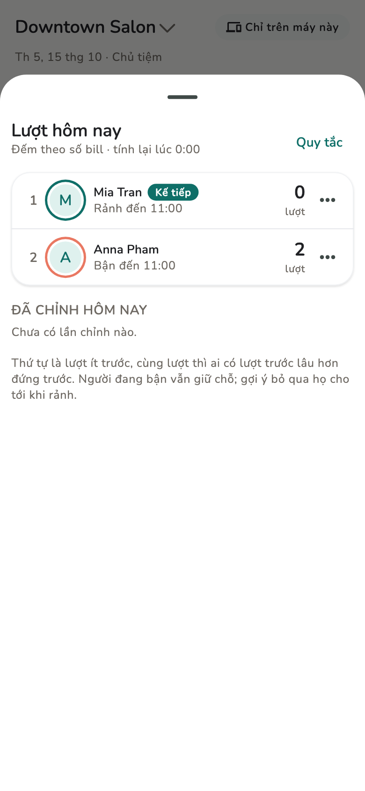
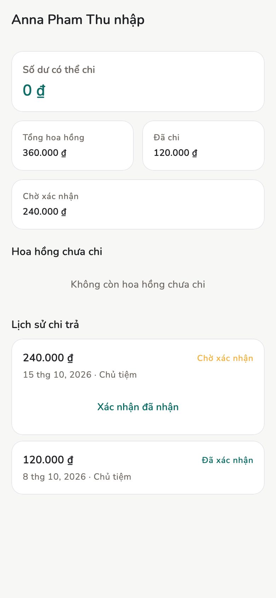
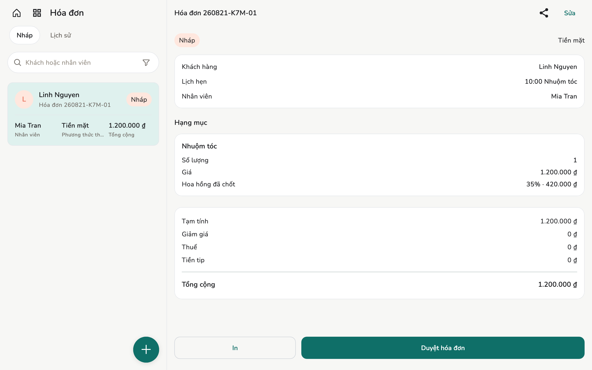

<!-- Raw HTML is not path-rewritten: this page is served from /vi/. -->
<video id="video" class="home-video" controls playsinline preload="none" poster="../assets/video/salony-intro-vi.jpg" aria-label="Video giới thiệu Salony">
  <source src="../assets/video/salony-intro-vi.mp4" type="video/mp4">
</video>

# Cả tiệm, gọn trong một app.

Lịch hẹn, hóa đơn, lượt thợ, hoa hồng cho tiệm tóc và tiệm nail. Dữ liệu
nằm **trên máy của tiệm**, mất mạng vẫn chạy, không cần tài khoản.

[Tải về](admin/downloads.md){ .md-button .md-button--primary }
[Xem cách bắt đầu](start/index.md){ .home-text-button }

Không tài khoảnMất mạng vẫn chạyKhông bản sao trên cloudMã hoá đầu cuối

## Mọi việc ở quầy, trong một app { #features }

Thay cuốn sổ hẹn, cái máy tính cầm tay và trí nhớ của
người đứng quầy.

Hôm nay

### Cả ngày của tiệm, trên một màn hình

Doanh thu trong ngày, khách đang làm, ai tới tiếp theo, hóa đơn chờ duyệt,
thợ nào đang rảnh. Mở app là biết, khỏi lật sổ.

[Một ngày ở tiệm :octicons-arrow-right-24:](guide/run-the-day.md)

Hóa đơn

### Lập hóa đơn trong vài giây

App gợi ý thợ đang rảnh. Chọn dịch vụ, hoặc bật ra lệnh bằng giọng nói rồi
giữ nút và nói. Duyệt bằng một chạm, có năm giây để hoàn tác. Khi duyệt,
giá và hoa hồng được khóa lại.

[Hóa đơn và biên lai :octicons-arrow-right-24:](guide/invoices.md)

Lượt thợ

### Chia khách công bằng, ai cũng thấy

App gợi ý ai làm khách tiếp theo theo lượt trong ngày. Bảng lượt để chỉnh tay,
quy tắc lượt do tiệm chọn. Hết cảnh nhớ lượt trong đầu.

[Lượt nhân viên :octicons-arrow-right-24:](guide/turns.md)

Đặt lịch online

### Khách đặt trên web, tiệm duyệt trên app

Gửi link hoặc mã QR. Khách chọn dịch vụ, ngày giờ, để lại tên và số điện
thoại, không cần cài app. Yêu cầu vào thẳng app; tiệm xác nhận thì mới thành
lịch hẹn.

[Đặt lịch online :octicons-arrow-right-24:](admin/online-booking.md)

Hoa hồng và chi trả

### Thợ tự theo dõi thu nhập của mình

Duyệt hóa đơn là chốt hoa hồng của thợ. Chủ tiệm ghi khoản đã chi, thợ thấy
ngay trên máy mình và bấm **Xác nhận đã nhận**. Hai bên khớp sổ, khỏi cãi
nhau cuối tháng.

[Thu nhập và chi trả :octicons-arrow-right-24:](guide/earnings.md)

-   :material-sale:{ .lg .middle } **Khuyến mãi tự tính**

    ---

    Đợt giảm giá theo ngày, giờ vàng theo khung giờ. App tự trừ vào hóa
    đơn.

    [:octicons-arrow-right-24: Khuyến mãi](guide/promotions.md)

-   :material-chart-line:{ .lg .middle } **Báo cáo và tóm tắt AI**

    ---

    Doanh thu theo ngày, tuần, tháng, quý. Xuất CSV. Tóm tắt AI chạy ngay
    trên máy.

    [:octicons-arrow-right-24: Báo cáo](guide/reports.md)

-   :material-account-heart:{ .lg .middle } **Khách hàng**

    ---

    Số lượt, lần ghé gần nhất, tổng chi tiêu. Lọc khách quen, lâu chưa ghé,
    khách mới.

    [:octicons-arrow-right-24: Khách hàng](guide/customers.md)

-   :material-printer:{ .lg .middle } **In biên lai**

    ---

    In ra máy in của tiệm hoặc xuất PDF. Biên lai in tiếng Việt hoặc tiếng
    Anh, chọn riêng với ngôn ngữ app.

    [:octicons-arrow-right-24: In biên lai](guide/printing.md)

## Một app, mọi màn hình { #screens }

Điện thoại trong túi thợ, tablet hoặc máy tính ở quầy.
Màn lớn xếp lịch theo từng thợ, mở chi tiết ngay bên cạnh.

<figure class="device device--phone" markdown>

</figure>

<figure class="device device--tablet" markdown>

</figure>

<figure class="device device--laptop" markdown>

</figure>

## Cài app, ghép máy, dùng ngay { #getting-started }

-   **Tải app**

    Bản 1.3.0 cho Android, cài thẳng từ file.

    [Tải về](admin/downloads.md)

-   **Tạo tiệm hoặc ghép máy**

    Chủ tiệm đặt tên tiệm. Máy của thợ ghép với máy tiệm: đặt gần nhau hoặc
    quét QR.

    [Lần đầu mở app](start/first-launch.md)

-   **Đón khách**

    Thêm dịch vụ, nhân viên, rồi đặt lịch và lập hóa đơn. Nhớ lưu mã khôi
    phục.

    [Ngày đầu](start/first-day.md)

Không tài khoản, không email, không mật khẩu, không cài
đặt phức tạp.

## Tiệm của bạn, dữ liệu của bạn { #privacy }

-   :material-cellphone-check:{ .lg .middle } **Dữ liệu trên máy**

    ---

    Lịch, hóa đơn, khách nằm trên điện thoại hoặc máy tính của tiệm.
    Salony không giữ bản sao trên cloud.

    [:octicons-arrow-right-24: Local-first](tech/local-first.md)

-   :material-signal-off:{ .lg .middle } **Mất mạng vẫn làm việc**

    ---

    Đặt lịch, lập hóa đơn, xem thu nhập như bình thường. Đồng bộ khi các
    máy gặp lại nhau.

    [:octicons-arrow-right-24: Một ngày làm việc](guide/run-the-day.md)

-   :material-shield-lock:{ .lg .middle } **Đồng bộ có mã hoá đầu cuối**

    ---

    Các máy trong tiệm đồng bộ qua Wi-Fi của tiệm, mã hoá từ máy này tới
    máy kia. Bản hiện tại chưa đồng bộ qua internet.

    [:octicons-arrow-right-24: Thiết bị và đồng bộ](admin/devices.md)

-   :material-key-variant:{ .lg .middle } **Không cần đăng nhập**

    ---

    Không email, không mật khẩu. Mất máy thì lấy lại tiệm bằng mã khôi
    phục và bản sao lưu.

    [:octicons-arrow-right-24: Bảo vệ và khôi phục tiệm](admin/backup.md)

## Salony chạy thế nào { #how-it-works }

Bên phát hành không giữ bản sao tiệm của bạn: không có gì để đọc, để bán,
cũng không khôi phục hộ được. Đổi lại, việc giữ tiệm an toàn là của bạn: mã
khôi phục và bản sao lưu tiệm, làm trong **Cài đặt → Bảo vệ tiệm**. Mất máy
mà không có bản sao lưu, cũng không có máy nào khác trong tiệm, thì mất dữ
liệu trên máy đó.

:material-cellphone: **Máy của bạn**

Lịch, hóa đơn, khách ghi trên máy này. Mất mạng vẫn chạy.

**Ghép gần đây hoặc QR**

Wi-Fi của tiệm · mã hoá đầu cuối

:material-tablet: **Máy đã ghép**

Chưa ghép thì máy kia không đọc được gì.

:material-shield-lock: **Không có máy chủ giữ tiệm**

Tiệm không nằm trên cloud. Không tài khoản email. [Vì sao](tech/local-first.md)

## Thử Salony ở tiệm bạn

Cài trên một máy, dùng thử một ngày. Cả tiệm theo sau khi bạn thấy hợp.

[Tải về](admin/downloads.md){ .md-button .md-button--primary }
[Đọc hướng dẫn](start/index.md){ .md-button }

