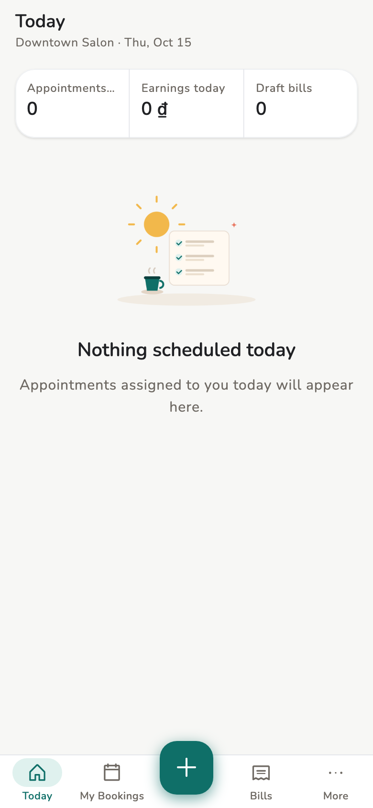

# Roles

Three roles **per store**. One device can be Owner in store A and Staff in
store B.

## Overview

In-app labels: **Owner**, **Manager**, **Staff**.

<figure class="shot-phone" markdown>
{ loading=lazy }
<figcaption>Owner / Manager</figcaption>
</figure>

<figure class="shot-phone" markdown>
{ loading=lazy }
<figcaption>Staff</figcaption>
</figure>

Every role gets the same bottom bar: **Today**, **Bookings**, **+**,
**Bills**, and **More**. On a Staff device the tabs show only that person's
work (their earnings instead of the store's revenue), and **+** opens a new
bill directly.

Staff see this phone layout on every device. On a tablet or computer it sits
in a phone-width column in the middle of the screen; an Owner or Manager on
the same machine gets the tablet layout.

## Concepts

| Job | Owner | Manager | Staff |
| --- | --- | --- | --- |
| Create appointments | Yes | Yes | **No** |
| Check-in / complete / cancel | Yes | Yes | Do not run the lifecycle like a manager |
| Draft invoices | Yes | Yes | Yes |
| Approve invoices | Yes | Yes | No (not their own) |
| Invite people | Yes | Yes | No |
| Change role | Yes | No | No |
| Service catalog (create, edit, price, deactivate, CSV import) | Yes | Yes | Use the list when drafting |
| Staff bookings (own / whole store) | Yes | No | — |
| Identity / data backup | Yes | Yes | Those rows are absent |
| Earnings / reports | Whole team | Whole team | *Their own* |
| Online booking — turn the page on | Yes | No | No |
| Online booking — publish / review requests | Yes | Yes | No |

## Related pages

- [Staff](../guide/staff.md)
- [Appointments](../guide/appointments.md)
- [Online booking](../admin/online-booking.md)
- [FAQ](faq.md)
