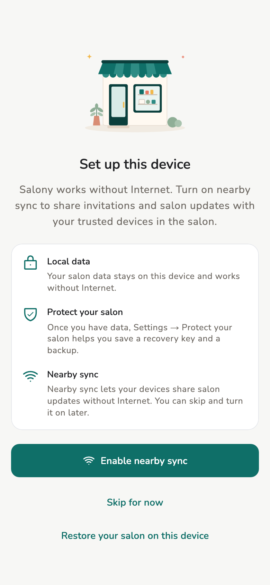
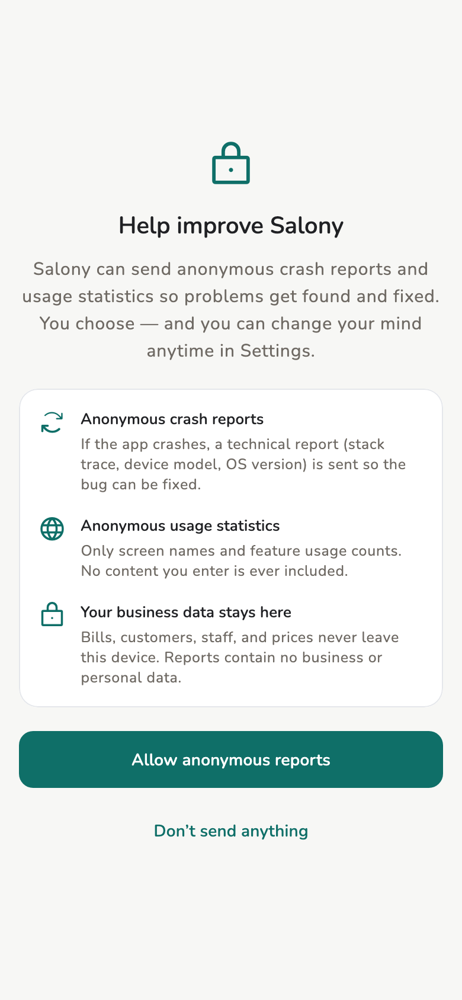

# First launch

Set up this device. There is no login account to create.

## Overview

The first screen, **Set up this device**, says what you are starting with:

- **Local data**: the salon's customers, appointments and invoices are kept on
  this device and work without Internet.
- **Protect your salon**: once you have data, you save a recovery key and a
  salon backup from **Settings → Protect your salon**. Nothing to do now.
- **Nearby sync**: lets your devices in the salon share updates without
  Internet. You can turn it on later.

Then the app asks for your name and whether to send anonymous crash reports.
The language can be changed any time in **Settings → Language**.

<figure class="shot-phone" markdown>
{ loading=lazy }
<figcaption>First-run setup</figcaption>
</figure>

<figure class="shot-phone" markdown>
{ loading=lazy }
<figcaption>Crash & usage reports</figcaption>
</figure>

## Prerequisites

Install a trial build from [Downloads](../admin/downloads.md), or use a copy
you already have.

## Usage

1. On **Set up this device**, tap **Enable nearby sync**, or **Skip for now**.
   Used Salony on another device before? Tap **Restore your salon on this
   device** instead (see [Restore your salon](../admin/backup.md#restore-your-salon-on-a-new-device)).
2. *What should owners call you?*: enter the name staff see when you invite
   them.
3. *Help improve Salony*: tap **Allow anonymous reports** or **Don’t send
   anything**.

!!! warning "There is no password to reset"

    Salony has no online account, so there is no "forgot password". What keeps
    the salon safe is the recovery key and the salon backup. Set them up from
    **Settings → Protect your salon** as soon as you have customers or
    invoices. See [Protect and restore your salon](../admin/backup.md).

## Related pages

- [Create or join a store](store.md)
- [Protect and restore your salon](../admin/backup.md)
- [How the recovery key works](../tech/identity.md) (technical)
- [FAQ](../reference/faq.md)
