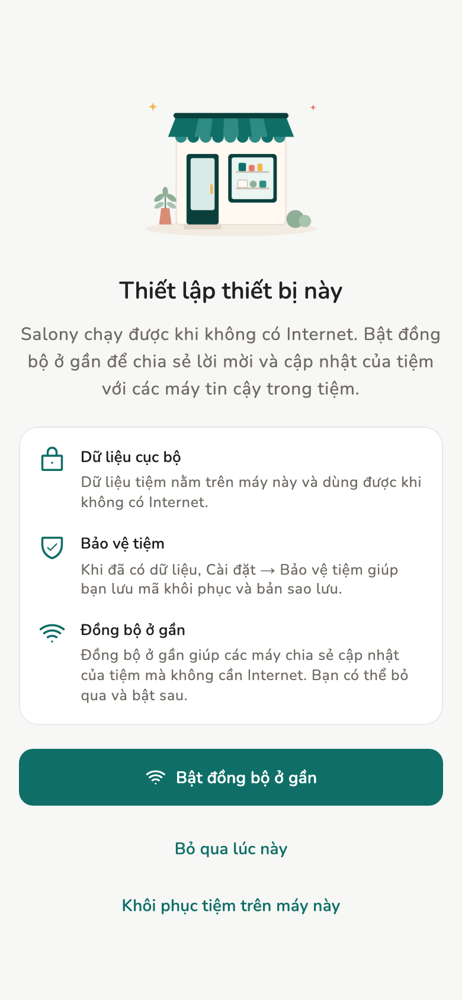
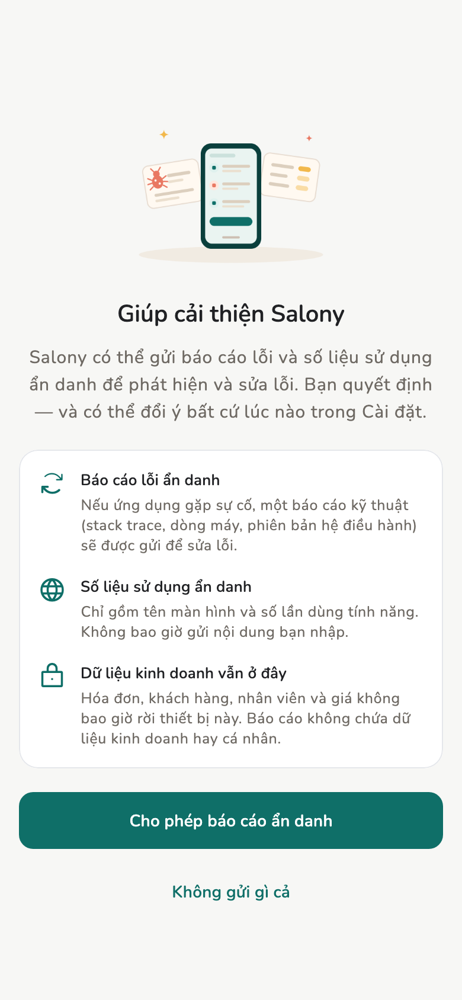

# Lần đầu mở app

Thiết lập máy này. Không cần tạo tài khoản, không cần email hay mật khẩu.

## Tổng quan

Màn đầu tiên, **Thiết lập thiết bị này**, cho biết bạn bắt đầu với những gì:

- **Dữ liệu cục bộ**: khách, lịch hẹn, hóa đơn của tiệm nằm trên máy này và
  dùng được khi không có Internet.
- **Bảo vệ tiệm**: khi đã có dữ liệu, bạn lưu mã khôi phục và bản sao lưu tiệm
  ở **Cài đặt → Bảo vệ tiệm**. Lúc này chưa cần làm gì.
- **Đồng bộ ở gần**: các máy trong tiệm chia sẻ cập nhật mà không cần
  Internet. Có thể bật sau.

Sau đó app hỏi tên bạn và có gửi báo cáo lỗi ẩn danh không. Đổi ngôn ngữ lúc
nào cũng được, trong **Cài đặt → Ngôn ngữ**.

<figure class="shot-phone" markdown>
{ loading=lazy }
<figcaption>Thiết lập lần đầu</figcaption>
</figure>

<figure class="shot-phone" markdown>
{ loading=lazy }
<figcaption>Báo cáo lỗi & sử dụng</figcaption>
</figure>

## Điều kiện

Cài bản thử từ [Tải về](../admin/downloads.md), hoặc bản bạn đã có trên máy.

## Cách làm

1. Ở màn **Thiết lập thiết bị này**, bấm **Bật đồng bộ ở gần** hoặc **Bỏ qua
   lúc này**. Đã dùng Salony trên máy khác? Bấm **Khôi phục tiệm trên máy
   này** (xem [Khôi phục tiệm](../admin/backup.md#khoi-phuc-tiem-tren-may-moi)).
2. *Chủ tiệm nên gọi bạn là gì?*: nhập tên mà nhân viên sẽ thấy khi bạn mời
   họ.
3. *Giúp cải thiện Salony*: bấm **Cho phép báo cáo ẩn danh** hoặc **Không gửi
   gì cả**.

!!! warning "Không có nút quên mật khẩu"

    Salony không có tài khoản online, nên không có chuyện lấy lại mật khẩu.
    Thứ giữ tiệm an toàn là mã khôi phục và bản sao lưu tiệm. Hãy làm ở
    **Cài đặt → Bảo vệ tiệm** ngay khi đã có khách hoặc hóa đơn. Xem
    [Bảo vệ và khôi phục tiệm](../admin/backup.md).

## Trang liên quan

- [Tạo hoặc vào tiệm](store.md)
- [Bảo vệ và khôi phục tiệm](../admin/backup.md)
- [Mã khôi phục hoạt động thế nào](../tech/identity.md) (kỹ thuật)
- [FAQ](../reference/faq.md)
