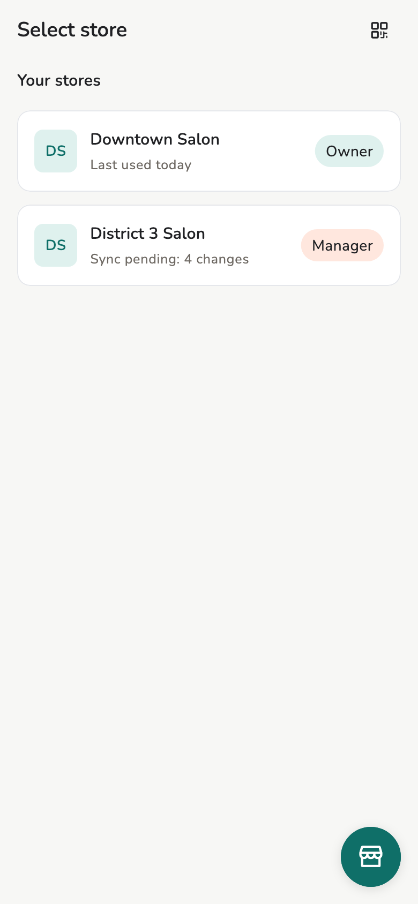
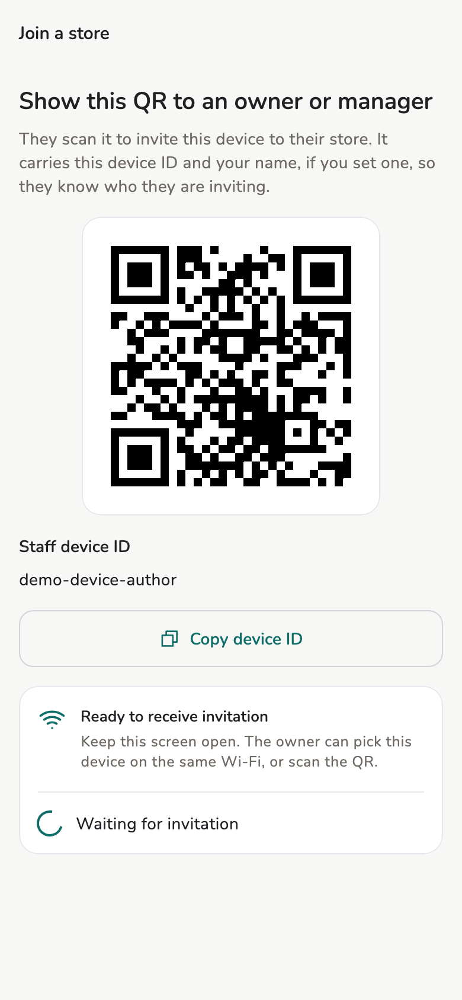

# Create or join a store

This device becomes a member of a store — the role is **per store**.

## Overview

Two paths: **Create store** (this device is Owner), or join an existing store
by invitation / add-device.

<figure class="shot-phone" markdown>
{ loading=lazy }
<figcaption>Select store</figcaption>
</figure>

## Usage

=== "Create a store"

    On **Select store**: the **Create store** button at the bottom. Name,
    currency, optional logo. This
    device becomes **Owner**.

    One person can belong to several stores; the role is not shared across
    stores.

=== "Join an existing store"

    An owner or manager pairs this device with theirs and sends an
    invitation. On this device, tap **Join a store with a QR code** under the
    salon list on **Select store** (or start from the welcome screen), and
    keep the QR open while they do.

    Adding a second device of your own, such as an iPad, works the same way:
    the owner device starts from **Settings → Advanced → Add another device**.

    Steps: [Pair two devices](../admin/devices.md#pair).

<figure class="shot-phone" markdown>
{ loading=lazy }
<figcaption>The new device shows this QR</figcaption>
</figure>

## Related pages

- [First day](first-day.md)
- [Staff](../guide/staff.md)
- [Roles](../reference/roles.md)
