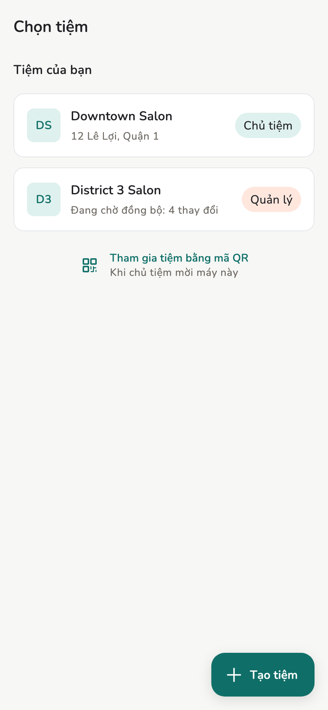
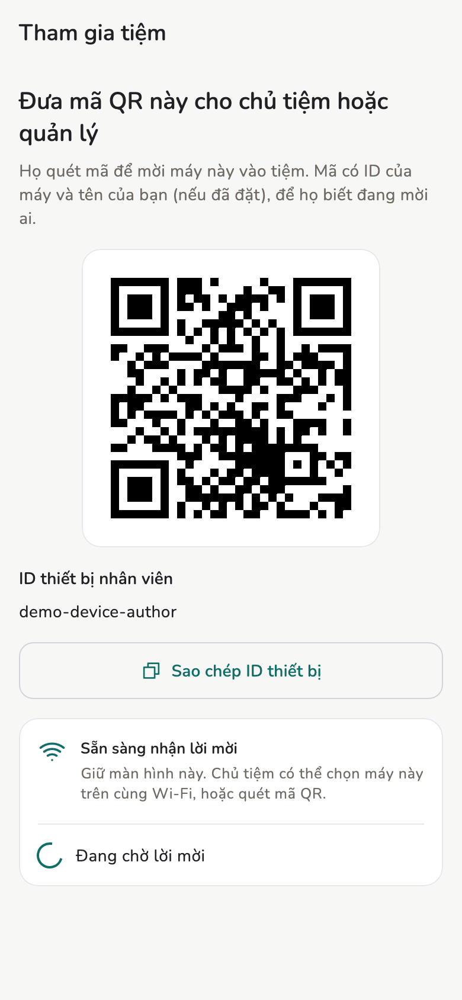

# Tạo hoặc vào tiệm

Máy này tham gia một tiệm. Vai trò bạn nhận chỉ có giá trị **trong tiệm đó**.

## Tổng quan

Hai cách: **Tạo tiệm** (máy này là Chủ tiệm), hoặc vào tiệm có sẵn khi được
mời / thêm thiết bị.

<figure class="shot-phone" markdown>
{ loading=lazy }
<figcaption>Chọn tiệm</figcaption>
</figure>

## Cách làm

=== "Tạo tiệm"

    Trên **Chọn tiệm**, bấm nút **Tạo tiệm** ở dưới. Đặt tên, tiền tệ, logo nếu muốn. Máy
    này thành **Chủ tiệm**.

    Một người có thể mở nhiều tiệm. Vai trò ở tiệm này không mang sang tiệm kia.

=== "Vào tiệm có sẵn"

    Chủ tiệm hoặc Quản lý ghép máy này với máy của họ rồi gửi lời mời. Trên
    máy này, bấm **Tham gia tiệm bằng mã QR** dưới danh sách tiệm trên màn
    **Chọn tiệm** (hoặc bắt đầu từ màn chào), rồi để mã QR mở trong lúc họ
    làm.

    Thêm máy thứ hai của chính bạn (iPad chẳng hạn) cũng làm y như vậy: máy
    Chủ tiệm bắt đầu từ **Cài đặt → Nâng cao → Thêm thiết bị khác**.

    Các bước: [Ghép hai máy](../admin/devices.md#pair).

<figure class="shot-phone" markdown>
{ loading=lazy }
<figcaption>Máy mới hiện mã QR này</figcaption>
</figure>

## Trang liên quan

- [Ngày đầu](first-day.md)
- [Nhân viên](../guide/staff.md)
- [Vai trò](../reference/roles.md)
